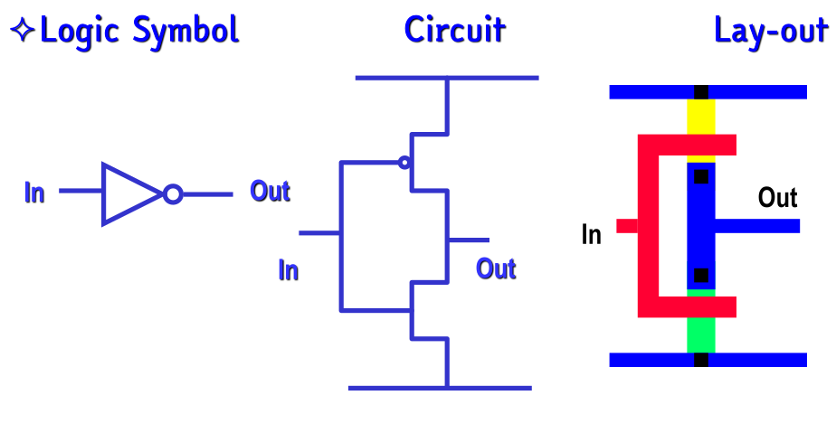
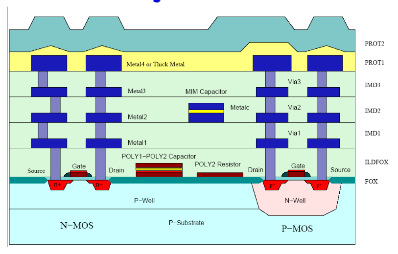
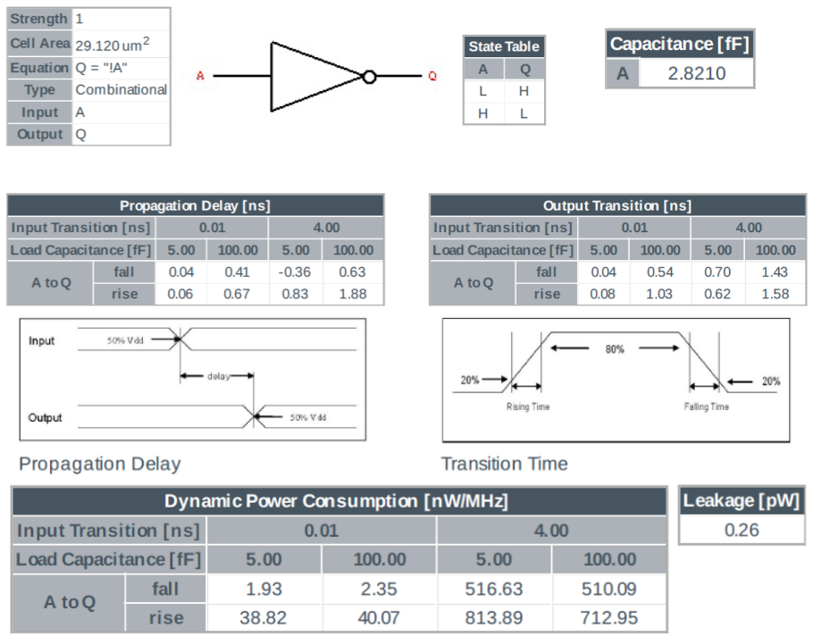

# 1. Index

<!--toc:start-->

- [1. Index](#1-index)
- [2. CMOS Combinatory Logic](#2-cmos-combinatory-logic)
  - [2.1. Logic Circuits](#21-logic-circuits)
  - [2.2. Finite State Machines](#22-finite-state-machines)
    - [2.2.1. Static Logic (Hard Node)](#221-static-logic-hard-node)
    - [2.2.2. Dynamic Logic (Soft Node)](#222-dynamic-logic-soft-node)
  - [2.3. Inverter](#23-inverter)
    - [2.3.1. AMS INVX1](#231-ams-invx1)
    - [2.3.2. Complementary CMOS](#232-complementary-cmos)
      - [2.3.2.1. Inverter Chain](#2321-inverter-chain)
    - [2.3.3. Manchester Carry Chain](#233-manchester-carry-chain)

# 2. CMOS Combinatory Logic

Before talking to **complementary CMOS logic**, let's make a review to some definitions.

## 2.1. Logic Circuits

When we talk about **logic circuits**, we can classify them in two main categories:

- **Combinatory Logic**: Circuit whose output are a _pure function_ of the
  _present_ input
- **Sequential Logic**: Circuit whose output _depends on both the present and
  the previous_ input

The **sequential logic** is a more complex circuit, and it is sub-categorized
into two further categories.

The first one are **Asynchronous Sequential Logic**, circuit whose output
depends on the present input and the _previous state of the circuit_.

These kind of circuits are characterized by an high speed and low power consumption,
but they are more difficult to design and must take into account _race conditions_
on the values.

Some example of asynchronous sequential logic are: _latches_, _flip-flops_, _counters_
and in general all **Mealy Machines**.

The second category is **Synchronous Sequential Logic**, circuit whose output
depends on the present input and _the previous state of the circuit_, **but**
it is _synchronized with a reference control signal_, called clock signal.

This masks sudden changes in the inputs, allowing the circuit to be more
stable and easier to design, but at the cost of slower systems that consumes more
power.

Some example of synchronous sequential logic are: _registers_, _counters_ and
in general all **Moore Machines** and **Delayed Mealy Machines**.

## 2.2. Finite State Machines

When we are presented with a problem, we can model it as a **Finite State Machine**
(FSM).

Before designing a FSM for a system, we must decide the topology on which we will
implement it. There are two main topologies for FSMs:

- **Static Logic (Hard Node)**
- **Dynamic Logic (Soft Node)**

### 2.2.1. Static Logic (Hard Node)

This kind of systems have **positive feedback**, meaning that there is an internal
connection between the output and the input that **regenerates the signal**.

In this architecture, the storage of states is done through _circuit topology_,
and is preserved **as long as the power supply is present**.

This kind of circuit are very useful when updates are infrequent, since them
being more robust means that they are slower on state changes.

### 2.2.2. Dynamic Logic (Soft Node)

Differently from static logic, this kind of systems store states through **parasitic
capacitances**. This means that they are able to hold state for only short
periods of time, requiring _periodic refresh_.

This disadvantage is compensated by the fact that not only they are easier to implement
since we don't have to connect a positive feedback into them, but for this
very reason they are **faster** and require lower power to update the state.

## 2.3. Inverter

To talk about CMOS Combinatory Logic, we will introduce the **inverter**.

The inverter is the implementation of the logic `NOT` function.

All combinatory logic are associated with a **logic symbol**, useful to
represent the logic function in a circuit diagram, and a **truth table**,
useful to represent the logic function in a tabular form.

We need to understand how fast our circuit will be.
For the inverter, in an _hard-node_ design, our propagation delay will be:

$$
\begin{align*}
  t_{pHL} &\propto \frac{KC}{\beta_n} \frac{1}{V_{DD}  V_{T_n}} \\
  t_{pLH} &\propto \frac{KC}{\beta_p} \frac{1}{V_{DD}  V_{T_p}}
\end{align*}
$$

Where $\beta_n$ and $\beta_p$ are the _transconductance_ of the NMOS and PMOS
transistors:

$$
\begin{align*}
  \beta_n &= \mu_n C_{ox} \frac{W_n}{L_n} \\
  \beta_p &= \mu_p C_{ox} \frac{W_p}{L_p}
\end{align*}
$$

In reality, the cross-section of an actual manufactured transistor is more something
like the following:

<figure class="">

<figcaption>

Wafer Cross-Section Austriamicrosystems, $0.35\;\mu m$ CMOS

</figcaption>
</figure>

This always comes with a **Technology Overview Table**, that contains the main
parameters of the technology used to manufacture the transistors.

This is important to remember, because the same circuit, for example the _inverter_,
can have **multiple implementations**.

### 2.3.1. AMS INVX1

It's a simple inverter, with **strength 1**, meaning that its able to work with
a load of **1 unit**.

On top of the informations in the image above, we are also given its performance
parameters at various _temperatures_ and _power supply voltages_:

|                      |      BEST      | TYPICAL |      WORST      |
| :------------------: | :------------: | :-----: | :-------------: |
|     Temeprature      | $-40$ - $0$ °C | $25$ °C |  $85 - 125$ °C  |
| Power Supply Voltage | $1.1\cdot VDD$ |  $VDD$  | $0.9 \cdot VDD$ |
|    Process Speed     |      Fast      | Typical |      Slow       |

Just one note has to be made: it may happen that we find **negative delays** between
inputs and outputs.

It is not sci-fi, there is no breaking of the causality principle, it is just
that the **input signal** changes is _slower_ than the output signal.

So, if we consider a switch at 50% values, when the output is at 50%, the
input is still lower (like 30-40%).

### 2.3.2. Complementary CMOS

The discussion on _Complementary CMOS_ is omitted in this document.

If you need further references, please refer to the [bachelors notes on my
GitHub](https://gabriele-d-cambria.github.io/Appunti-Elettronica-Digitale-2025-2026/Circuiti%20Digitali#33-famiglia-cmos-complementare).

#### 2.3.2.1. Inverter Chain

If we happen to have two or more inverter in series, we can calculate the
**propagation delay** of the chain as:

$$
t_{pHL} = \sum_{i=1}^{n} t_{pHL_i} \quad\quad\quad t_{pLH} = \sum_{i=1}^{n} t_{pLH_i}
$$

Supposing we have two inverters in the series, both with a given $\beta_n$,
the first one with fixed dimensions, and the second one to be dimensioned.

If we want to have a minimal resistance we could dimension the second to be
$1000$ times the first one.

Though, this won't be doable, as not only the power consumption would be too high:

$$
W^\ast = \frac{W_nC_L}{C_{in}} \approx 1000 W_n
$$

But the high load would make our circuit **too slow**.

Instead, what we can do is implement a **chain of inverters**, each one with
an area $A_i$ such that:

$$
A_i = \begin{cases}
  1 & i = 1 \\
  A^i & i > 1
\end{cases}
$$

This means that the total time at the $i$-th inverter will be:

$$
\tau_i = K \cdot \frac{A^i C_{in}}{\beta_n A^{i-1}} = A \tau_m
$$

Hence, in the end the total delay will be:

$$
\tau_{tot} = N A \tau_m
$$

The load capacitance will then be $C_L = A^N C_{in}$, meaning that the total
delay will be:

$$
\tau_{tot} = \frac{A}{\ln{A}} \tau_m \ln{\frac{C_L}{C_{in}}}
$$

If we want to find the number of inverters $n$ that minimizes the total delay,
we can derive the previous equation with respect to $A$ and set it to zero:

$$
\frac{\partial}{\partial A}\tau_{tot} = \frac{1 - \ln{A}}{(\ln{A})^2}
  \tau_m \ln{\frac{C_L}{C_{in}}} = 0
$$

We will later decide if to add another inverter if the output is the opposite of
the desired one.

In the end, the optimal gaze sizing factor for dynamic energy is **smaller than
the one for performance**, especially for a large number of components.

### 2.3.3. Manchester Carry Chain

The **Manchester Carry-Chain Adder** is a full adder implemented with a $N$ **pass
transistor chain**.

Typically, the carry chain is implemented with a **dynamic logic** circuit
made up by `NMOS` transistors in series, meaning that it suffers a _threshold voltage
drop_ on _high values_.

Apart from this, the carry chain is very fast, since it is a _single path_ from
input to output.

We can compute the delay of the whole chain by summing the delay of each
transistor $T_p$ in the series, modeling it as a $RC$-cell.

Hence, it is obvious that the overall delay **grows with** $N^2$:

$$
T_{tot} = T_p \cdot N^2.
$$

Meaning that it becomes very high just after a few pass transistors.

To optimise the delay, we can use **buffers**, since in them delay grows linearly.

What we will do is to divide the whole chain of $N$ transistors into $M$ groups,
each made by $K$ pass transistors and $1$ buffer.

Chosen $K$, the number of groups is simply $M = \frac{N}{K}$.

Calling $T_B$ the delay of the buffer, we can compute the total delay as:

$$
T_{tot} = MT_B + M(K^2 T_p) = \frac{N}{K}T_B + NK T_p
$$

We can derive this value to find **the optimal** $K$:

$$
\begin{align*}
  \frac{\partial}{\partial K}T_{tot} &= -\frac{N}{K^2}T_B + N T_p = 0 \\
  &\vdots \\
  K &= \sqrt{\frac{T_B}{T_p}}
\end{align*}
$$

This way not only we will not suffer from **Threshold Voltage Drop**, since the
buffer act as a _feedback circuit_ regenerating the signal, but we will also
have a **lower linear delay** than simply having a full $N$ transistor chain.
