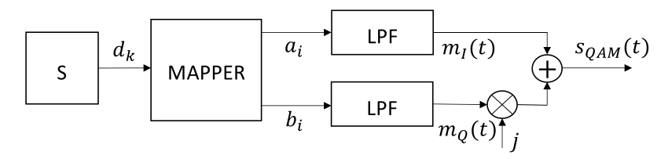
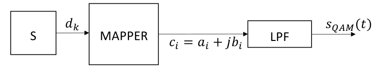
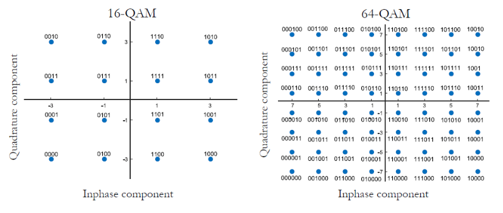
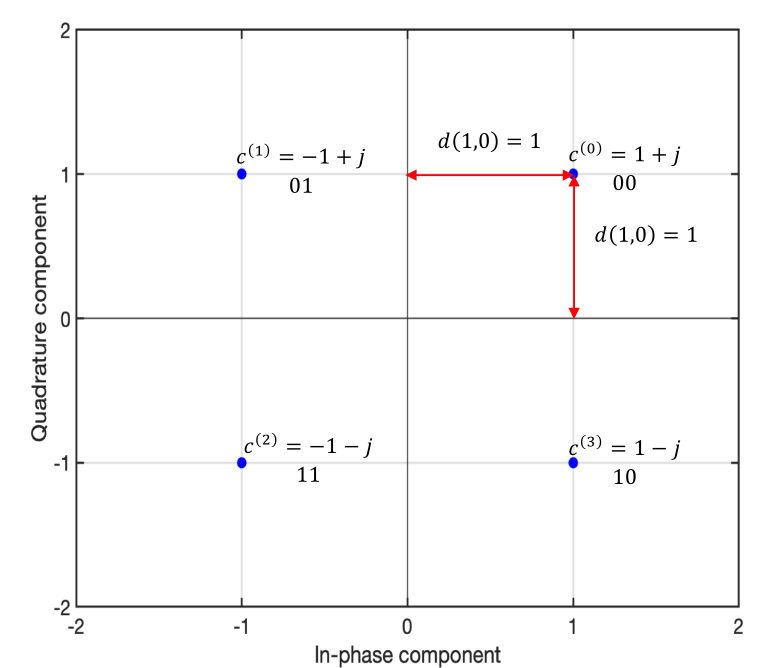

# 1. Index

<!--toc:start-->

- [1. Index](#1-index)
- [2. Digital Communications (QAM)](#2-digital-communications-qam)
  - [2.1. QAM Symbols](#21-qam-symbols)
    - [2.1.1. Energy of a Symbol](#211-energy-of-a-symbol)
  - [2.2. Error Probability](#22-error-probability)
    - [2.2.1. Error Probability of 4 QAM](#221-error-probability-of-4-qam)
    - [2.2.2. Symbol Error Probability](#222-symbol-error-probability)
    - [2.2.3. Bit Error Probability](#223-bit-error-probability)
    <!--toc:end-->

# 2. Digital Communications (QAM)

In analog modulation, we saw that **Quadrature Modulation** (QM) is obtained
by transmitting _in quadrature_ two DSB signals, generated from the baseband
messages $m_I(t)$ and $m_Q(t)$, which complex envelope is given by:

$$
\tilde{s}_{QAM}(t) = m_I(t) + j m_Q(t)
$$

**Digital Quadrature Amplitude Modulation (QAM)** is obtained in the same way,
by replacing the continuous valued messages $m_I(t)$ and $m_Q(t)$ with **two
PAM waveforms**:

$$
\begin{align*}
  s_{QAM}(t) &= \sum_i{a_i g_T{t-iT}} + j \sum_i{b_i g_T(t-iT)} \\
    &= \sum_i{(a_i + j b_i) g_T(t-iT)} \\
    &= \sum_i{c_i g_T(t-iT)}
\end{align*}
$$

Meaning that we can draw a scheme of how QAM works:

<figure class="">

<figcaption>

Highlighting the in phase and quadrature components.

</figcaption>
</figure>

<figure class="">

<figcaption>

Using _complex symbols_

</figcaption>
</figure>

## 2.1. QAM Symbols

Since quadrature QAM is obtained by combining two PAM signals in quadrature (both
with size $M_{PAM}$), the total number of symbol required for the QAM is
$M_{QAM} = M_{PAM}^2$, while the number of bits per QAM signal is $q_{QAM} = 2 q_{PAM}$.

For instance, if the QAM is obtained by two `4-PAM`, we call it a `16-QAM`
(since $M_{QAM} = 4^2 = 16$), and the number of bits per symbol is
$q_{QAM} = 2 \cdot 2 = 4$.

### 2.1.1. Energy of a Symbol

At this point a question arises: _"What is the point of using QAM instead of two
independent PAM signals?"_

We can answer this question by looking at the energy of a symbol.

To make an efficient analysis, we can start by noticing that both the in-phase and
quadrature components are independent, and therefore they have identical PAM statistics.

The _mean squared value_ of the complex symbols $c_m$ is then:

$$
\begin{align*}
A &= E\Set{\vert c_m \vert^2} \\
  &= E\Set{a_m^2 + b_m^2} \\
  &= E\Set{a_m^2} + E\Set{b_m^2} \\
  &= 2 E\Set{a_m^2} \\
  &= 2 \cdot \frac{M_{PAM}^2 - 1}{3} \\
  &= 2 \cdot \frac{M_{QAM} - 1}{3}
\end{align*}
$$

Thus, the energy per symbol is:

$$
E_s = \frac{A}{2} = \frac{M_{QAM} - 1}{3}
$$

For the same constellation size $M$ and adjacent symbol spacing, a QAM constellation
is **more compact** than a $M$-PAM, requiring **lower average symbol energy**
to achieve the same error probability.

|   Size   |                    PAM                    |             QAM              |
| :------: | :---------------------------------------: | :--------------------------: |
| $M = 4$  |  $E_s = \frac{4^2 - 1}{6} = \frac{5}{2}$  | $E_s = \frac{4 - 1}{3} = 1$  |
| $M = 16$ | $E_s = \frac{16^2 - 1}{6} = \frac{85}{2}$ | $E_s = \frac{16 - 1}{3} = 5$ |

## 2.2. Error Probability

At the receiver, the QAM complex decision variable is:

$$
\begin{align*}
  x[m] &= c_m + n[m] \\
     &= (a_m + j b_m) + (n_I[m] + j n_Q[m]) \\
      &= (a_m + n_I[m]) + j (b_m + n_Q[m])
\end{align*}
$$

Meaning that also the _in-phase_ and _quadrature_ noise components are independent.

Given this information, and the fact that also square-QAM detection separates
into independent decision on the two components, the **corresponding component
error events are independent**.

A $M$-QAM symbol is correctly detected if and only if **both** the $\sqrt{M}$-PAM
components are _correctly detected_.

Lets $P^{\sqrt{M}-PAM}$ denote the _symbol error probability_ on each
component.

Therefore, the probability of having a **correct decision** is the complementary:

$$
  P_c^{\sqrt{M}-PAM} = 1 - P^{\sqrt{M}-PAM}
$$

The corresponding **probability of making a _correct decision_ for a QAM** is:

$$
P_c^{M-QAM} = \left(P_c^{\sqrt{M}-PAM}\right)^2 = 1 - 2 P^{\sqrt{M}-PAM} +
\left(P^{\sqrt{M}-PAM}\right)^2
$$

Therefore, the error probability of a $M-QAM$ symbol is just the complementary:

$$
P_s^{M-QAM} = 1 - P_c^{M-QAM} = 2 P^{\sqrt{M}-PAM} - \left(P^{\sqrt{M}-PAM}\right)^2
$$

Knowing that at _medium-to-high_ SNR, the symbol error probability of a $\sqrt{M}$-PAM
is very small $\left(P^{\sqrt{M}-PAM} \ll 1\right)$, we can neglect the
squared term:

$$
P_s^{M-QAM} \approx 2 P^{\sqrt{M}-PAM}
$$

### 2.2.1. Error Probability of 4 QAM

A `4-QAM` is obtained by combining two `2-PAM` signals in quadrature.

The symbol error probability in this case is:

$$
\begin{align*}
  P_s^{(4-QAM)} &= \frac{1}{4} \sum_{i=0}^3{P\left(e\;\vert\;c^{(i)}\right)} \\
    &= \frac{1}{4} \cdot 4 P\left(e\;\vert\;c^{(0)}\right) \\
    &= 2 \cdot P^{(2-PAM)} - \left(P^{(2-PAM)}\right)^2 \\
    &\approx 2 \cdot P^{(2-PAM)} = 2 \cdot Q\left(\frac{1}{\sigma}\right)
\end{align*}
$$

In the image on the right it is easy to see why we have to remove a factor on our
equation.

In fact the two $P^{(2-PAM)}$ terms are the probability of making an error on the
_in-phase_ and _quadrature_ components. Multiplying them by two means consider _twice_
the event when they are both wrong. By removing the squared factor we fix this
problem.

### 2.2.2. Symbol Error Probability

Like we did for PAM, we can also compute the symbol error probability of a QAM signal:

$$
\begin{align*}
  E_s = \frac{M - 1}{3} \quad \Rightarrow \quad \frac{3E_s}{M - 1} = 1 \\
  \frac{1}{\sigma} = \sqrt{\frac{1}{\sigma^2}} =
\sqrt{ \frac{3}{M -1} \cdot \frac{E_s}{N_0} } \\
\end{align*}
$$

Hence, at _medium-to-high_ SNR, the symbol error probability of a $M$-QAM
signal is:

$$
P_s \approx 2 \cdot \frac{2\sqrt{M} - 1}{\sqrt{M}} \cdot
Q\left(\sqrt{\frac{3}{M - 1} \cdot \frac{E_s}{N_0}}\right)
$$

For example:

- `4-QAM`: &emsp; $P_s \approx 2 Q \left(\sqrt{\frac{E_s}{N_0}}\right)$
- `16-QAM`: &emsp; $P_s \approx 3 Q \left(\sqrt{\frac{E_s}{5 N_0}}\right)$

### 2.2.3. Bit Error Probability

As we said before, the number of bits per $M$-QAM symbol is twice what it was
for a $\sqrt{M}$-PAM:

$$
  q_{QAM} = \log_2{M} = 2 \log_2{\sqrt{M}} = 2\cdot q_{PAM}
$$

The bits transmitted by an $M$-QAM symbol are equally split between
the independet _in-phase_ and _quadrature_ components.
Meaning that, although an $M$-QAM transmits **twice as many bits per symbol**,
the bit error probability **equals that of either** $\sqrt{M}-PAM$ **component**.

With _Gray Mapping_ and _Medium-to-High SNR_, the bit error probability of
a $M$-QAM signal is:

$$
P_b \approx 2 \frac{\sqrt{M} - 1}{\sqrt{M} \log_2{M}} \cdot
  Q\left(\sqrt{\frac{3 \log_2{M}}{M - 1} \cdot \frac{E_b}{N_0}}\right)
$$
