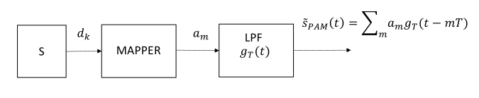
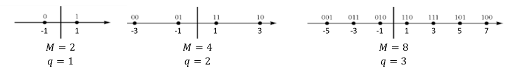
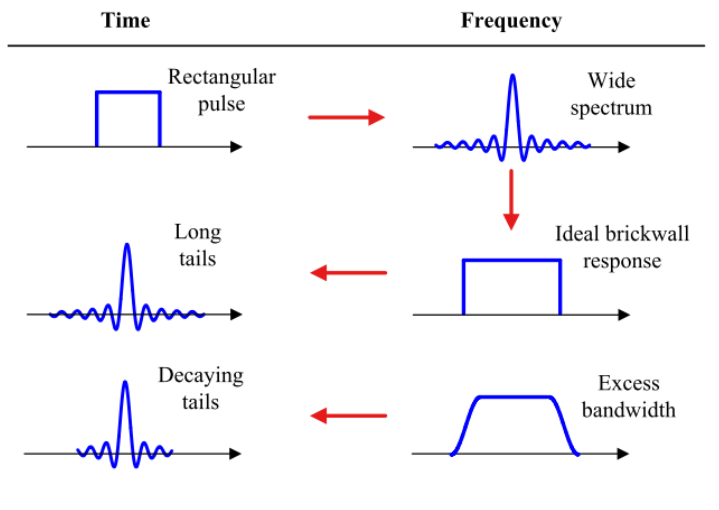
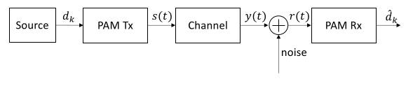
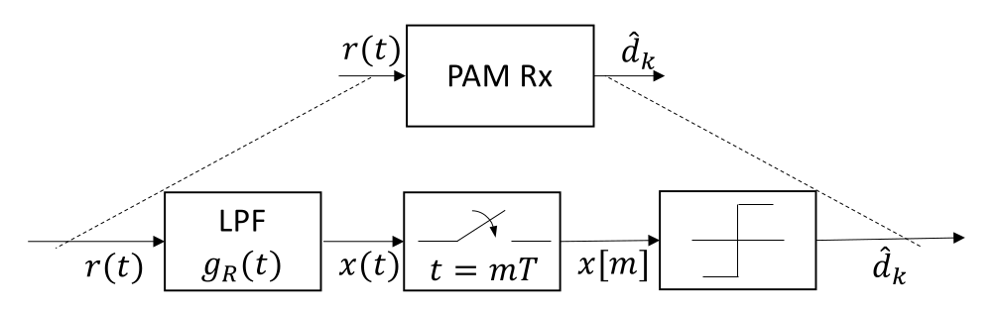
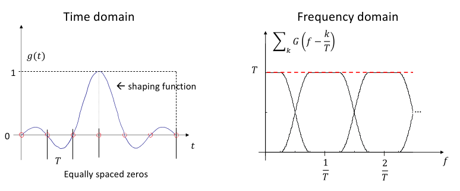
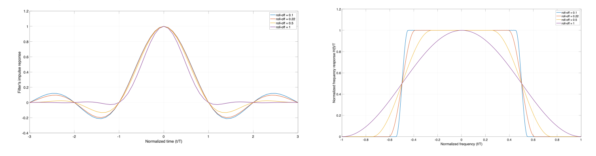
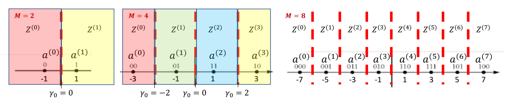

# 1. Index

<!--toc:start-->

- [1. Index](#1-index)
- [2. Digital Communications](#2-digital-communications)
  - [2.1. Pulse Amplitude Modulation (PAM)](#21-pulse-amplitude-modulation-pam)
    - [2.1.1. Symbol Mapping](#211-symbol-mapping)
    - [2.1.2. Power Spectral Density](#212-power-spectral-density)
    - [2.1.3. Pulse Shaping](#213-pulse-shaping)
    - [2.1.4. Receiver Architecture](#214-receiver-architecture)
      - [2.1.4.1. Received Signal and Noise](#2141-received-signal-and-noise)
      - [2.1.4.2. Receive Filter and Nyquist Criterion](#2142-receive-filter-and-nyquist-criterion)
        - [2.1.4.2.1. Raised-Cosine Filter](#21421-raised-cosine-filter)
        - [2.1.4.2.2. Noise](#21422-noise)
        - [2.1.4.2.3. Bandwidth](#21423-bandwidth)
        - [2.1.4.2.4. Power and Symbol Energy](#21424-power-and-symbol-energy)
        - [2.1.4.2.5. Noise Variance](#21425-noise-variance)
      - [2.1.4.3. Decision Logic](#2143-decision-logic)

# 2. Digital Communications

The passband signal in a communication system takes the following form:

$$
s(t) = Re\Set{\tilde{s}(t)e^{j2\pi f_ct}} =
  s_I \cos{(2\pi f_c t)} - s_Q \sin{(2\pi f_c t)}
$$

In _analog modulation_, the complex envelope $\tilde{s}(t)$ is determined by the
continuous-valued message signal $m(t)$.

Instead, in _digital modulation_ it is generate from a **discrete sequence of
information symbols**.

## 2.1. Pulse Amplitude Modulation (PAM)

The **Pulse Amplitude Modulation** (`PAM`) is obtained by:

1. Mapping the bits $d_k$ to **information symbols** $a_i$
1. Generating a continuous-tie waveform by _pulse shaping_ the symbol
   sequence with a _transmit filter_ of _impulsive response_ $g_T(t)$.

Since each information symbol represents $q$ bits, the relationship between
_bit-duration_ $T_b$ and _symbol-interval_ $T$ is:

$$
  T = q \cdot T_b
$$

The signal $\tilde{s}_{PAM}(t)$ is a **real baseband signal** that has the same
modulation structure as an _analog DSB signal_.
Its modulating signal is the _pulse-shaped symbol sequence_:

$$
\tilde{s}_{PAM}(t) = \sum_m{a_m \cdot g_T(t - mT)}
$$

The baseband PAM signal can be later translated to any carrier frequency just like
any other analog signal:

$$
s_{PAM}(t) = Re\Set{\tilde{s}_{PAM}(t)e^{j2\pi f_ct}} =
  \tilde{s}_{PAM}(t) \cos{(2\pi f_c t)}
$$

From now on, unless otherwise stated, all signal are represented by their _complex
baseband equivalent_, simplifying the notation as to:

$$
s_{PAM}(t) := \tilde{s}_{PAM}(t) = \sum_m{a_m \cdot g_T(t - mT)}
$$

### 2.1.1. Symbol Mapping

The **mapper** is a device that associates a sequence of $q$ bits $d_k$ to a single
symbol $a_m \in A \subset \R$.

We call the collections of all the possible $M$ symbols a **Constellation**.

Using _fixed-length binary mapping_, the constellation contains $M = 2^q$ symbols.

Usually, we use constellations that are _symmetric to $0$_. This way if we have
equi-probable symbols, the expectation will be $E \Set{a_m} = 0$.

Using larger constellations means representing more bits per symbol, therefore
providing _higher spectral efficiency_.

However, for a fixed minimum distance between adjacent symbols, increasing $M$ increases
the _average symbol energy_, meaning we will need **more band**.

Given that the bit duration is $T_b$, the rate will be $R_B = \frac{1}{T_b}$.

In an interval $T$, if each symbol represents $q$ bits:

$$
  T = q T_b = T_b \cdot \log_2{M}
$$

Accordingly, the symbol rate $R_s$ will be:

$$
  R_s = \frac{1}{T} = \frac{1}{qT_b} = \frac{R_b}{q} = \frac{R_b}{\log_2{M}}
$$

To optimize also error recovery, we can introduce **Gray Mapping**,
constellations that yield two properties:

1. They are symmetric to $0$
2. Adjacent symbol map sequence of bits different for **exactly one bit**.

<figure class="">

<figcaption>

Some example of **Gray Mapping**

</figcaption>
</figure>

### 2.1.2. Power Spectral Density

The symbol sequence $\Set{a_m}$ is modelled as a **stationary discrete-time**,
**discrete-valued** random process with independent symbols.

Since the symbols are aligned with a _periodic time grid_, the resulting
_continuous-time_ PAM signal is **cyclostationary** with period $T$.

The _time-averaged_ PSD of its complex envelope $s(t)$ is:

$$
  S_s(f) = \frac{1}{T} S_a(f) \cdot \vert G_T(f) \vert^2
$$

Where $S_a(f)$ is the PSD of $a_m$ and $G_T(f)$ is the **frequency response** of
the filter $g_T(t)$.

The PSD describes how the _average signal power_ is distributed over the frequency
spectrum, an therefore used to characterize the occupied bandwidth.

$S_a(f)$ is computed as the **discrete-time Fourier transform** of the
_autocorrelation_ sequence $R_a[l]$ of the _stationary discrete-time_ process
$\Set{a_m}$, whose symbols are independent.

Defining $\mu_a = E\Set{a_m}$ and $A = E\Set{a_m^2}$ for the **symmetric,
equiprobable PAM constellations** the symbol mean is zero:

$$
  \mu_a = 0
$$

The autocorrelation sequence is computed:

$$
R_a[l] = E\Set{a_m a_{m+l}} = \begin{cases}
  A & l = 0 \\
  E\Set{a_m}E{a_{m+l}} = \mu_a^2 & l \neq 0
\end{cases}
$$

For our symmetric, equiprobable PAM constellations, the autocorrelation
sequence is simply:

$$
  R_a[l] = \begin{cases}
    A & l = 0 \\
    0 & l \neq 0
  \end{cases} = A \delta[l]
$$

This means that the _Discrete-Time Fourier Transform_ (_DTFT_) of the autocorrelation
sequence is:

$$
R_a[l] \Leftrightarrow S_a(f) = A
$$

Meaning that the PSD of the symbol sequence depends only on the **average
symbol energy** $A$ and the filter frequency response $G_T(f)$:

$$
S_s(f) = \frac{A}{T} \cdot \vert G_T(f) \vert^2
$$

### 2.1.3. Pulse Shaping

The choice of the _low-pass transmit_ filter determines the spectrum and the
bandwidth of the PAM signal.

Pulse shapes extending over several symbol intervals can achieve a _more
compact spectrum_ rather than a _rectangular pulse_, at the cost of
**inter-symbol interference** (**ISI**), where different symbols interfere with
each other.

The temporal overlap does not necessarily imply interference at the sampling instant.

### 2.1.4. Receiver Architecture

The propagation channel is generally modelled as an **LTI filter** with
_impulse response_ $h(t)$.

For ideal channels, the impulse response is a _delta function_ $h(t) = \delta(t)$.

The role of the receiver is to **reconstruct the transmitted bit sequence** from
the received signal $r(t)$.

In this phase we will assume we have an **ideal channel**
$(y(t) = s(t)\otimes h(t) = s(t))$ with **no noise** $(n(t) = 0)$, and
therefore the received signal is simply $s(t)$.

The PAM receiver performs the _inverse operations_ of the transmitter, in
reverse order:

1. Extract the transmitted bits from the continuous-time signal $r(t)$
2. Limits out-of-band noise and interference, shaping the received waveform with
   a receive filter $g_R(t)$
3. Samples the filtered signal $x(t)$ once every symbol interval $T$
4. Recovers the transmitted bits from the signal samples $x[m]$

#### 2.1.4.1. Received Signal and Noise

The received complex baseband signal is:

$$
  r(t) = s(t) \otimes h(t) + \tilde{w}(t)
$$

Where $w(t)$ represents the **noise**, modeled as a **_Real White Gaussian Process_**.
It being _white_ means that it has a **flat stationary** PSD:

$$
  S_w(f) = \frac{N_0}{2}
$$

The first step of the receiver is to recover the received signal with a
receive filter.

Still, we are dealing with a physical noise $w(t)$ represented by the
equivalent complex baseband noise:

$$
\tilde{w}(t) = w_I(t) + j w_Q(t) \quad \rArr \quad S_{\tilde{w}}(f) = 2N_0
$$

#### 2.1.4.2. Receive Filter and Nyquist Criterion

The receive filter shapes both the useful signal and the noise:

$$
x(t) = r(t)\otimes g_R(t) = \sum_i{a_ig(t-iT) + n(t)}
$$

Where:

- $g(t) = g_T(t)\otimes h(t)\otimes g_R(t)$ is the _overall impulse response_
  of the transmitter and receiver filters.
- $n(t) = \tilde{w}(t)\otimes g_R(t)$ is the _filtered noise_ (typically _colored_).

One of the design objectives of the receive filter is to _shape the overall
response_ $g_R(t)$ so that **ISI** (_Inter-Symbol Interference_) vanishes at
the sampling instants.

Letting $x[m] = x(t)\big|_{t=mT}$ and $n[m] = n(t)\big|_{t=mT}$, the received
filtered sample is:

$$
\begin{align*}
  x[m] &= \sum_l{a_lg(m-l) + n[m]}
       &= a_m g(0) + \sum_{l\neq m}{a_lg(m-l)} + n[m] \\
\end{align*}
$$

Neglecting for now _noise_, the condition on $g[l] = g(t)\big|_{t=lT}$ to
avoid ISI is:

$$
g[l] = \begin{cases}
  g(0) & l = 0 \\
  0 & l \neq 0
\end{cases} = \delta[l]
$$

This is called **Nyquist Criterion** _in the time domain_, and when satisfied
the received filtered sample is:

$$
  x[m] = a_m + n[m]
$$

If we instead operate in the _frequency domain_, we must first define $G(f)$
as the **Fourier Transform of the overall impulse response** $g(t)$.

Sampling $g(t)$ every $T$ seconds produces the sequence $g[l]$ whose DTFT is:

$$
\mathcal{F}_{DT}\Set{g[l]} = \sum_{l=-\infty}^{\infty}{g[l]e^{-j2\pi flT}} =
\frac{1}{T} \sum_{k=-\infty}^{\infty}{G(f-k/T)}
$$

We know that when the _time-domain_ criterion is satisfied:

$$
  g[l] = \delta[l] \quad \Leftrightarrow \quad \mathcal{F}_{DT}\Set{g[l]} = 1
$$

Hence, the **Frequency-Domain Nyquist Criterion** is:

$$
\sum_{k=-\infty}^{\infty}{G(f-k/T)} = T
$$

##### 2.1.4.2.1. Raised-Cosine Filter

**Raised-Cosine** filters are a family of filters that satisfy the Nyquist Criterion.
They have an occupied bandwidth of:

$$
  B_{RC} = \frac{1+\alpha}{2T}
$$

In frequency we can describe them as:

$$
H_{RC}(f) = \begin{cases}
  1 & 0 \le \vert f \vert \le \frac{1-\alpha}{2T} \\
  \frac{1}{2} & \vert f \vert = \frac{1+\alpha}{2T} \\
  0 & \vert f \vert > \frac{1+\alpha}{2T} \\
\end{cases}
$$

Where $\alpha$ is a design parameter called the **Roll-Off Factor**.
When $\alpha = 0$, the filter is called a **brick-wall filter**, and its perfectly
equal to a $\operatorname*{rect}()$, with a $\operatorname*{sinc}()$ impulse
response.

This has the _minimum Nyquist bandwidth_ of $B_{min} = \frac{1}{2T}$, but is
not realizable in practice, since it would mean having an _infinite impulse response_.

##### 2.1.4.2.2. Noise

The receive filter shapes the complex baseband noise:

$$
n(t) = n_I(t) + j n_Q(t) = g_R(t)\otimes \tilde{w}(t)
$$

Since $S_{\tilde{w}}(f) = 2N_0$, the PSD of the filtered noise is:

$$
S_n(f) = S_{\tilde{w}}(f) \cdot \vert G_R(f) \vert^2 = 2N_0 \cdot \vert G_R(f) \vert^2
$$

Since its in-phase and quadrature components are _independent_:

$$
S_{n_I}(f) = S_{n_Q}(f) = N_0 \cdot \vert G_R(f) \vert^2
$$

Therefore, as we said before, even though the filtered noise is colored, we
can still model it as _white_ inside the receiver bandwidth.

Neglecting the effect of the channel, another major impairment at the receiver is
the presence of _Gaussian Noise_.
To address this, the receiver should be designed to _minimize the negative
effect_ of the noise.

The sample of the noise $n[m]$ is a _Gaussian random variable_ with zero mean
and variance:

$$
\begin{align*}
  \sigma^2 &= E\left[\vert n[m]\vert^2\right]  - \vert \mu_n \vert^2 \\
  &= E\left[\vert n[m]\vert^2\right] \\
\end{align*}
$$

We can show that choosing a receiver filter such that:

$$
  g_R(t) = g_T^\ast(-t) \quad \Leftrightarrow \quad G_R(f) = G_T^\ast(f)
$$

**Maximises the _Signal-to-Noise Ratio_** at the sampling instants.

We can notice that, if our filter $g_T(t)$ is both _real_ and _even_, then our
condition simplifies to having the **same filter on both transmitter and receiver**
$g_R(t) = g_T(t)$.

A common and useful filter often used in practice are **Root Raised Cosine** filters.
They are filter whose frequency response is the _square root_ of a Raised-Cosine
filter:

$$
H_{RRC}(f,\alpha) = \sqrt{H_{RC}(f,\alpha)}
$$

If $G_T(f) = G_R(f) = H_{RRC}(f,\alpha)$, both the transmitter and receiver filters
satisfy the two design objectives:

1. **Nyquist Criterion**: $G(f) = G_T(f)G_R(f) = \left(H_{RRC}(f,\alpha)\right)^2
  = H_{RC}(f,\alpha)$
2. **Matching Condition**: since the RRC filter is _real_ and _even_, $g_R(f)
  = g_T(f)$, meaning we have the same filter on both transmitter and receiver.

##### 2.1.4.2.3. Bandwidth

If $G_T(f) = H_{RRC}(f,\alpha)$, and the symbol are _zero-mean_, the Power Spectral
Density of the complex envelope signal is:

$$
S_s(f) = \frac{1}{T} S_a(f) \vert G_T(f) \vert^2
= \frac{A}{T} H_{RC}(f,\alpha)
$$

The bandwidth occupied by the PAM _complex envelope_ will then be:

$$
B_{PAM}^{(BB)} = \frac{1 + \alpha}{2T}
  = \frac{1 + \alpha}{2} \frac{1}{\log_2{M} T_b}
  = \frac{1 + \alpha}{2} \frac{R_b}{\log_2{M}}
$$

When converting to a _passband_ signal, the bandwidth doubles:

$$
B_{PAM}^{(PB)} = 2 B_{PAM}^{(BB)} = (1 + \alpha) \frac{R_b}{\log_2{M}}
$$

##### 2.1.4.2.4. Power and Symbol Energy

For _zero-mean_ symbols and RRC filtering, the Power of the complex-envelope is:

$$
\begin{align*}
  P_{BB} &= \int_{-\infty}^{\infty}{S_s(f) df} \\
    &= \int_{-\infty}^{\infty}{\frac{A}{T} H_{RC}(f,\alpha)\;df} \\
    &= \frac{A}{T} \int_{-\infty}^{\infty}{H_{RC}(f,\alpha)\;df}\\
    &= \frac{A}{T} \int_{-\infty}^{\infty}{H_{RC} \cdot e^{-j2\pi f\cdot 0}\;df}\\
    &= \frac{A}{T} g(0) && \text{Nyquist Criterion } \to g(0) = 1 \\
    &= \frac{A}{T}
\end{align*}
$$

The power of the corresponding passband signal will be halved because of
the modulation theorem:

$$
  P_{PB} = \frac{P_{BB}}{2} = \frac{A}{2T}
$$

As for symbol energy, for a $M$-PAM Gray constellation with adjacent symbols separated
by a distance $2$, the average symbol energy is:

$$
A = E\Set{a_m^2} = \frac{1}{M} \sum_{i=0}^{M-1}{a_i^2} = \frac{M^2 - 1}{3}
$$

We can then compute the average symbol energy of the passband signal as:

$$
  E_s = P_{PB} \cdot T = \frac{A}{2T} \cdot T = \frac{A}{2} = \frac{M^2 - 1}{6}
$$

The energy cost increases with $M^2$, while the bandwidth cost decreases with
$\log_2{M}$, meaning that increasing $M$ has a worse effect on the energy efficiency
than a good one on the spectral efficiency.

##### 2.1.4.2.5. Noise Variance

The sample $n[m] = n_I[m] + j n_Q[m]$ is a _zero-mean complex Gaussian random variable_,
with variance:

$$
\sigma_n^2 = E\Set{\vert n[m] \vert^2} = \int_{-\infty}^{\infty}{S_n(f)\;df} =
2N_0 \cdot \int_{-\infty}^{\infty}{\vert G_R(f) \vert^2\;df}
$$

With the normalized RRC filtering we adopted, we obtain that the variance of the
noise sample is simply:

$$
  \sigma_n^2 = 2N_0
$$

Knowing that the in-phase and quadrature components are _independent_, the variance
of each component will then be:

$$
\sigma^2 = \sigma_{n_I}^2 = \sigma_{n_Q}^2 = \frac{1}{2}\sigma_n^2 = N_0
$$

#### 2.1.4.3. Decision Logic

The receiver reduce the continuous-time communication system to an equivalent
_discrete-time detection logic_, where the decision variable is:

$$
x[m] = a_m + n[m]
$$

We have to apply a **decision rule** that _minimizes_ the symbol error probability.

The one we are looking for is a **Maximum A Posteriori** (_MAP_) decision rule:

$$
\hat{a}_m = \argmax_{a^{(i)} \in A}{P\left(a^{(i)} \vert x[m]\right)}
$$

Note that $a_m$ denotes the **symbol transmitted** at the $m$-th symbol interval,
while $a^(i)$ is the $i$-th symbol of the PAM constellation.

Using _Bayes' Theorem_, we can rewrite the MAP decision rule as:

$$
p\left(a^{(i)} \vert x[m]\right) = \frac{p(x[m] \vert a^{(i)}) p(a^{(i)})}{p(x[m])}
$$

For _equiprobable symbols_ $p(a^{(i)}) = \frac{1}{M}$, simplifying the MAP to
a **Maximum Likelihood** (_ML_):

$$
\hat{a}_m = \argmax_{a^{(i)} \in A}{p\left(x[m] \vert a^{(i)}\right)}
$$

Since the PAM signal is real, only the _in-phase_ components carries useful
informations, allowing us to reduce the decision variable to:

$$
x_I[m] = a_m + n_I[m] \Rightarrow x = a_m + n[m]
$$

Conditioned on $a_m = a^{(i)}$, the decision variable is a
_Gaussian random variable_ with mean $a^{(i)}$ and variance $\sigma^2 =
\sigma_{n_I}^2 = N_0$:

$$
  x[m]\; \vert \;a_m = a^{(i)} \sim \mathcal{N}\left(a^{(i)}, N_0\right)
$$

The probability density function of the decision variable is:

$$
p\left(x[m] \vert a^{(i)}\right) = \frac{1}{\sqrt{2\pi N_0}}
  e^{-\frac{\left(x[m] - a^{(i)}\right)^2}{2N_0}}
$$

The symbol $a^{(i)}$ that **maximizes** $p\left(x[m] \vert a^{(i)}\right)$ is
the one that **minimizes** the distance between the symbol and the received sample:

$$
\hat{a}_m = \argmin_{a^{(i)} \in A}{\left\vert x[m] - a^{(i)}\right\vert}
$$

The _ML_ detection for PAM simply reduces to a **nearest-neighbor decision rule**.

Under this detection rule, each received sample $x$ is assigned to the
**nearest constellation point**:

$$
Z^{(i)} = \Set{x\; \Big\vert \; d\left(x,a^{(i)}\right) < d\left(x, a^{(j)}\right),
  j \ne i, j = 0,\dots, M-1}
$$

Each _decision threshold_ $\gamma_i$ will be computed as the **midpoint**
between the symbols of the two adjacent regions:

$$
  \gamma_i = \frac{a^{(i)} + a^{(i+1)}}{2} \qquad i = 0,\dots, M-2
$$

