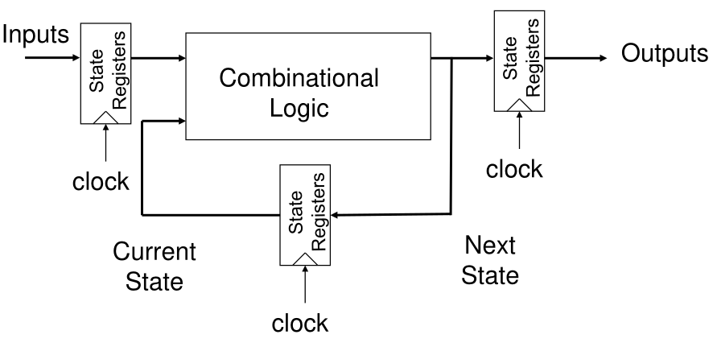
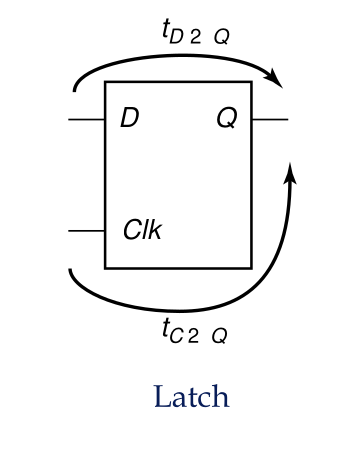
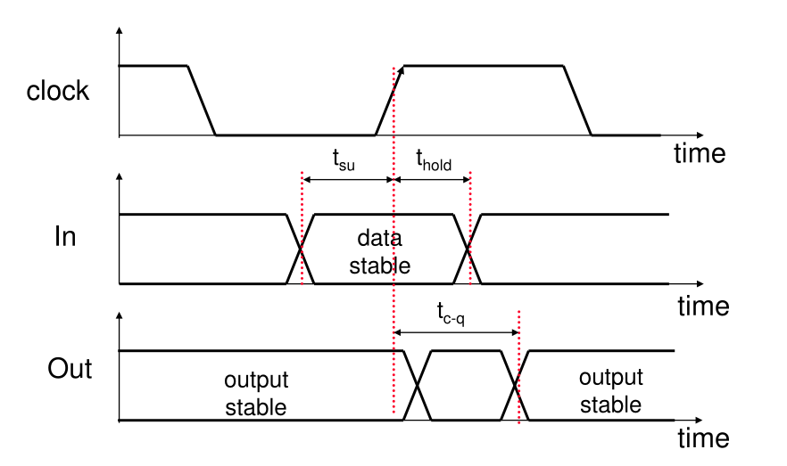
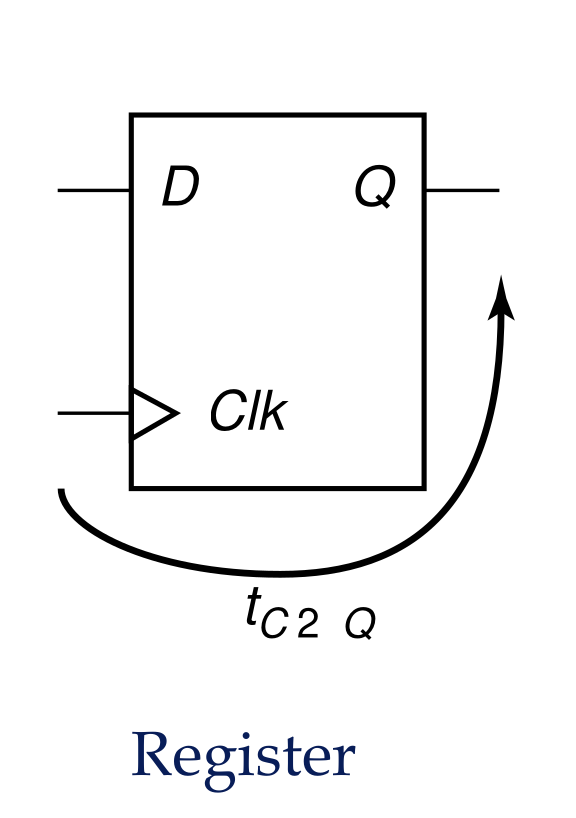
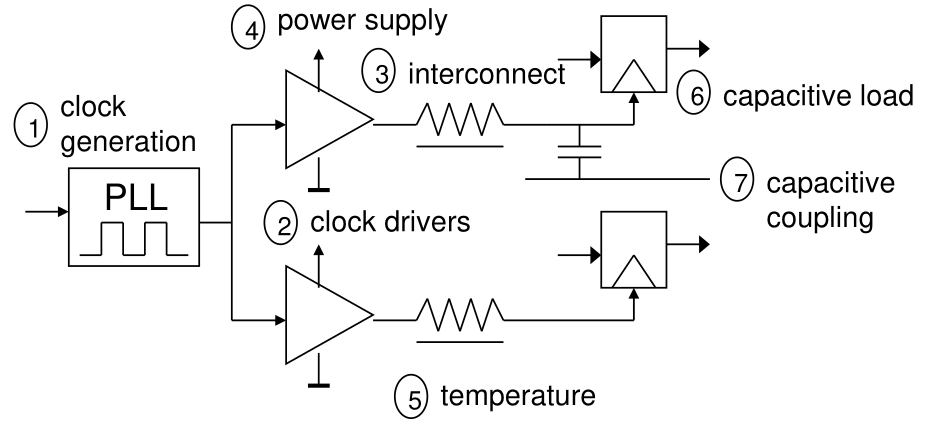
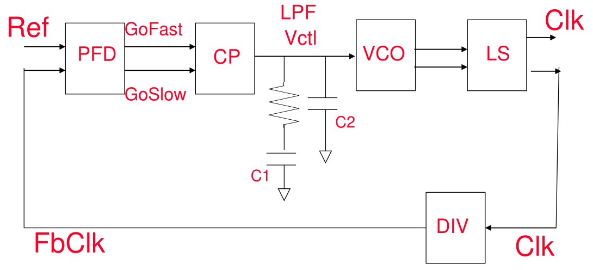
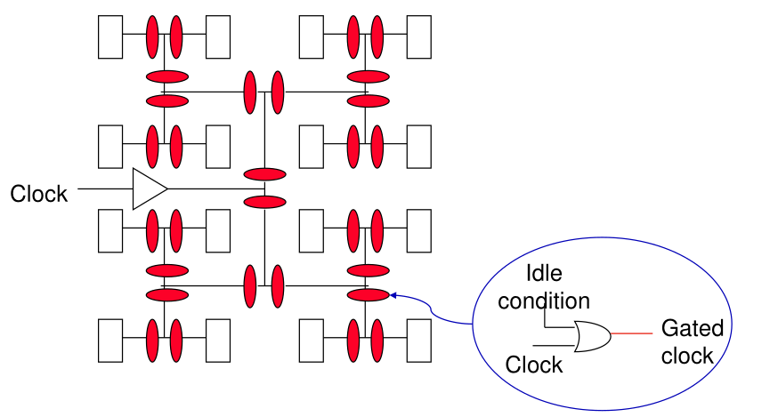
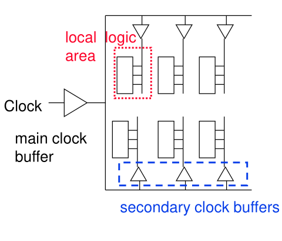

# 1. Index

<!--toc:start-->

- [1. Index](#1-index)
- [2. Timing Issues](#2-timing-issues)
  - [2.1. Global Asynchronous Local Synchronous Technique](#21-global-asynchronous-local-synchronous-technique)
  - [2.2. Latches and Flip Flops](#22-latches-and-flip-flops)
    - [2.2.1. Set-Up Time Violations](#221-set-up-time-violations)
    - [2.2.2. Hold Time Violations](#222-hold-time-violations)
  - [2.3. Sources of Clock Skew and Jitter](#23-sources-of-clock-skew-and-jitter)
    - [2.3.1. Positive and Negative Clock Skew](#231-positive-and-negative-clock-skew)
      - [2.3.1.1. Example: Clock Generator](#2311-example-clock-generator)
  - [2.4. Clock Distribution Network](#24-clock-distribution-network)
    - [2.4.1. H-Tree Clock Network](#241-h-tree-clock-network)
    - [2.4.2. Clock Grid Network](#242-clock-grid-network)
    <!--toc:end-->

# 2. Timing Issues

When projecting any sequential logic, **timing** is one of the main concerns.

We deal mainly with _synchronous_ logic, which is **clocked** by an
alternating periodic signal that oscillates between two states.

What we do is synchronize the operation of the sequential logic according to
the **rising edge of the clock**.



The clock is typically a square wave generated from a component called
**Phase Locked Loop (PLL)**, what contains a quartz crystal oscillator
that generates a stable frequency.

The first problem arises exactly at the moment when we connect the PLL to
the various components, since different components will be placed at different
distances from the PLL. Therefore, the wires connecting the PLL and the
components will all be of different length, meaning they will have a
different capacitance.

This means that just by connecting the components, we will have a **delay** in the
clock signal reaching each component, which is called **Clock Skew**.

Thus, our first concern is to keep the clock skew _as low as possible_ (in reference
of the clock period), so that all components receive the clock signal with the least
delay between them.

## 2.1. Global Asynchronous Local Synchronous Technique

A way we can keep low delays is using **Clock Domains**.

We divide our board into different areas, each with its own PLL. Each time
we add a new components that needs a clock signal, we connect it with the PLL
of the domain in which the components was placed.

The different PLL are then kept synchronized with each other using handshaking signals.

## 2.2. Latches and Flip Flops

Latches and Flip Flops are the basic building blocks of sequential logic.

They are different based on **when they sample the input**:

- **Latches** sample the input when the clock is **high**.
- **Filp-Flops** sample the input at the **rising edge of the clock**.

A latch is a **transparent device**.

```vhdl
-- Latch
if clk = '1' then
  q <= d;
end if;
```



The latch stores the value at the input for the whole duration of the
high level of the clock.

There are two main timing delays: $t_{D2Q}$ and $t_{C2Q}$, respectively the
**data to queue delay** and the **clock to queue delay**.



The fact that it is _transparent_ means that the output will change as soon as
the input changes, as long as the clock is high. This often translates in the
need to add an additional **set-up time** to account for possible unwanted
variation in the input signal before it actually assumes the true value.

In contrast, a **flip-flop** is a **non-transparent device**.

```vhdl
-- Flip-Flop
if rising_edge(clk) then
  q <= d;
end if;
```



This means that the output will only change at the rising edge of the clock,
after a small **clock to queue** $t_{C2Q}$ time, and will remain stable for
the rest of the clock period.

Thus, it is required for the input signal to be setup before the rising edge of
the clock, and to remain stable for a certain amount of time after the rising edge.
These two timing constraints are called **setup time** $t_{su}$ and **hold time**
$t_{hold}$.

Hence, in a typical Register-Logic-Register (RLR) configuration, we have several
timing constraints.

### 2.2.1. Set-Up Time Violations

For the first register we have the following timing constraints:

- The signal must be piloted such that it stays at least $t_{su_1}$ before the
  rising edge of the clock, and $t_{hold_1}$ after it.
- The output will change after a $t_{C2Q_1}$ time, and will remain stable for
  the rest of the clock period.

Assuming that the sequential logic has a $t_{p-logic}$ and $t_{cd-logic}$ delays,
we have similar timing constraints for the second register.

In particular, the conditions for the second register **must happen before
the next rising edge of the clock**, otherwise we will have a **timing violation**.

This means that the clock period, that we assume synchronized for the two registers,
must be:

$$
T \ge t_{C2Q_1} + t_{p-logic} + t_{su_2}
$$

This relation accounts for **the Worst Case Scenario**, where the first register
changes its output at the last possible moment, and the second register samples
the input at the first possible moment.

It is important to note that **registers are not logical components**, thus
in a possible architecture of three cascading registers, the only path we
have to account for are the first to the second, and the second to the third,
with the first to the third not being a valid path.

### 2.2.2. Hold Time Violations

Beside having the setup time violation, we can also have a **hold time violation**.

This happens when the first register changes its output too soon, and the second
register has not the time to samples the input before it has changed.

In this case, we need for the clock to be long enough for the first signal
to _stabilize_ before an actor at the end of the chain samples it.

$$
t_{hold2} \le t_{cd-logic} + t_{cd-register1}
$$

## 2.3. Sources of Clock Skew and Jitter



From the different wire capacitance the clock signal will reach the different components
at different times, which is called **Clock Skew**.

Beside the clock skew, we also have **Clock Jitter**, which is a variation in the
clock period due to the PLL not being perfect.

This means that our clock period $T$ is not constant, but rather a Random
Variable with a certain distribution, which can be approximated as a Gaussian distribution.

**Jitter** is usually caused by the how the PLL itself is built.

<div class="grid2">
<div class="">

On the image on the right we can see a Block Diagram of a **Charge-Pump PLL**.

The various components of the PLL are:

- **Phase Frequency Detector (PFD)**: compares the phase and frequency of the
  input clock with the output clock, generating an error signal.
- **Charge Pump (CP)**: converts the error signal into a current, which is then
  used to charge or discharge a capacitor.
- **Loop Filter (LF)**: filters the current from the charge pump, generating a voltage
  that is used to control the VCO.
- **Voltage Controlled Oscillator (VCO)**: generates the output clock, whose frequency
  is controlled by the voltage from the loop filter.
- **VCO Level Shifter (LS)**: shifts the voltage level of the VCO output to
  match the input level of the PFD.
- **Feedback Divider (FBDIV)**: divides the output clock frequency by a
  certain factor, feeding it back to the PFD for comparison with the input clock.

</div>
<div class="">

</div>
</div>

Both _jitter_ and _skew_ can be affected by _environmental factors_, such as
temperature, voltage, and electromagnetic interference.

### 2.3.1. Positive and Negative Clock Skew

Let's analyse a RLR configuration where it is not true anymore that
$t_{ckl_1} = t_{ckl_2}$, but rather $t_{ckl_1} < t_{ckl_2}$ by a factor $\delta$.

The effect on the timing constraints is that the second register will sample the
input **only after** the delay $\delta$.

This means that our timing constraint contains become:

$$
\begin{align*}
T + \delta &\ge t_{C2Q_1} + t_{p-logic} + t_{su_2} && \text{Better performance}\\
t_{hold2} + \delta &\le t_{cd-logic} + t_{cd-register1} && \text{Harder to meet}
\end{align*}
$$

If instead we had that $t_{ckl_1} > t_{ckl_2}$ (by the same factor $\delta$),
the effect on the timing constraints is that the second register will sample
the input **before** the delay $\delta$:

$$
\begin{align*}
T - \vert \delta \vert &\ge t_{C2Q_1} + t_{p-logic} + t_{su_2} && \text{Worst performance}\\
t_{hold2} - \vert \delta \vert &\le t_{cd-logic} + t_{cd-register1} &&
\text{Easier to meet}
\end{align*}
$$

As for jitter it makes our **Setup Time** constraint harder to meet, since it
will reduce the performance of the sequential circuit:

$$
T - 2t_{jitter} \ge t_{C2Q_1} + t_{p-logic} + t_{su_2}
$$

In the end, combining all the effects of clock skew and jitter, we have the
following timing constraints:

$$
\begin{align*}
  T &\ge t_{C2Q_1} + t_{p-logic} + t_{su_2} - \delta + 2t_{jitter} &&
\text{Setup Time constraint}\\
  t_{hold2} &\le t_{cd-logic} + t_{cd-register1} + \delta - 2t_{jitter} &&
\text{Hold Time constraint}
\end{align*}
$$

#### 2.3.1.1. Example: Clock Generator

> Suppose to have a chip with $10.000$ Flip-Flops, each with a $c_{in} = 50\;fF$
> for the clock input.
> Know that $f_{clk} = 100\;MHz$ and $t_r = t_f = 1\;ns$.

Our clock generator needs to drive a total capacitance of
$C_{tot} = 10.000 \cdot 50\;fF = 500\;pF$.

The current needed to drive this capacitance is:

$$
\begin{align*}
  I_M &= C_{tot} \cdot \frac{\partial V_{DD}}{\partial t}\bigg\vert_{MAX} \\
    &= C \cdot \frac{V_{DD}}{t_r} \approx 2.5\;A
\end{align*}
$$

This means we will have:

- **High Power Consumption**.
- **Noise** on the _supply line_
- **High current density** in _interconnections_.

The last phenomenon is called **elettromigration**, which is the movement of
metal atoms in a conductor due to the momentum transfer from the electrons
that are moving through it.

## 2.4. Clock Distribution Network

Clock _skew_ and _jitter_ can ultimately limit the performance of a digital
system, so designing a clock network that minimizes both is very important.

In many high-speed processors, a majority of the dynamic power is dissipated
in the clock network, and to reduce dynamic power, the clock network must
support **clock gating**, literally shutting down (disabling) the clock units.

There are two main clock distribution techniques:

- **Balanced paths** (H-tree network, matched RC trees): in the ideal case,
  they can eliminate skew, taking multiple cycles for the clock signal to
  propagate to the leaves of the tree.
- **Clock grids**: typically used in the final stage of the clock
  distribution network, it minimizes _absolute delay_ (not _relative_)

### 2.4.1. H-Tree Clock Network

<div class="grid2">
<div class="">

We distribute the clock signal in something like a _binary-tree_.

If the paths are perfectly balanced then the **clock skew is null**.

This architecture allows to shut-off a single lead, as well as an entire
branch of the tree, which is useful for **clock gating**.

</div>
<div class="">

</div>
</div>

### 2.4.2. Clock Grid Network

<div class="grid2">
<div class="">

It uses distributed buffering to reduce absolute delay, making clock gating easier.

The problem with this architecture is that it is **sensitive to variations**
in the buffer delay.

The secondary buffers allow us to isolate the local clock nets from the
upstream load, amplifying the signal. This will produce steeper clocks with a
smaller absolute skew in the **local logic area**.

</div>
<div class="">

</div>
</div>
