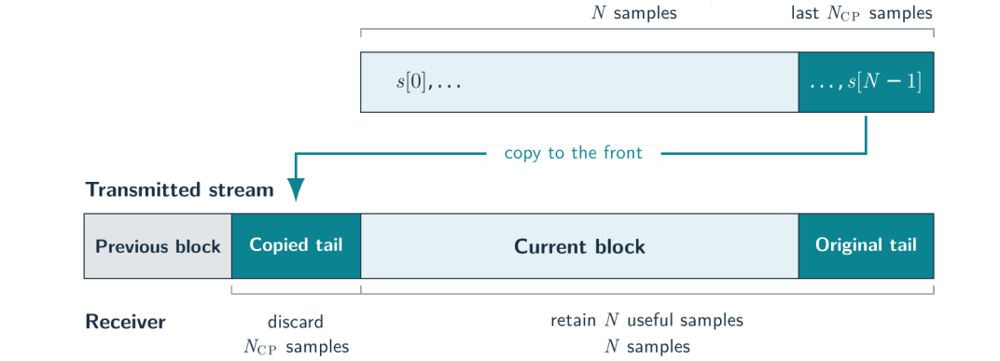
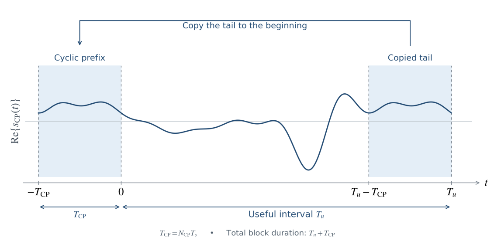
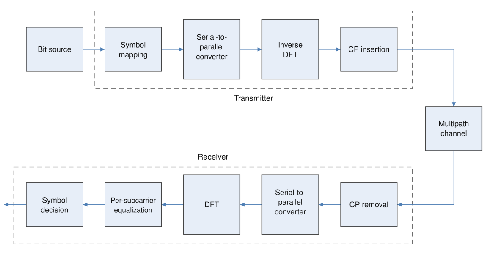
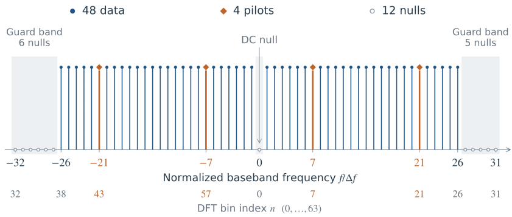

# 1. Index

<!--toc:start-->

- [1. Index](#1-index)
- [2. Multi Carrier Modulation](#2-multi-carrier-modulation)
  - [2.1. Equivalent discrete time channel](#21-equivalent-discrete-time-channel)
  - [2.2. Handling Interference](#22-handling-interference)
    - [2.2.1. Block Isolation](#221-block-isolation)
    - [2.2.2. Cyclic Prefix](#222-cyclic-prefix)
  - [2.3. Continuous Time OFDM Signal](#23-continuous-time-ofdm-signal)
    - [2.3.1. Consequences of the Cyclic Prefix](#231-consequences-of-the-cyclic-prefix)
    - [2.3.2. Power Spectral Density and Bandwidth](#232-power-spectral-density-and-bandwidth)
  - [2.4. Choosing OFDM Parameters](#24-choosing-ofdm-parameters)
  - [2.5. OFDM Baseband Transceiver](#25-ofdm-baseband-transceiver)
  - [2.6. IEEE 802.11a/g Sub-carrier Allocation](#26-ieee-80211ag-sub-carrier-allocation)
  - [2.7. Noise Before and After the DFT](#27-noise-before-and-after-the-dft)
  <!--toc:end-->

# 2. Multi Carrier Modulation

**Orthogonal Frequency Division Multiplexing (OFDM)** based waveform are
used in LTE and 5G NR and in most modern communication standards.

The main reason for using them are:

- **Robustness to multipath**: as we saw, at high symbol rates, multipath can cause
  inter-symbol interference. OFDM transmits parallel lower-rate streams, with a
  cyclic prefix to allow simple equalization on each sub-carrier.
- **Frequency-domain flexibility**: closed spaced orthogonal sub-carriers can be
  modulated and allocated separately according to channel conditions and users'
  needs.

This type of waveform is based on the **multi-carrier principle**:

> A channel can be frequency selective across the signal bandwidth $B$, while
> its response varies little over a much narrower frequency interval.

## 2.1. Equivalent discrete time channel

Up until now, we have been approximating the channel as **linear time-invariant**:

$$
h(t) = \sum_{m=0}^{L-1} \alpha_m e^{j\phi_m} \delta(t - \tau_m)
$$

This will mean that the received waveform will be the sum of
the delayed and weighted versions of the transmitted waveform:

$$
y(t) = \sum_{m=0}^{L-1} \alpha_m e^{j\phi_m} s(t - \tau_m)
$$

However, at the receiver we never see the channel $h(t)$ directly, but rather the
result of the convolution of it with the transmit and receive filters, and the sampling
process:

$$
  g(t) = g_T(t) \otimes h(t) \otimes g_R(t)
$$

We represent the channel impulse response by an **equivalent discrete-time
filter**, called a **_Tapped Delay Line (TDL)_**.

The multipath channel will contain paths with _arbitrary physical delays_.

The coefficients $h[l]$ are none other than samples of the **effective impulse
response** $g(t)$ taken at the sampling interval of the equivalent discrete-time
model $T_s$:

$$
h[l] = g(lT_s)
$$

Each tap $h[l]$ describe the channel observed at the sampling instant $lT_s$,
considering the combination of the contributions from the different physical paths.

This way, the number of taps $L_{eq}$ won't need to be equal to the number of
resolvable paths $L$.

However, for a channel with $L_{eq}$ taps each received sample will depend
on **the current input sample** and up to $L_{eq} - 1$ **preceding samples**.

The contributions from earlier input samples create _time-domain interference_:

$$
y[k] = \sum_{l=0}^{L_{eq}-1} h[l] s[k-l]
     = h[0] s[k] + \sum_{l=1}^{L_{eq}-1} h[l] s[k-l]
$$

## 2.2. Handling Interference

To understand who OFDM works, we can first see the idea behind it.

Instead of using one large carrier, we use $N$ _equally spaced sub-carriers_.

If the spacing $\Delta f_{sc} \approx \frac{B}{N}$ were to be **much smaller** than
the coherence bandwidth $B_c$, the channel response would be approximately
**constant over each narrow sub-channel**.

This allows to go from a large-bandwidth frequency-selective channel $(B > B_c)$
to $N$ narrowband flat-fading channels $\frac{B}{N} < B_c$.

While this works well _in theory_, in practice it is extremely difficult
to separate the sub-channels in frequency without having any leakage between them.
Also, within each sub-channel, the channel will still have memory, and thus the
received samples will depend on the current and previous transmitted samples,
resulting in mixing.

Then, what we do with OFDM is transmitting symbols in **blocks of $N$ time-domain
samples**.

We then have to address these effects in two steps:

1. **Block Isolation**: we add a _cyclic prefix_ so that, after discarding it,
   the $N$ useful received samples will only depend on the current transmitted block
2. **Handle Within-Block Interference**: we manage to compensate for this
   effect in the _frequency domain_.

### 2.2.1. Block Isolation

Consider a block of $N$ time-domain samples:

$$
\mathbf{s} = \begin{bmatrix}
  s[0] \\
  s[1] \\
  \vdots \\
  s[N-1]
\end{bmatrix}
$$

Each received sample will also depend on the ones transmitted before the block.

However, the first block will have no previous samples, thus:

$$
y[0] = h[0]s[0]
$$

The other samples will be:

$$
\begin{align*}
  y[0] &= h[0] s[0] \\
  y[1] &= h[0] s[1] + h[1]s[0] \\
  y[2] &= h[0] s[2] + h[1] s[1] + h[2] s[0] \\
  &\vdots \\
  y[N-1] &= h[0] s[N-1] + h[1] s[N-2] + \ldots + h[L_{eq}-1] s[0]
\end{align*}
$$

Using vector notation, we can define the **Channel Matrix** $\mathcal{H}_{lin}
\in \Complex^{N \times N}$:

$$
\mathbf{y} = \mathcal{H}_{lin} \mathbf{s}
$$

For $N = 5$ and $L_{eq} = 3$, the channel matrix will be:

$$
\mathcal{H}_{lin} = \begin{bmatrix}
  h[0] & 0 & 0 & 0 & 0 \\
  h[1] & h[0] & 0 & 0 & 0 \\
  h[2] & h[1] & h[0] & 0 & 0 \\
  0    & h[2] & h[1] & h[0] & 0 \\
  0    & 0    & h[2] & h[1] & h[0]
\end{bmatrix}
$$

> [!NOTE]
> Each row describes one received sample.
>
> The matrix is _lower triangular_ and _Toeplitz_, meaning that the entries along
> each diagonal are constant.

### 2.2.2. Cyclic Prefix

All these techniques are based on the fact that the first symbol of each block
is **not affected by interference** from previous blocks.

To achieve this, we add a **_Cyclic Prefix_**.

In a continuous transmission, the samples before the block are obviously not zero.

However, if we add a _sufficiently long cyclic prefix_ to the block, we can
prevent the preceding block from interfering with the $N$ useful received samples.

However, we cannot use any sample to build this prefix, as the first sample will
still be affected by them.

What we do is add **periodicity**, by using the last $N_{CP}$ samples of the same
block as the prefix, and adding them before $s[0]$:

<figure class="">

<figcaption>

To cover for channel memory we should use $N_{CP} \ge L_{eq} - 1$

</figcaption>
</figure>

With this extension, at the receiver happens something slightly different
than what we saw before.

Let's denote $s_{CP}[k]$ the _cyclically extended_ block of samples:

$$
s_{CP}[k] = s[k \mod N], \quad -N_{CP} \le k < N
$$

Over the _useful interval_, the channel output will still be:

$$
y[k] = \sum_{l=0}^{L_{eq}-1} h[l] s[k-l], \quad 0 \le k < N
$$

However, for $k = 0$ now we have that:

$$
\begin{align*}
  y[0] &= h[0]s_{CP}[0]+h[1]s_{CP}[-1]+\cdots+h[L_{eq} - 1]s_{CP}[-(L_{eq}+1)] \\
       &= h[0]s[0] + h[1]s[N-1] + \cdots + h[L_{eq}-1]s[N-(L_{eq}-1)]
\end{align*}
$$

The same will apply to _every useful sample_. Therefore, within the retained
block:

$$
y[k] = \sum_{l=0}^{L_{eq}-1} h[l] s[(k-l) \mod N]
$$

With a sufficiently long cyclic prefix, we can guarantee that the $N$
retained received samples will depend only on the current block:

$$
\mathbf{y} = \mathcal{H}_{circ} \mathbf{s}
$$

For $N = 5$ and $L_{eq} = 3$, the **Circular Channel Matrix** will be:

$$
\mathcal{H}_{circ} = \begin{bmatrix}
  h[0] & 0 & 0 & h[2] & h[1] \\
  h[1] & h[0] & 0 & 0 & h[2] \\
  h[2] & h[1] & h[0] & 0 & 0 \\
  0    & h[2] & h[1] & h[0] & 0 \\
  0    & 0    & h[2] & h[1] & h[0]
\end{bmatrix}
$$

In this case, **each column/row is a _cyclic shift_ of the previous one**.

> [!NOTE]
> The terms in the upper-right corner come from the samples copied in the
> cyclic prefix

Remembering (or discovering for the first time right now) some linear algebra
concepts, a circulant matrix can be **diagonalized** by the **Discrete Fourier Transform
(DFT)** matrix:

$$
  \mathcal{H}_{circ} = \mathbf{F}^H \mathbf{\Lambda} \mathbf{F}
$$

Where:

$$
\begin{align*}
  [\mathbf{F}]_{n,k} &= \frac{1}{\sqrt{N}} e^{-j2\pi n k/N}
&& \text{Normalized DFT Matrix} \\
  [\mathbf{\Lambda}]_{n,n} = H[n] &= \sum_{l=0}^{L_{eq}-1} h[l] e^{-j2\pi nl/N}
&& \text{channel at frequency index } n
\end{align*}
$$

If we define $\mathbf{Y} = \mathbf{Fy}$ and $\mathbf{S} = \mathbf{Fs}$, we can write
the received signal applying the DFT:

$$
\mathbf{Y} = \mathbf{Fy} = \mathbf{F} \mathcal{H}_{circ} \mathbf{s}
  = \mathbf{FF}^H \mathbf{\Lambda Fs} = \mathbf{\Lambda S}
$$

Which means that, in the **frequency domain**, each received symbol is **only affected
by the corresponding transmitted symbol and the channel**:

$$
Y[n] = H[n]S[n], \qquad n = 0, 1, \ldots, N-1
$$

Since each frequency-domain symbol component is affected by a single channel
coefficient, we can choose the entries of $\mathbf{S}$ to be the **information
symbols** we want to transmit (e.g., QAM symbols).

To transmit these symbols, we just have to generate the corresponding
time-domain samples using the _inverse DFT_:

$$
\mathbf{s} = \mathbf{F}^H \mathbf{S}
$$

Ignoring the _cyclic-prefix overhead_, the symbol mapper supplies one
information symbol every $T_s$.

By grouping $N$ symbols into the $\mathbf{S}$ vector, the IDFT converts these
into $N$ time-domain samples, transmitted at intervals of $T_s$.

$$
s[k] = \frac{1}{\sqrt{N}} \sum_{n=0}^{N-1} S[n]e^{j2\pi kn/N}, \qquad
k = 0, 1, \ldots, N-1
$$

The _useful block_ duration is $T_u = NT_s$.

## 2.3. Continuous Time OFDM Signal

The IDFT outputs can be interpreted as **samples of the continuous-time OFDM
baseband signal**:

$$
s(t) = \frac{1}{\sqrt{N}} \sum_{n=0}^{N-1} S[n] e^{j2\pi n \Delta f_{sc} t}, \qquad
0 \le t < T_u
$$

Where the sub-carrier spacing is $\Delta f_{sc} = \frac{1}{T_u}$.

Sampling this signal at $t = kT_s$ gives exactly the IDFT output:

$$
s(kT_s) = \frac{1}{\sqrt{N}} \sum_{n=0}^{N-1} S[n] e^{j2\pi n k/N} = s[k]
$$

Each symbol $S[n]$ weights a **complex sinusoid** at frequency $n \Delta f_{sc}$,
which is the **$n$-th sub-carrier**.

Their sum forms the useful OFDM waveform.

Exactly like in quadrature modulation, at the receiver we recover the
coefficients of orthogonal waveforms by projecting the signal onto each
waveform.

With $\Delta f_{sc} = \frac{1}{T_u}$, the sub-carriers are **orthogonal** over
the useful interval:

$$
\frac{1}{T_u} \int_0^{T_u} e^{j2\pi n \Delta f_{sc} t}
e^{-j2\pi p \Delta f_{sc} t}\;dt = \begin{cases}
  1, & n = p \\
  0, & n \ne p
\end{cases}
$$

Hence, projecting the receiver signal onto the sub-carrier $p$ will **extract
its symbol** and **cancel the contributions from the other sub-carriers**:

$$
\frac{\sqrt{N}}{T_u} \int_0^{T_u} y(t) e^{-j2\pi p \Delta f_{sc} t}\;dt = S[p]
$$

> [!NOTE]
> The DFT performs the corresponding projections on the $N$ time-domain samples.

### 2.3.1. Consequences of the Cyclic Prefix

Since $\Delta f_{sc} = \frac{1}{T_u}$, _every subcarrier_ repeats after $T_u$.

Therefore, their sum admits a periodic extension with period $T_u$:

$$
e^{j2\pi n \Delta f (t + T_u)} = e^{j2\pi n \Delta f t}
$$

The cyclic prefix transmits the last $T_{CP} = N_{CP}T_s$ seconds of the useful
block before it:

$$
s_{CP}(t) = s(t + T_u), \qquad -T_{CP} \le t < 0
$$

By linearity, we can analyze one sub-carrier at a time (we denote them by
the subscript $n$).

Including the cyclic prefix, the samples of each sub-carrier $n$ are:

$$
s_{n,CP}[k] = \frac{S[n]}{\sqrt{N}} e^{j2\pi n k/N}, \qquad -N_{CP} \le k < N
$$

When $N \ge L_{eq} - 1$, all delayed samples that contribute to the useful
received block **belong to the extended sinusoid**:

$$
\begin{align*}
y_n[k] &= \sum_{l=0}^{L_{eq}-1} h[l] s_{n,CP}[k-l] \\
  &= \frac{S[n]}{\sqrt{N}} e^{j2\pi n k/N} \sum_{l=0}^{L_{eq}-1} h[l] e^{-j2\pi
nl/N} \\
  &= \frac{S[n]}{\sqrt{N}} \cdot e^{k2\pi n k/N} \cdot H[n] \\
  &= s_n[k] \cdot H[n]
\end{align*}
$$

We can also use matrix notation to express the received block as:

$$
Y[n] = H[n] S[n]
$$

If the channel remains constant over the block, multipath will change only the
**amplitude and phase** of each sub-carrier, but not its **_orthogonality_**.

<figure class="">

<figcaption>

After the CP removal, each carrier is scaled by its channel coefficient $H[n]$.

</figcaption>
</figure>

Over the useful interval $T_u$, each sub-carrier is a **complex sinusoid** windowed
by a **unit-amplitude rectangular pulse** $g_T(t) = \operatorname*{rect}\left(
\frac{t - T_u/2}{T_u}\right)$.

Thus, its spectral magnitude has a _shifted_ $\operatorname*{sinc}$ shape.
With $\Delta f_{sc} = \frac{1}{T_u}$, their spectrum has _zeros_ at the
frequencies of all other sub-carriers:

$$
\begin{align*}
  S_n(f) &= \frac{S[n]}{\sqrt{N}} T_u e^{j2\pi \Delta f T_u/2} \operatorname*{sinc}
((f - n\Delta f)T_u)\\
  &= \frac{S[n]}{\sqrt{N}} T_u e^{-j\pi f T_u} \operatorname*{sinc}
((f - n \Delta f)T_u) \\
  &= \frac{S[n]}{\sqrt{N}} T_u e^{-j\pi f T_u} \operatorname*{sinc}(fT_u - n)
\end{align*}
$$

### 2.3.2. Power Spectral Density and Bandwidth

Ignoring the cyclic prefix, each sub-carrier carries a sequence of
**independent zero-mean symbols**, shaped by $g_T(t)$.

As in PAM, its _power spectral density_ is:

$$
S_{s_n}(f) = \frac{E[\vert S[n]\vert^2]}{N} \cdot \frac{1}{T_u}
  \left\vert G_T(f - n\Delta f_{sc}) \right\vert^2
= \frac{E[\vert S[n]\vert^2]}{N} \cdot \frac{1}{T_u}
$$

For independent symbols across sub-carriers, the total power spectral density
is the **sum** of the individual contributions:

$$
S_s(f) = \sum_{n=0}^{N-1} S_{s_n}(f)
$$

We can once again approximate the OFDM bandwidth, as:

$$
B_{OFDM} \approx N \Delta f_{SC} = N \cdot \frac{1}{N}{T_s} = \frac{1}{T_s}
$$

The bandwidth is similar to that of a PAM signal, which is:

$$
B_{PAM}^{(BP)} = \frac{1}{T_s} \cdot (1 + \alpha)
$$

We see that the only difference is the _roll-off factor_ $\alpha$ of the
pulse shaping filter.

## 2.4. Choosing OFDM Parameters

When we want to use OFDM, we need to choose several parameters.

Here's a summary of the most important ones:

- **Cyclic Prefix Length**: It must cover the equivalent channel memory
  $$
    N_{CP} \ge L_{eq} - 1
  $$
- **Number of Sub-carriers**: For a fixed sampling interval $T_s$, increasing
  $N$ increases the useful duration, but reduces the sub-carrier spacing:
  $$
    T_u = NT_s, \qquad \Delta f_{sc} = \frac{1}{T_u}
  $$
  A larger $N$ also reduces the relative CP overhead, but makes the transmission
  more sensitive to _variation within the block_. Still, is should remain constant
  over the complete block:
  $$
    T_{OFDM} = (N + N_{CP})T_S \ll T_c
  $$
- **Nominal Bandwidth**:
  $$
    B_{OFDM} \approx \frac{1}{T_s}
  $$
- **Sub-carrier Spacing**:
  $$
    \Delta f \approx \frac{B_{OFDM}}{N}
  $$

## 2.5. OFDM Baseband Transceiver

We can summarize the baseband OFDM transceiver as follows:

1. In the serial-to-parallel block, a block of $N$ consecutive data
   symbols are collected in the vector
   $$
   \mathbf{S} = \begin{bmatrix}
     S[0] \\
     S[1] \\
     \vdots \\
     S[N-1]
   \end{bmatrix}
   $$
1. The IDFT block converts $\mathbf{S}$ into a "time-domain" vector:
   $$
   \mathbf{s} = \mathbf{F}^H \mathbf{S}
   $$
1. A $N_{CP}$–long cyclic prefix is inserted to create the new time-domain
   vector of length $N + N_{CP}$:

   $$
   \mathbf{s}_{CP} = \begin{bmatrix}
     s[N-N_{CP}] \\
     s[N-N_{CP}+1] \\
     \vdots \\
     s[N-1] \\
     s[0] \\
     s[1] \\
     \vdots \\
     s[N-1]
     \end{bmatrix}
   $$

1. The signal propagates through the wireless channel with _equivalent
   impulse_ response $\mathbf{h} = \left[ h[0], h[1], \ldots, h[L_{eq}-1] \right]$:
   $$
   r[k] = \sum_{l=0}^{L_{eq}-1} h[l] s_{CP}[k-l] + \tilde{w}[k]
   $$
1. At the receiver, the samples corresponding to the CP, which do not
   carry any additional data, are discarded and the remaining samples
   are collected in the vector $\mathbf{r}$ and then transformed into the frequency
   domain by the DFT, yielding:
   $$
   \mathbf{R} = \mathbf{Fr} = \mathbf{F}\mathcal{H}_{circ}\mathbf{s} + \mathbf{Fw}
    = \mathbf{\Lambda} \mathbf{S} + \mathbf{W}
   $$
1. Each sub-carrier is equalized before symbol detection. The decision is performed
   on the equalized vector $\mathbf{X} = \mathbf{\Lambda}^{-1} \mathbf{R} =
   \mathbf{\Lambda}^{-1}\mathbf{W}$, yielding the estimated symbol vector $\mathbf{S}$.

## 2.6. IEEE 802.11a/g Sub-carrier Allocation

`IEEE 802.11a/g` (commonly known as _Wi-Fi_) uses OFDM with $N = 64$ sub-carriers,
transmitting at a sampling rate of $B_{OFDM} = 20\;MHz$ (i.e., has a sampling
interval of $T_s = 50\;ns$), giving each sub-carrier spacing of $312.5\;kHz$.

Of the 64 sub-carriers, $48$ **carry data**, $4$ are used for **pilot signals**
and the remaining $12$ are **null**, used as _guard bands_ to avoid
interference due to adjacent signal (it dumps the non-null tails of the sinc-shaped
sub-carrier spectra).

The cyclic prefix of each block is $N_{CP} = 16$ samples long, thus:

$$
\begin{align*}
  T_u &= N T_s = 3.2\;\mu \\
  T_{CP} &= N_{CP}T_s = 0.8\;\mu s \\
  T_{OFDM} &= (N + N_{CP})T_s = 4\;\mu s
\end{align*}
$$

For a receiver moving at $v = 3\;m/s$ and a carrier frequency of $f_c = 5\;GHz$,
we can compute the **maximum Doppler shift**:

$$
f_{D,max} = f_c \cdot \frac{v}{c} = 50\;Hz
$$

Using $T_C \approx \frac{1}{2f_{D,max}}$, we can calculate the coherence time
to be approximately $10\;ms$.

Since $T_{OFDM} = 4\;\mu s \ll T_C \approx 10\;ms$, the channel can be considered
constant over each block.

Another parameter we have to consider is the _Symbol Rate_, in fact
the purpose of all this shenanigans is to allow us to transmit symbols.

Since each sub-carrier carries a new symbol every $T_{OFDM} = 4\;\mu s$,
and there are $48$ sub-carriers dedicated to data transmission, the
overall symbol rate is:

$$
R_{sym,data} = \frac{N_{data}}{T_{OFDM}} = \frac{48}{4\;\mu s} = 12\;Msym/s
$$

If we compare to a regular PAM:

$$
\begin{align*}
  B_{PAM} &= \frac{1}{T_s} = 20\;MHz \\
  R_{sym,PAM} &= \frac{1}{T_s} = \frac{B}{1+\alpha} = \frac{20}{1 + 0.5} = 13.3\;Msym/s
\end{align*}
$$

We are losing a bit of bandwidth efficiency, but we are gaining robustness to
multipath and frequency-selective fading.

We can also compute some statistic regarding spectral efficiency:

$$
\begin{align*}
  \eta_{CP} &= \frac{N_{CP}}{N + N_{CP}} = \frac{48}{4\;\mu s} = 20\%
&& \text{CP insertion overhead}\\
  \eta_{PG} &= \frac{N_{null} + N_{pilot}}{N} = 25\%
&& \text{Pilot and Guard overhead}
\end{align*}
$$

Our overall utilization of time-frequency resources is:

$$
  \frac{N}{N + N_{CP}} \cdot \frac{N_{data}}{N} = \frac{64}{80} \cdot
\frac{48}{64} = 60\%
$$

## 2.7. Noise Before and After the DFT

After CP removal, the $N$ useful received samples include
**additive complex-baseband noise**:

$$
r[k] = y[k] + \tilde w[k], \qquad 0 \le k < N
$$

If we assume _independent circularly symmetric complex Gaussian noise samples_
(i.e., $\tilde w[k] \sim \mathcal{CN}(0, 2N_0)$), stacking them
into a vector gives us:

$$
\mathbf{w} := \begin{bmatrix}
  \tilde w[0] \\
  \tilde w[1] \\
  \vdots \\
  \tilde w[N-1]
\end{bmatrix} \sim \mathcal{CN}(\mathbf{0}, 2N_0 \mathbf{I}_N)
$$

The _Discrete Fourier Transform_ (DFT) transforms the noise vector into
$\mathbf{W} = \mathbf{Fw}$.

Since $\mathbf{F}$ is a unitary matrix, the noise vector $\mathbf{W}$ maintains
the **same distribution**:

$$
\begin{CD}
{
  E\Set{\mathbf{WW}^H} = \mathbf{FE}\Set{\mathbf{ww}^H}\mathbf{F}^H =
  2N_0 \mathbf{FF}^H = 2N_0 \mathbf{I}_N
} \\ @VVV \\
{
  \mathbf{W} \sim \mathcal{CN}(\mathbf{0}, 2N_0 \mathbf{I}_N)
}
\end{CD}
$$

The output of the **FFT** is:

$$
\mathbf{R} = \mathbf{\Lambda S} + \mathbf{W}
$$

Since known training and pilot symbols support channel estimation, the
receiver can remove the effect of the channel by using the estimates of
$H[n]$.

If we assume perfect channel estimation and $H[n] \ne 0$, the decision variable
will be:

$$
X[n] = \frac{R[n]}{H[n]} = S[n] + \frac{W[n]}{H[n]} = S[n] + W'[n],
\qquad W'[n] \sim \mathcal{CN}(0, \frac{2N_0}{\vert H[n]\vert^2})
$$

Equalization **removes the channel gain**, but **_increases the noise
variance_** on strongly attenuated sub-carriers.

Without considering these last sub-carriers, after equalization each
sub-carrier can be detected as in an AWGN (Additive White Gaussian Noise)
channel, with a noise variance that depends on $\vert H[n] \vert^2$.

The symbol error probability will then depend:

- On the specific modulation employed to map the bits of the information source
- On the OFDM noice variance

For example, in case of $4$-QAM it is:

$$
\begin{align*}
  P\left(e\middle\vert H[n]\right) \approx
    2Q\left(\sqrt{\frac{E_s}{N_0} \cdot \vert H[n]\vert^2}\right) \\
  \overline{P}_s \approx \frac{2}{N_{data}}
    \sum_{n \in \mathcal{D}} Q\left(\sqrt{\frac{E_s}{N_0} \cdot \vert H[n]\vert^2}\right)
\end{align*}
$$

Where:

- $\mathcal{D}$ is the set of sub-carriers used for data transmission
- $N_{data}$ is the number of sub-carriers used for data transmission
- $\overline{P}_s$ is the **average symbol error probability**
