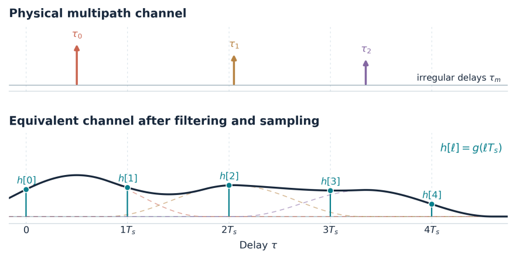
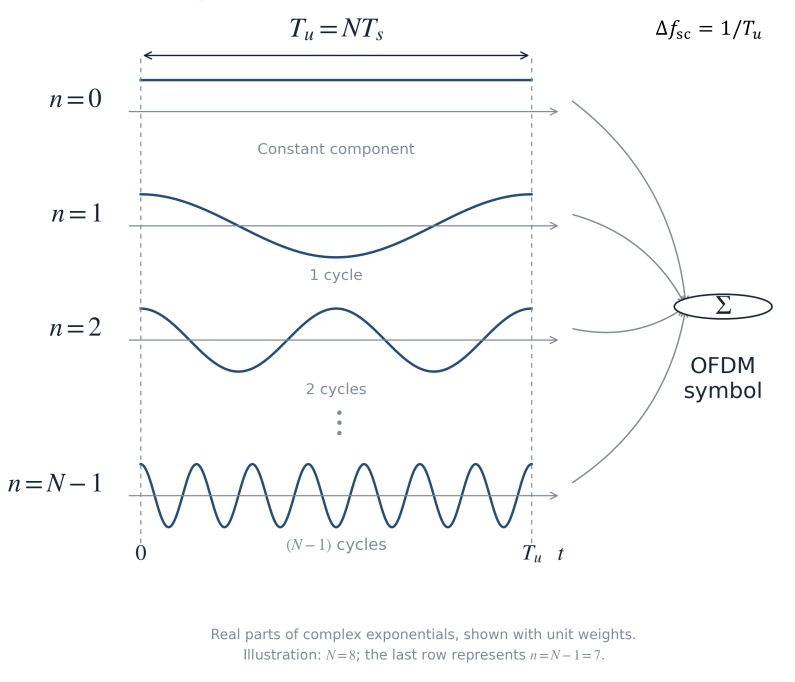

# 1. Index

<!--toc:start-->

- [1. Index](#1-index)
- [2. Multi Carrier Modulation](#2-multi-carrier-modulation)
  - [2.1. Equivalent discrete time channel](#21-equivalent-discrete-time-channel)
  - [2.2. Handling Interference](#22-handling-interference)
    - [2.2.1. Block Isolation](#221-block-isolation)
    - [2.2.2. Cyclic Prefix](#222-cyclic-prefix)
  - [2.3. Continuous Time OFDM Signal](#23-continuous-time-ofdm-signal)
    - [2.3.1. Consequences of the Cyclic Prefix](#231-consequences-of-the-cyclic-prefix)
    <!--toc:end-->

# 2. Multi Carrier Modulation

**Orthogonal Frequency Division Multiplexing (OFDM)** based waveform are
used in LTE and 5G NR and in most modern communication standards.

The main reason for using them are:

- **Robustness to multipath**: as we saw, at high symbol rates, multipath can cause
  inter-symbol interference. OFDM transmits parallel lower-rate streams, with a
  cyclic prefix to allow simple equalization on each sub-carrier.
- **Frequency-domain flexibility**: closed spaced orthogonal sub-carriers can be
  modulated and allocated separately according to channel conditions and users'
  needs.

This type of waveform is based on the **multi-carrier principle**:

> A channel can be frequency selective across the signal bandwidth $B$, while
> its response varies little over a much narrower frequency interval.

## 2.1. Equivalent discrete time channel

Up until now, we have been approximating the channel as **linear time-invariant**:

$$
h(t) = \sum_{m=0}^{L-1} \alpha_m e^{j\phi_m} \delta(t - \tau_m)
$$

This will mean that the received waveform will be the sum of
the delayed and weighted versions of the transmitted waveform:

$$
y(t) = \sum_{m=0}^{L-1} \alpha_m e^{j\phi_m} s(t - \tau_m)
$$

However, at the receiver we never see the channel $h(t)$ directly, but rather the
result of the convolution of it with the transmit and receive filters, and the sampling
process:

$$
  g(t) = g_T(t) \otimes h(t) \otimes g_R(t)
$$

We represent the channel impulse response by an **equivalent discrete-time
filter**, called a **_Tapped Delay Line (TDL)_**.

The multipath channel will contain paths with _arbitrary physical delays_.

The coefficients $h[l]$ are none other than samples of the **effective impulse
response** $g(t)$ taken at the sampling interval of the equivalent discrete-time
model $T_s$:

$$
h[l] = g(lT_s)
$$

Each tap $h[l]$ describe the channel observed at the sampling instant $lT_s$,
considering the combination of the contributions from the different physical paths.

This way, the number of taps $L_{eq}$ won't need to be equal to the number of
resolvable paths $L$.

However, for a channel with $L_{eq}$ taps each received sample will depend
on **the current input sample** and up to $L_{eq} - 1$ **preceding samples**.

The contributions from earlier input samples create _time-domain interference_:

$$
y[k] = \sum_{l=0}^{L_{eq}-1} h[l] s[k-l]
     = h[0] s[k] + \sum_{l=1}^{L_{eq}-1} h[l] s[k-l]
$$

## 2.2. Handling Interference

To understand who OFDM works, we can first see the idea behind it.

Instead of using one large carrier, we use $N$ _equally spaced sub-carriers_.

If the spacing $\Delta f_{sc} \approx \frac{B}{N}$ were to be **much smaller** than
the coherence bandwidth $B_c$, the channel response would be approximately
**constant over each narrow sub-channel**.

This allows to go from a large-bandwidth frequency-selective channel $(B > B_c)$
to $N$ narrowband flat-fading channels $\frac{B}{N} < B_c$.

While this works well _in theory_, in practice it is extremely difficult
to separate the sub-channels in frequency without having any leakage between them.
Also, within each sub-channel, the channel will still have memory, and thus the
received samples will depend on the current and previous transmitted samples,
resulting in mixing.

Then, what we do with OFDM is transmitting symbols in **blocks of $N$ time-domain
samples**.

We then have to address these effects in two steps:

1. **Block Isolation**: we add a _cyclic prefix_ so that, after discarding it,
   the $N$ useful received samples will only depend on the current transmitted block
2. **Handle Within-Block Interference**: we manage to compensate for this
   effect in the _frequency domain_.

### 2.2.1. Block Isolation

Consider a block of $N$ time-domain samples:

$$
\mathbf{s} = \begin{bmatrix}
  s[0] \\
  s[1] \\
  \vdots \\
  s[N-1]
\end{bmatrix}
$$

Each received sample will also depend on the ones transmitted before the block.

However, the first block will have no previous samples, thus:

$$
y[0] = h[0]s[0]
$$

The other samples will be:

$$
\begin{align*}
  y[0] &= h[0] s[0] \\
  y[1] &= h[0] s[1] + h[1]s[0] \\
  y[2] &= h[0] s[2] + h[1] s[1] + h[2] s[0] \\
  &\vdots \\
  y[N-1] &= h[0] s[N-1] + h[1] s[N-2] + \ldots + h[L_{eq}-1] s[0]
\end{align*}
$$

Using vector notation, we can define the **Channel Matrix** $\mathcal{H}_{lin}
\in \Complex^{N \times N}$:

$$
\mathbf{y} = \mathcal{H}_{lin} \mathbf{s}
$$

For $N = 5$ and $L_{eq} = 3$, the channel matrix will be:

$$
\mathcal{H}_{lin} = \begin{bmatrix}
  h[0] & 0 & 0 & 0 & 0 \\
  h[1] & h[0] & 0 & 0 & 0 \\
  h[2] & h[1] & h[0] & 0 & 0 \\
  0    & h[2] & h[1] & h[0] & 0 \\
  0    & 0    & h[2] & h[1] & h[0]
\end{bmatrix}
$$

> [!NOTE]
> Each row describes one received sample.
>
> The matrix is _lower triangular_ and _Toeplitz_, meaning that the entries along
> each diagonal are constant.

### 2.2.2. Cyclic Prefix

All these techniques are based on the fact that the first symbol of each block
is **not affected by interference** from previous blocks.

To achieve this, we add a **_Cyclic Prefix_**.

In a continuous transmission, the samples before the block are obviously not zero.

However, if we add a _sufficiently long cyclic prefix_ to the block, we can
prevent the preceding block from interfering with the $N$ useful received samples.

However, we cannot use any sample to build this prefix, as the first sample will
still be affected by them.

What we do is add **periodicity**, by using the last $N_{CP}$ samples of the same
block as the prefix, and adding them before $s[0]$:

<figure class="">

<figcaption>

To cover for channel memory we should use $N_{CP} \ge L_{eq} - 1$

</figcaption>
</figure>

With this extension, at the receiver happens something slightly different
than what we saw before.

Let's denote $s_{CP}[k]$ the _cyclically extended_ block of samples:

$$
s_{CP}[k] = s[k \mod N], \quad -N_{CP} \le k < N
$$

Over the _useful interval_, the channel output will still be:

$$
y[k] = \sum_{l=0}^{L_{eq}-1} h[l] s[k-l], \quad 0 \le k < N
$$

However, for $k = 0$ now we have that:

$$
\begin{align*}
  y[0] &= h[0]s_{CP}[0]+h[1]s_{CP}[-1]+\cdots+h[L_{eq} - 1]s_{CP}[-(L_{eq}+1)] \\
       &= h[0]s[0] + h[1]s[N-1] + \cdots + h[L_{eq}-1]s[N-(L_{eq}-1)]
\end{align*}
$$

The same will apply to _every useful sample_. Therefore, within the retained
block:

$$
y[k] = \sum_{l=0}^{L_{eq}-1} h[l] s[(k-l) \mod N]
$$

With a sufficiently long cyclic prefix, we can guarantee that the $N$
retained received samples will depend only on the current block:

$$
\mathbf{y} = \mathcal{H}_{circ} \mathbf{s}
$$

For $N = 5$ and $L_{eq} = 3$, the **Circular Channel Matrix** will be:

$$
\mathcal{H}_{circ} = \begin{bmatrix}
  h[0] & 0 & 0 & h[2] & h[1] \\
  h[1] & h[0] & 0 & 0 & h[2] \\
  h[2] & h[1] & h[0] & 0 & 0 \\
  0    & h[2] & h[1] & h[0] & 0 \\
  0    & 0    & h[2] & h[1] & h[0]
\end{bmatrix}
$$

In this case, **each column/row is a _cyclic shift_ of the previous one**.

> [!NOTE]
> The terms in the upper-right corner come from the samples copied in the
> cyclic prefix

Remembering (or discovering for the first time right now) some linear algebra
concepts, a circulant matrix can be **diagonalized** by the **Discrete Fourier Transform
(DFT)** matrix:

$$
  \mathcal{H}_{circ} = \mathbf{F}^H \mathbf{\Lambda} \mathbf{F}
$$

Where:

$$
\begin{align*}
  [\mathbf{F}]_{n,k} &= \frac{1}{\sqrt{N}} e^{-j2\pi n k/N}
&& \text{Normalized DFT Matrix} \\
  [\mathbf{\Lambda}]_{n,n} = H[n] &= \sum_{l=0}^{L_{eq}-1} h[l] e^{-j2\pi nl/N}
&& \text{channel at frequency index } n
\end{align*}
$$

If we define $\mathbf{Y} = \mathbf{Fy}$ and $\mathbf{S} = \mathbf{Fs}$, we can write
the received signal applying the DFT:

$$
\mathbf{Y} = \mathbf{Fy} = \mathbf{F} \mathcal{H}_{circ} \mathbf{s}
  = \mathbf{FF}^H \mathbf{\Lambda Fs} = \mathbf{\Lambda S}
$$

Which means that, in the **frequency domain**, each received symbol is **only affected
by the corresponding transmitted symbol and the channel**:

$$
Y[n] = H[n]S[n], \qquad n = 0, 1, \ldots, N-1
$$

Since each frequency-domain symbol component is affected by a single channel
coefficient, we can choose the entries of $\mathbf{S}$ to be the **information
symbols** we want to transmit (e.g., QAM symbols).

To transmit these symbols, we just have to generate the corresponding
time-domain samples using the _inverse DFT_:

$$
\mathbf{s} = \mathbf{F}^H \mathbf{S}
$$

Ignoring the _cyclic-prefix overhead_, the symbol mapper supplies one
information symbol every $T_s$.

By grouping $N$ symbols into the $\mathbf{S}$ vector, the IDFT converts these
into $N$ time-domain samples, transmitted at intervals of $T_s$.

$$
s[k] = \frac{1}{\sqrt{N}} \sum_{n=0}^{N-1} S[n]e^{j2\pi kn/N}, \qquad
k = 0, 1, \ldots, N-1
$$

The _useful block_ duration is $T_u = NT_s$.

## 2.3. Continuous Time OFDM Signal

The IDFT outputs can be interpreted as **samples of the continuous-time OFDM
baseband signal**:

$$
s(t) = \frac{1}{\sqrt{N}} \sum_{n=0}^{N-1} S[n] e^{j2\pi n \Delta f_{sc} t}, \qquad
0 \le t < T_u
$$

Where the sub-carrier spacing is $\Delta f_{sc} = \frac{1}{T_u}$.

Sampling this signal at $t = kT_s$ gives exactly the IDFT output:

$$
s(kT_s) = \frac{1}{\sqrt{N}} \sum_{n=0}^{N-1} S[n] e^{j2\pi n k/N} = s[k]
$$

Each symbol $S[n]$ weights a **complex sinusoid** at frequency $n \Delta f_{sc}$,
which is the **$n$-th sub-carrier**.

Their sum forms the useful OFDM waveform.

Exactly like in quadrature modulation, at the receiver we recover the
coefficients of orthogonal waveforms by projecting the signal onto each
waveform.

With $\Delta f_{sc} = \frac{1}{T_u}$, the sub-carriers are **orthogonal** over
the useful interval:

$$
\frac{1}{T_u} \int_0^{T_u} e^{j2\pi n \Delta f_{sc} t}
e^{-j2\pi p \Delta f_{sc} t}\;dt = \begin{cases}
  1, & n = p \\
  0, & n \ne p
\end{cases}
$$

Hence, projecting the receiver signal onto the sub-carrier $p$ will **extract
its symbol** and **cancel the contributions from the other sub-carriers**:

$$
\frac{\sqrt{N}}{T_u} \int_0^{T_u} y(t) e^{-j2\pi p \Delta f_{sc} t}\;dt = S[p]
$$

> [!NOTE]
> The DFT performs the corresponding projections on the $N$ time-domain samples.

### 2.3.1. Consequences of the Cyclic Prefix

Since $\Delta f_{sc} = \frac{1}{T_u}$, _every subcarrier_ repeats after $T_u$.

Therefore, their sum admits a periodic extension with period $T_u$:

$$
e^{j2\pi n \Delta f (t + T_u)} = e^{j2\pi n \Delta f t}
$$

The cyclic prefix transmits the last $T_{CP} = N_{CP}T_s$ seconds of the useful
block before it:

$$
s_{CP}(t) = s(t + T_u), \qquad -T_{CP} \le t < 0
$$

By linearity, we can analyze one sub-carrier at a time (we denote them by
the subscript $n$).

Including the cyclic prefix, the samples of each sub-carrier $n$ are:

$$
s_{n,CP}[k] = \frac{S[n]}{\sqrt{N}} e^{j2\pi n k/N}, \qquad -N_{CP} \le k < N
$$

When $N \ge L_{eq} - 1$, all delayed samples that contribute to the useful
received block **belong to the extended sinusoid**:

$$
\begin{align*}
y_n[k] &= \sum_{l=0}^{L_{eq}-1} h[l] s_{n,CP}[k-l] \\
  &= \frac{S[n]}{\sqrt{N}} e^{j2\pi n k/N} \sum_{l=0}^{L_{eq}-1} h[l] e^{-j2\pi
nl/N} \\
  &= H[n] s_n[k]
\end{align*}
$$

If the channel remains constant over the block, multipath will change only the
**amplitude and phase** of each sub-carrier, but not its **_orthogonality_**.

