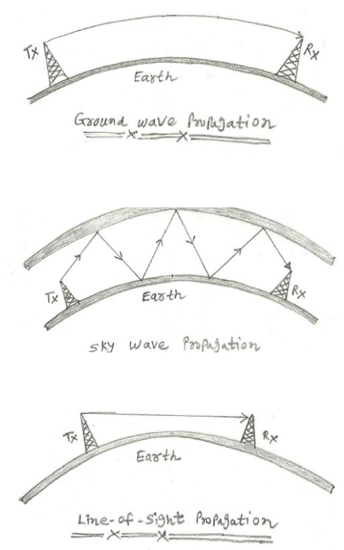
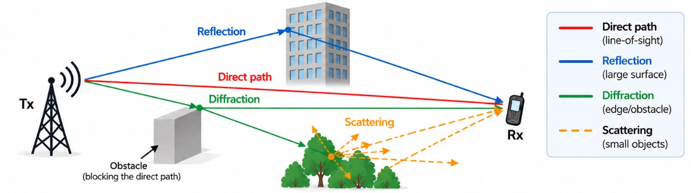
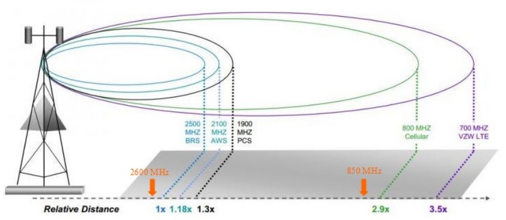
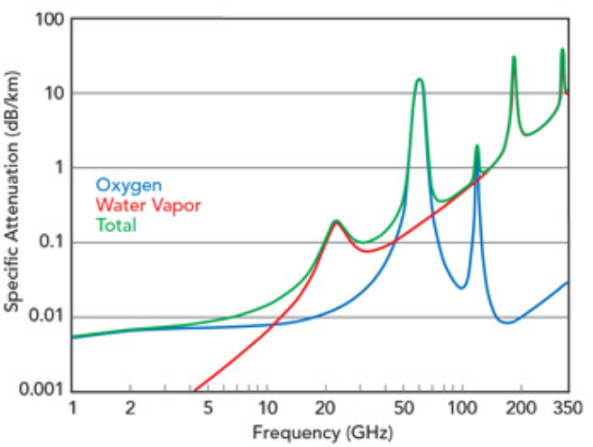
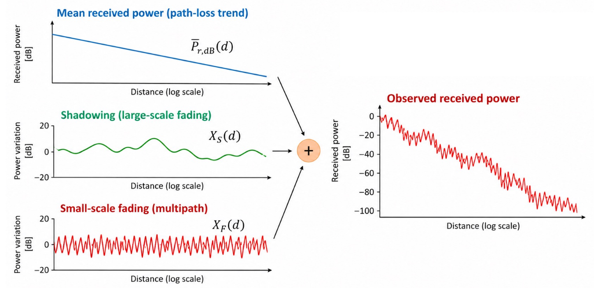
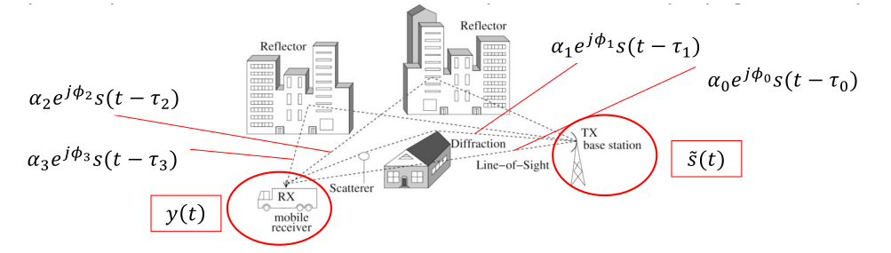
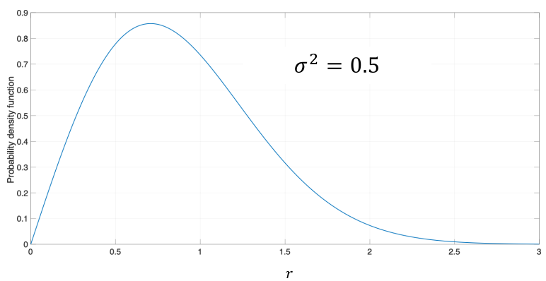
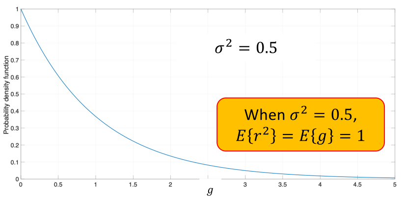
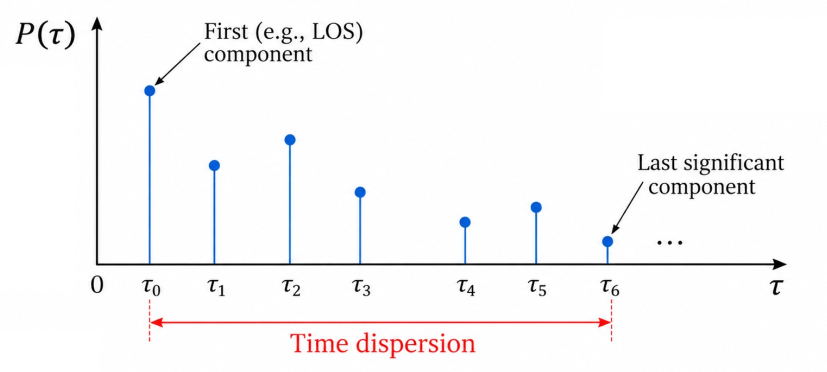

# 1. Index

<!--toc:start-->

- [1. Index](#1-index)
- [2. Wireless Propagation Channel](#2-wireless-propagation-channel)
  - [2.1. Space-Wave Phenomena](#21-space-wave-phenomena)
    - [2.1.1. Large-Scale Fading](#211-large-scale-fading)
      - [2.1.1.1. Path Loss](#2111-path-loss)
      - [2.1.1.2. Shadowing](#2112-shadowing)
    - [2.1.2. Small-Scale Fading: Multipath Propagation](#212-small-scale-fading-multipath-propagation)
      - [2.1.2.1. Reyleigh Fading](#2121-reyleigh-fading)
      - [2.1.2.2. Time Dispersion](#2122-time-dispersion)
      <!--toc:end-->

# 2. Wireless Propagation Channel

Radio signals do not propagate in the same way at all frequencies.

Depending on frequency and environment, different propagation mechanisms become
dominant.

We classify the propagation mechanisms into three categories:

- **Ground-wave propagation**: at low frequencies, radio waves can propagate close
  to the Earth's surface, partially following its curvature. This mechanism
  is particularly relevant in the LF $(<300kHz)$ and MF $(300kHz-3MHz)$ bands and
  can provide coverage **beyond the geometric horizon**.
- **Sky-wave propagation**: At HF $(3MHz-30MHz)$ frequencies, the ionosphere
  can **refract radio waves back** toward the Earth. Multiple ionospheric
  returns may allow communication over distances of hundreds or thousands of kilometres.
- **Space-wave propagation**: From VHF upward $(>30MHz)$, propagation is
  mainly associated with direct and reflected waves travelling through the lower
  atmosphere. Communication is therefore primarily limited by geometry,
  obstacles, and the surrounding propagation environment.

Most modern wireless systems operate from `VHF` to _millimeter-wave
frequencies_, where space-wave propagation is dominant.

In this regime, the received signal is typically the combination of:

- **Direct path**
- **Multiple interactions due to environmental objects**

These propagation effects can cause signal variations over _different spatial scales_
leading to the distinction between _large-scale_ and _small-scale_ fading.

> ![note]
> When defining _large_, _comparable_ and _small_ we are always referring to spatial
> dimensions relative to the carrier wavelength $\lambda$.

## 2.1. Space-Wave Phenomena

When dealing with _space-wave propagation_, several phenomena can be observed:
_transmission_, _reflection_, _refraction_, _diffraction_, _absorption_ and
_scattering_.

For our purpose, we will account just for:

- **Reflection**: occurs when a wave encounters a large surface, producing
  reflected and transmitted components.
- **Diffraction**: occurs around sharp edges or obstacles, allowing the wave
  to reach regions beyond direct line of sight.
- **Scattering**: occurs on small objects or rough surfaces, redistributing
  the wave energy in several directions.

The received signal is the combination of the multiple propagation paths, meaning
that it will suffer from both **large-scale fading** (distance larger than the wavelength)
and **small-scale fading** (distances in order of the wavelength).

The first are typically due to **path loss** and **shadowing**, while the
second are due to **multipath propagation** (and **Doppler effects** when
there is mobility).

### 2.1.1. Large-Scale Fading

Large-scale fading describes variations of the local average received power
over distances **much larger than the wavelength**.

It is mainly modeled trough **path loss** and **shadowing**.

To understand it, we shall first understand what happens to signal when it propagates
in free space from a transmitter.

Supposing that the transmitter is isotropic, and radiates the power $P_t$
uniformly in all directions of a spherical surface.

Hence, the power flux density at a distance $d$ from the transmitter is given by:

$$
S(d) = \frac{P_tG_t}{4\pi d^2} \quad [W/m^2]
$$

Where $G_t$ is the gain of the transmitting antenna.

A receiving antenna will collect power proportional to its **effective aperture**:

$$
A = \frac{G_r\lambda^2}{4\pi}
$$

Thus, the received power at a distance $d$ will be:

$$
P_r = S(d) A = P_t G_t G_r \cdot \frac{\lambda^2}{16\pi^2 d^2}
$$

This means that, in free space, the received powers decreases as $\frac{1}{d^2}$.

For example, supposing we have $\lambda = 0.1m (3GHz)$ , $G_t = G_r = 1$:

- $d = 1m \to 0.006\%\to-42dB$
- $d = 10m \to 0.00006\%\to-62dB$

#### 2.1.1.1. Path Loss

We can then introduce **path-loss** as a measure of _the average propagation
attenuation for a Tx-Rx distance_ $d$:

$$
P_r(d) = \frac{P_tG_tG_r}{L(d)} \quad [W]
$$

In $dB$ this relation cha be expressed as:

$$
  L_{dB}(d) = P_{t,dB} + G_{t,dB} + G_{r,dB} - P_{r,dB}(d)
$$

By this definition, in free-space the path-loss is:

$$
\begin{CD}
{
  P_r = P_t G_t G_r \left(\frac{\lambda}{4\pi d}\right)^2
}
@>>>
{
  L(d) = \left(\frac{4\pi d}{\lambda}\right)^2
}
\end{CD}
$$

In a generic propagation environment, we can average the received power and the
path-loss over a distance $d$ as:

$$
\begin{align*}
  P_r(d) &\approx P_r(d_0) \cdot \left(\frac{d_0}{d}\right)^{n} \\
  L(d) &\approx L(d_0) \cdot \left(\frac{d}{d_0}\right)^{n}
\end{align*}
$$

Where $d_0$ is the **reference distance** obtained from either the _free-space_
equations or from _measurements_.

Instead, $n$ is the **path-loss exponent**, which depends on the environment. Some
typical values are:

|           Environment            | Path Loss Exponent $n$ |
| :------------------------------: | :-----------------------: |
|            Free space            |             2             |
|    Urban area cellular radio     |         2.7 – 3.5         |
| Urban area cellular (obstructed) |            3–5            |
|    In-building line-of-sight     |         1.6 – 1.8         |
|      Obstructed in-building      |            4–6            |
|     Obstructed in-factories      |            2–3            |

For fixed antenna gains, the free-space path loss increases with the
**square of the carrier frequency**:

$$
L_{FS,dB}(f_c, d) = 20 \cdot \log_{10}{\left(\frac{4\pi d f_c}{c}\right)}
\quad [dB]
$$

Atmospheric gases can introduce an additional frequency-selective attenuation
$\gamma(f_c) [dB/km]$, which becomes particularly relevant at millimetre-wave
frequencies:

$$
L_{atm,dB}(f_c, d) = \gamma(f_c) \cdot d \quad [dB]
$$

The total path loss for free-space propagation with atmospheric absorption is then:

$$
L_{tot,dB}(f_c, d) = L_{FS,dB}(f_c, d) + L_{atm,dB}(f_c, d) \quad [dB]
$$

When projecting cell size for a wireless system, this means that
at its edges the path-loss may exceed $100dB$.

For fixed antenna gains and link budget, higher carrier frequencies result in
higher free-space path loss and smaller coverage radius, meaning that:

- **Low-frequency** bands are better suited for _wide-area_ coverage.
- **Higher-frequency** bands are commonly used in _smaller cells_ to provide
  high capacity.

#### 2.1.1.2. Shadowing

Two points at the same Tx-Rx distance $d$ have the same _distance-dependent path-loss_.
However, they might experience _different local average received powers_.

This happens because of **Shadowing**, which accounts for random variations
of the local average received power around the _distance-dependent path-loss model_.

In $dB$, the shadowing $A_S$ is commonly modeled as a **zero-mean Gaussian
Random Variable**:

$$
p(A_S) = \frac{1}{\sqrt{2\pi}\sigma_S} \cdot e^{-\frac{A_S^2}{2\sigma_S^2}}
$$

Where $\sigma_S$ is the _standard deviation in decibels_ (typically a few $dB$).

Equivalently, the shadowing factor is **log-normally distributed** in linear scale.

This means, that the received power at a distance $d$ can be expressed as:

$$
P_{r,dB}(d) = \overline{P}_{r,dB}(d) + X_S(d) + X_F(d)
$$

<figure class="75">

<figcaption>

We will see _Small-Scale Fading_ $X_F(d)$ in the next section.

</figcaption>
</figure>

### 2.1.2. Small-Scale Fading: Multipath Propagation

> [!IMPORTANT]
> From now on, all signals and channel responses are represented
> in equivalent complex baseband, unless otherwise stated.

In the equivalent complex-baseband representation, multiple replicas of the
transmitted signal reach the receiver through different propagation paths, with
each replica experiencing a different _attenuation_ $\alpha_l$, _phase shift_ $\phi_l$
and _propagation delay_ $\tau_l$.

Hence, the overall signal $y(t)$:

$$
y(t) = \sum_{l=0}^{L-1} {\alpha_l \cdot e^{j\phi_l} \cdot s(t-\tau_l)}
$$

For a static, or quasi-static, propagation environment, the equivalent
complex-baseband channel can be modeled as an **LTI filter**, knowing
that $y(t) = s(t) \otimes h(t)$:

$$
h(\tau) = \sum_{l=0}^{L-1} {\alpha_l \cdot e^{j\phi_l} \cdot \delta(\tau-\tau_l)}
$$

We have made some assumption in this model, for example that the channel is
**linear** and **time-invariant**, other that **noiseless**.

A _resolvable multipath component_ represents a group of propagation
contributions with **very similar delays**, observed by the receiver as a **single
delay component**.

The complex gain $h$ of one such component results from the _superposition of
many scattered contributions_ with different random phases:

$$
h = \sum_{m=0}^{M-1} {\alpha_m \cdot e^{j\theta_m}}
$$

When many independent scattered contribution add and _no dominant contribution
is present_, the in-phase and quadrature components of $h$ can be modeled as
a _zero-mean Gaussian random variable_, following the **Central Limit Theorem**:

$$
h = h_I + jh_Q \qquad h_I, h_Q \sim \mathcal{N}(0, \sigma_h^2)
$$

Meaning that we can model the sum of all the scattered contributions as a
**complex Gaussian random variable**:

$$
  h \cdot \delta(t-\tau)
$$

#### 2.1.2.1. Reyleigh Fading

When no dominant propagation path is present, the received signal envelope
$r = \vert h \vert$ follows a **Rayleigh distribution**:

$$
f_R(r) = \frac{r}{\sigma_h^2} \cdot e^{-\frac{r^2}{2\sigma_h^2}}, \quad r \ge 0
$$

The channel phase $\phase{h}$ is **uniformly distributed** in $[0, 2\pi)$.

<figure class="75">

<figcaption>

Having a Rayleigh-distributed envelope means that when received signal amplitude
is near zero, we have a non-negligible probability of deep fades, which can cause
**severe signal degradation**.

</figcaption>
</figure>

The channel power gain $g = \vert h \vert^2 = r^2$ is instead **exponentially
distributed**:

$$
f_G(g) = \frac{1}{2\sigma_h^2} \cdot e^{-\frac{g}{2\sigma_h^2}}, \quad g \ge 0
$$

The consideration in the image above can be proved:

$$
\begin{align*}
  E\Set{r^2} &= E\Set{\vert h \vert ^2} \\
    &= E\Set{h_I^2 + h_Q^2} \\
    &= E\Set{h_I^2} + E\Set{h_Q^2} \\
    &= \sigma_h^2 + \sigma_h^2 \\
    &= 2\sigma_h^2
\end{align*}
$$

#### 2.1.2.2. Time Dispersion

Different resolvable multipath components arrive at the receiver
**with different delays**, spreading the channel response over time.

The **Power Delay Profile (PDP)** describes how the average received power is
distributed over the propagation delays $\tau_l$:

$$
  P(\tau_l) = E\Set{\vert h_{tau_l} \vert^2}
$$

Thus, the channel's time dispersion will be characterized by the **Root Mean
Square (RMS) Delay Spread** $\sigma_\tau$. (i.e., the standard deviation of
the PDP)

For a discrete PDP, delay statistics are computed by _weighting each resolvable
component_ by its average power.

Defining $P_l = P(\tau_l)$, the normalized weights can be expressed as:

$$
p_l = \frac{P_l}{\sum_{k} P_k} \qquad \sum_{l} p_l = 1
$$

This allows us to compute the **mean delay** $\overline{\tau}$ and the
**RMS delay spread** $\sigma_\tau$, which measures the power-weighted dispersion
of the multipath delays around the mean delay:

$$
\begin{align*}
  \overline{\tau} &= \sum_{l} p_l \cdot \tau_l \\
  \sigma_\tau &= \sqrt{\sum_{l} p_l \cdot (\tau_l - \overline{\tau})^2}
\end{align*}
$$
