# 1. Index

<!--toc:start-->

- [1. Index](#1-index)
- [2. Arithmetic](#2-arithmetic)
  - [2.1. Digital Processor and Basic Building Blocks](#21-digital-processor-and-basic-building-blocks)
  - [2.2. 1-Bit Full Adder (FA)](#22-1-bit-full-adder-fa)
    - [2.2.1. Inversion Property and CMOS Implementation](#221-inversion-property-and-cmos-implementation)
  - [2.3. Serial Adder](#23-serial-adder)
  - [2.4. Parallel Adders](#24-parallel-adders)
    - [2.4.1. Ripple Carry Adder (RCA)](#241-ripple-carry-adder-rca)
    - [2.4.2. Carry Look Ahead Adder (CLA)](#242-carry-look-ahead-adder-cla)
    - [2.4.3. CLA Extensions for N greater than 4 and Delay Comparison](#243-cla-extensions-for-n-greater-than-4-and-delay-comparison)
  - [2.5. Pipeline Solutions](#25-pipeline-solutions)
  - [2.6. Subtractor and Adder-Subtractor](#26-subtractor-and-adder-subtractor)
  - [2.7. Arithmetic Logic Unit (ALU)](#27-arithmetic-logic-unit-alu)
  - [2.8. Parallel Multiplier](#28-parallel-multiplier)
  <!--toc:end-->

# 2. Arithmetic

## 2.1. Digital Processor and Basic Building Blocks

Let's start by looking at the architecture of a generic **Digital Processor**,
which is composed of four interconnected fundamental blocks:

- **Datapath**: contains the execution units (**Adder**, **Multiplier**,
  **Divider**, **Shifter**), the **Register File**, _pipeline registers_,
  **Multiplexers**, and **Decoders**.
- **Control**: implemented through **Finite State Machines** (**PLA**, **ROM**,
  or _random logic_) to coordinate operations.
- **Memory**: includes **Caches** (**SRAMs**), **TLBs**, **DRAMs**, and
  buffers.
- **Interconnect**: handles communication via switches, arbiters, and buses
  TOWARDS **Input-Output** interfaces.

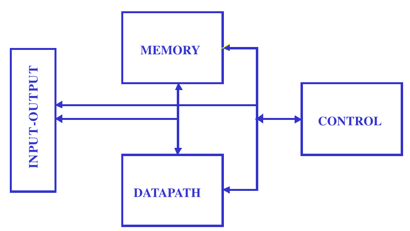

When performing binary arithmetic in _2's complement_, both positive and
negative additions are handled seamlessly by the same hardware:

- $+5 + 7 = +12 \quad \to \quad 0101_2 + 0111_2 = 1100_2$
- $-5 + 7 = +2 \quad \to \quad 1011_2 + 0111_2 = 0010_2$ &emsp;ignoring the
  final carry-out bit

## 2.2. 1-Bit Full Adder (FA)

The **1-Bit Full Adder** (**FA**) is the core building block for binary
addition.

It takes three 1-bit inputs ($A_i$, $B_i$, and the incoming carry $C_{i-1}$)
and produces two 1-bit outputs: the sum $S_i$ and the outgoing carry $C_i$.

The logic scheme is the one on the right, and its _Truth Table_ is as follows:

$$
\def\arraystretch{1.5}
\begin{array}{c:c:c|c:c}
A_i & B_i & C_{i-1} & S_i & C_i \\
\hline
0 & 0 & 0 & 0 & 0 \\
0 & 1 & 0 & 1 & 0 \\
1 & 0 & 0 & 1 & 0 \\
0 & 0 & 1 & 1 & 0 \\
0 & 1 & 1 & 0 & 1 \\
1 & 0 & 1 & 0 & 1 \\
1 & 1 & 0 & 0 & 1 \\
1 & 1 & 1 & 1 & 1
\end{array}
$$

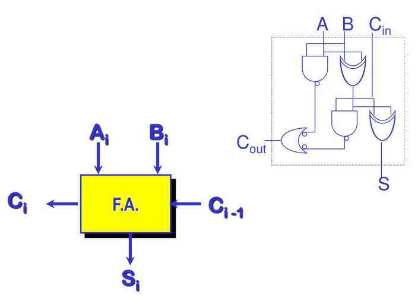

From the _Truth Table_, we obtain the boolean equations for the outputs:

$$
  S_i = A_i \oplus B_i \oplus C_{i-1}
$$

$$
C_i = A_i \cdot B_i + A_i \cdot C_{i-1} + B_i \cdot C_{i-1} = A_i \cdot B_i +
C_{i-1} (A_i \oplus B_i)
$$

The transistor implementation, aside from the carry-out goes something like
this:

<figure class="">
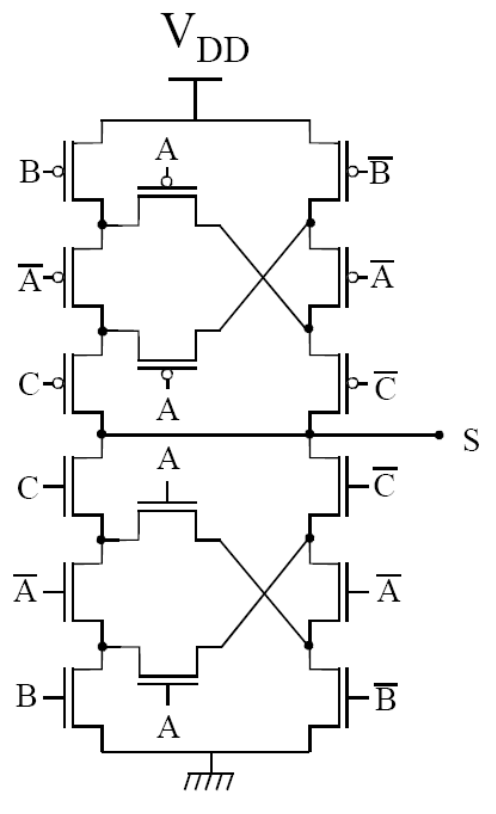
<figcaption>

A total of $22$ transistor is needed, $16$ for the logic, and $6$ for the inverters.

</figcaption>
</figure>

### 2.2.1. Inversion Property and CMOS Implementation

A key characteristic of the **Full Adder** is its _Inversion Property_:
inverting all inputs results in inverting all outputs.

$$\overline{S}(A, B, C_i) = S(\overline{A}, \overline{B}, \overline{C_i})$$

$$\overline{C_o}(A, B, C_i) = C_o(\overline{A}, \overline{B}, \overline{C_i})$$

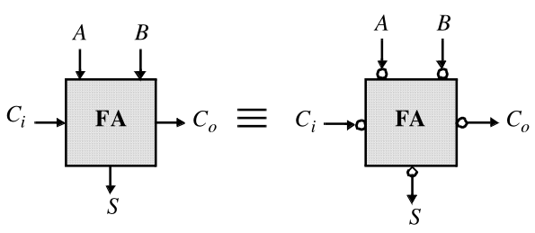

We can also express the sum $S$ as a function of the carry-out $C_o$:

$$
S = \overline{C_o}(A + B + C_i) + A B C_i
$$

Depending on how we synthesize these equations in **CMOS technology**, we
obtain different transistor counts:

- **Direct Gate-Level Implementation**: $32$ transistors ($16$ for the sum
  stage, $10$ for the carry stage, and $6$ for the inverters).
- **Compact CMOS Mirror Adder**: $28$ transistors, exploiting $\overline{C_o}$
  to compute $\overline{S}$ and adding output inverters.

<figure class="90">
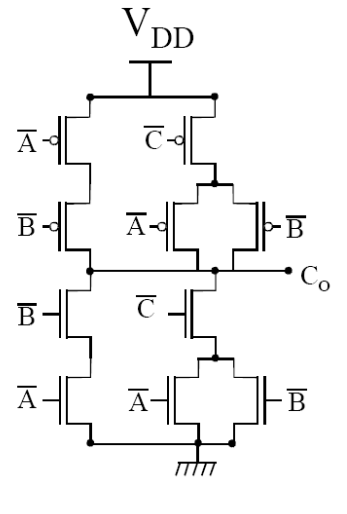
<figcaption>

This implementation uses a total of $32$ transistors: $16$ for the sum stage,
$10$ for the carry stage, and $6$ for the inverters.
We can optimize the carry stage to reduce the transistor count to $28$ by using
the _inversion property_.

</figcaption>
</figure>

<figure class="90">
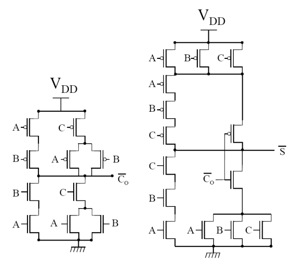
<figcaption>

This will have a higher overall propagation delay than the previous
implementation. 
However, the carry stage is faster, which is beneficial for **Ripple Carry
Adders**, for which the higher delay of the sum is not critical.

</figcaption>
</figure>

In a $0.35\ \mu\text{m}$ **CMOS Standard Cell Library**, the **FA1** cell
(1x _drive strength_) has an area of $364\ \mu\text{m}^2$ ($\approx 8$
equivalent gates) and a power consumption of $1.632\ \mu\text{W/MHz}$.

The _propagation delay_ $t_{pd}$ depends on the _input slope_ $SL$ and the
_output load_ $L$.

## 2.3. Serial Adder

To add two $N$-bit words with minimal hardware, we can use a **Serial Adder**
architecture.

This sequential circuit requires:

- **1-Bit Full Adder**: $1$ unit to compute the bit-by-bit addition.
- **N-Bit Shift Registers**: $3$ units (for inputs $A$, $B$, and output $S$).
- **Edge-Triggered D Flip-Flop**: $1$ unit to store and feed back the carry
  bit across clock cycles.

<figure class="75">
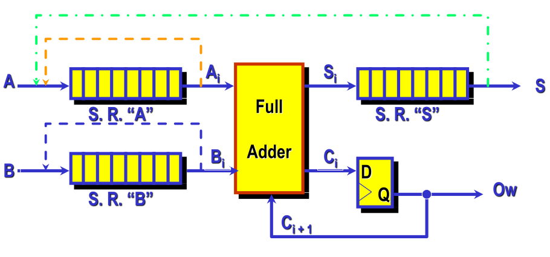
<figcaption>

This implementation is actually not exactly right. 
To make it work, we need to add a **reset signal** to our _edge-triggered D
Flip-Flop_ to initialize the carry bit to $0$ for the first addition cycle.

</figcaption>
</figure>

Assuming the carry _propagation delay_ $t_C$ is greater than the sum delay
$t_S$, the minimum clock period $T_{CK}$ and total execution time $t_{tot}$
are:

$$
T_{CK} \ge t_{c-q} + t_C + t_{su} \quad \to \quad t_{tot} = N \cdot T_{CK}
$$

The total number of Register-Logic-Register (**RLR**) paths is $6$ (without
considering the internal shift-register paths).

As for the _input throughput_, it is a tricky question.

If we suppose that the shift registers allow for a multiplexer to load
each cell in parallel, then we can say that the _word input throughput_
is $\frac{1}{N}$. _Input latency_ is of course the inverse of the throughput,
which is $N$ clock cycles.

Let's analyze the main trade-offs of this architecture:

- **Low Hardware Complexity**: requires only one **FA1** ($364\ \mu m^2$,
  $\approx 8\;NAND2$ gates) and one **DFX1 Flip-Flop** ($232.96\ \mu m^2$,
  $\approx 5\;NAND2$ gates), plus the registers (without considering the
  shift register logic). This means that it occupies the same area
  of approximately $13\;NAND2$ gates.
- **Input Preservation**: performs $S \leftarrow A + B$ while keeping the
  original inputs intact.
- **Register Optimization**: can perform the accumulation $A \leftarrow A + B$,
  saving one **Shift Register**.
- **Long Execution Time**: requires $N$ clock cycles to complete a single
  $N$-bit addition.

## 2.4. Parallel Adders

To overcome the speed limitation of serial addition, we use **Parallel Adders**,
which are purely combinational networks that process all $N$ bits in parallel.

### 2.4.1. Ripple Carry Adder (RCA)

The **Ripple Carry Adder** (**RCA**), or **Carry Propagate Adder**, cascades
$N$ **1-Bit Full Adders** by connecting the carry-out $C_{i-1}$ of each stage
to the carry-in of the next stage.

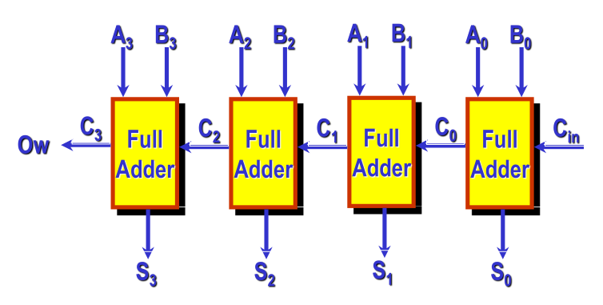

While this scheme is highly modular and much faster than the **Serial Adder**,
its _critical path_ is limited by the carry chain propagation across all $N$
stages:

$$
  T_{tot} = (N - 1) \cdot T_c + T_{su} + T_{c-q}
$$

Where $T_c$ is the _worst-case carry propagation delay_ of a single **Full
Adder**, $T_{su}$ is the _setup time_ of the output register, and $T_{c-q}$ is the
_clock-to-Q delay_ of the input register.

> [!note]
> This equation considers $\tau_{S} \ge \tau_{C}$, meaning that the sum stage is
> slower than the carry stage.

To minimize the _critical path_ without changing the logic topology, we can
exploit the _Inversion Property_ by alternating **Even Cells** and **Odd Cells**
with inverted inputs/outputs, eliminating the inverting stages along the carry
chain.

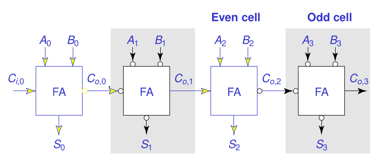

### 2.4.2. Carry Look Ahead Adder (CLA)

To break the linear dependency of the carry chain, the **Carry Look-Ahead
Adder** (**CLA**) pre-computes the carry signals in parallel.

From the **Full Adder** carry equation, we define two auxiliary signals for
each bit position $i$:

- $G_i = A_i \cdot B_i \quad \to \quad$ _Carry Generate_ &emsp;a carry is
  generated at stage $i$ regardless of $C_{i-1}$
- $P_i = A_i \oplus B_i \text{ (or } A_i + B_i\text{)} \quad \to \quad$ _Carry
  Propagate_ &emsp;the incoming carry $C_{i-1}$ is propagated to $C_i$

From the _Full Adder Truth Table_, we can derive the following equations:

$$
\begin{align*}
  C_i &= A_iB_iC_{i-1} + A_iB_i\overline{C_{i-1}} + A_i\overline{B_i}C_{i-1} +
  \overline{A_i}B_iC_{i-1} \\
    &= A_iB_i + C_{i-1}(A_i\overline{B_i} + \overline{A_i}B_i)
\end{align*}
$$

Using $G_i$ and $P_i$, the basic cell equations become:

$$
\begin{align*}
  C_i &= G_i + P_i \cdot C_{i-1}
  S_i &= P_i \oplus C_{i-1}
\end{align*}
$$

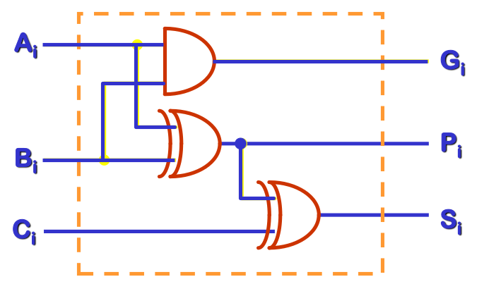

By recursively expanding the carry equation, we can express every carry signal
purely as a function of $C_{in}$ and the stage inputs $G_k, P_k$:

- $C_0 = G_0 + P_0 C_{in}$
- $C_1 = G_1 + P_1 C_0 = G_1 + P_1 G_0 + P_1 P_0 C_{in}$
- $C_2 = G_2 + P_2 C_1 = G_2 + P_2 G_1 + P_2 P_1 G_0 + P_2 P_1 P_0 C_{in}$
- $C_3 = G_3 + P_3 C_2 = G_3 + P_3 G_2 + P_3 P_2 G_1 + P_3 P_2 P_1 G_0 + P_3 P_2
  P_1 P_0 C_{in}$

This means that **all carry signals** can be expressed as function of $G_i$ and
$P_i$, meaning that they **can be generated simultaneously using a Gate-Level
_AND-OR_** combinational network.

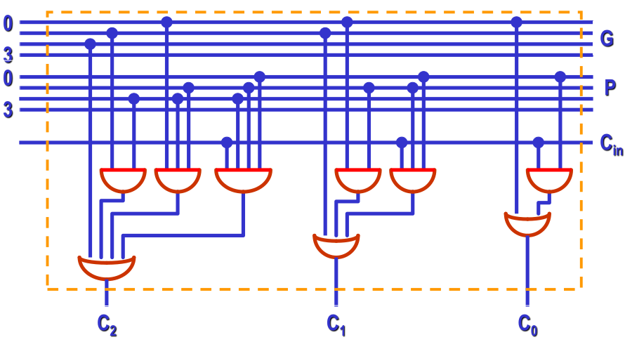

<figure class="90">
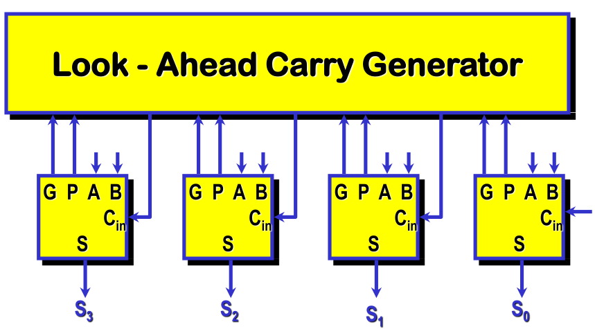
<figcaption>

This scheme suffers from the fact that the delay increases very much
when we go to higher levels of the carry generator, because the fan-in of
the AND and OR gates increases with the number of bits, and the delay itself
its proportional to the square of the fan-in.

</figcaption>
</figure>

### 2.4.3. CLA Extensions for N greater than 4 and Delay Comparison

As $N$ grows, a monolithic **CLA** becomes impractical because it requires wide
$G$ and $P$ buses and **AND** gates with very high _fan-in_.

For $N > 4$, we use two main modular approaches based on 4-bit **CLA4** blocks:

CLA4 Ripple Carry Solution

---

The **CLA4 Ripple Carry Solution** cascades $N/4$ **CLA4** blocks in a ripple
configuration, yielding a total delay of $T_{tot} = \frac{N}{4} T_{CLA4}$.

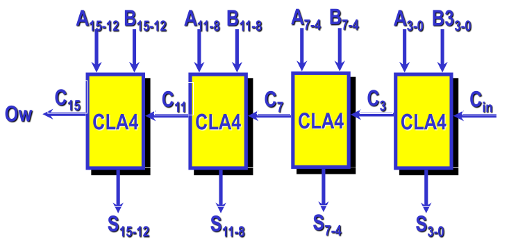

Hierarchical CLA Solution

---

In the **Hierarchical CLA Solution** each **CLA4** block generates group
propagate ($P' = P_3 P_2 P_1 P_0$) and group generate
($G' = G_3 + P_3 G_2 + P_3 P_2 G_1 + P_3 P_2 P_1 G_0$) signals, which are
fed into a **higher-level CLA** unit, reducing the total delay to
$T_{tot} = \log_4(N) \cdot T_{CLA4}$.

This architecture is indeed more complex, but it is scalable also for larger $N$
values.

This is typically the one used in modern **ALUs**.

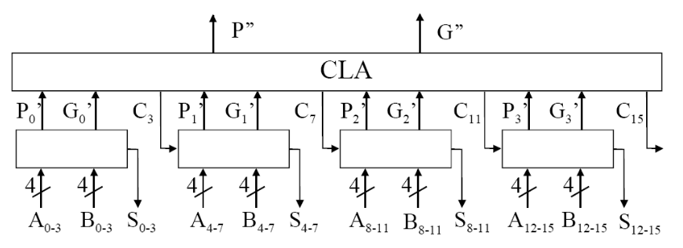

---

Let's compare the _propagation delay_ for a $64$-bit adder ($N = 64$) in
$0.25\ \mu\text{m}$ **CMOS technology**, where $T_c \approx 0.5\ \text{ns}$ and
$T_{CLA4} \approx 1\ \text{ns}$:

- **Ripple Carry Adder (RCA)**: $T_{tot} = 64 \cdot T_c = 32\;ns$
- **CLA4 Ripple Carry (CLA4-R)**: $T_{tot} = 16 \cdot T_{CLA4} = 16\;ns$
- **Hierarchical CLA (CLA4-G)**: $T_{tot} = \log_4(64) \cdot T_{CLA4} = 3 \cdot
  T_{CLA4} = 3\;ns$

We can see that there is almost 1 whole order of magnitude difference between the
**RCA** and the **Hierarchical CLA**.

## 2.5. Pipeline Solutions

If we need a higher clock frequency (throughput) on a **Ripple Carry Adder**,
we can insert **Pipeline Registers** (**Flip-Flops**) to split the carry chain
into shorter combinational stages.

Without pipelining, a 4-bit **RCA** between input/output registers requires:

$$
T_{CK} \ge t_{c-q} + 4 t_C + t_{su}
$$

<figure class="100">
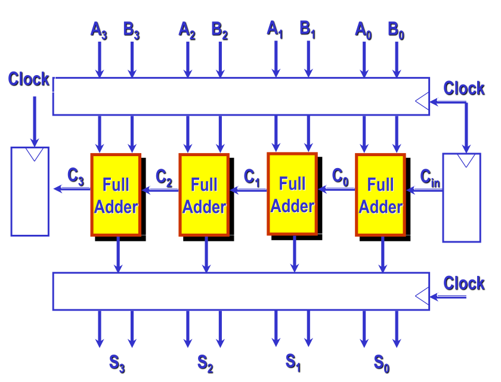
<figcaption>

This implementations requires a total of **14** D-Flip-Flops.

</figcaption>
</figure>

By adding a pipeline register on the middle carry line $C_1$, and appropriately
skewing the inputs ($A_{3-2}, B_{3-2}$) and outputs ($S_{1-0}$) with
matching registers, we halve the combinational path:

$$
T_{CK} \ge t_{c-q} + 2 t_C + t_{su}
$$

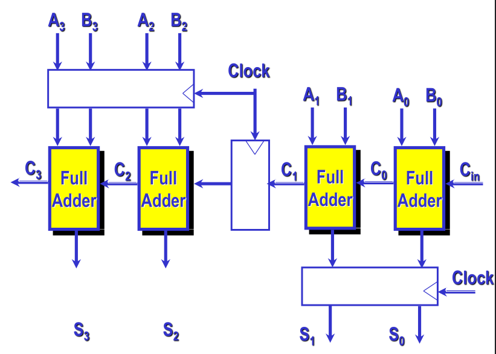

We can compare the two solutions in terms of **throughput** and **latency**
for a generic $N$-bit **RCA** with $n$ pipeline stages:

|                | Unpipelined | Pipelined | $T_{CK} - t_{cq} - t_{su}$ |
| :------------: | :---------: | :-------: | :------------------------: |
| **throughput** |     $1$     |    $1$    |          $n t_C$           |
|  **latency**   |     $1$     |    $2$    |         $n/2 t_C$          |

Of course, we can always add more pipeline stages to further reduce the combinational path,
but that will come with more **latency** and more **hardware cost**.

## 2.6. Subtractor and Adder-Subtractor

In _2's complement_ representation, subtraction is performed by adding the
negated operand:

$$
D = A - B = A + (-B) = A + B^* + 1
$$

Where $B^*$ is the bitwise complement ($\overline{B}$) of $B$.

We can easily transform a 4-bit **Adder** into a **Subtractor** by inverting
the $B$ inputs and setting the initial carry-in to $C_{in} = 1$.

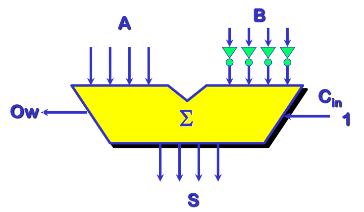

To build a unified **Adder-Subtractor**, we exploit the programmable inversion
property of the **XOR** gate ($U = B \oplus X$):

- $X = 0 \quad \to \quad U = B$ &emsp;the input passes unaltered
- $X = 1 \quad \to \quad U = B^*$ &emsp;the input is bitwise inverted

By placing **XOR** gates on both $A$ and $B$ buses controlled by signals $X_1$
and $X_2$, with $C_{in} = X_1 + X_2$, we obtain the following _Coding Table_:

$$
\def\arraystretch{1.5}
\begin{array}{c:c|c}
X_1 & X_2 & S \\
\hline
0 & 0 & A + B \\
0 & 1 & A - B \\
1 & 0 & B - A
\end{array}
$$

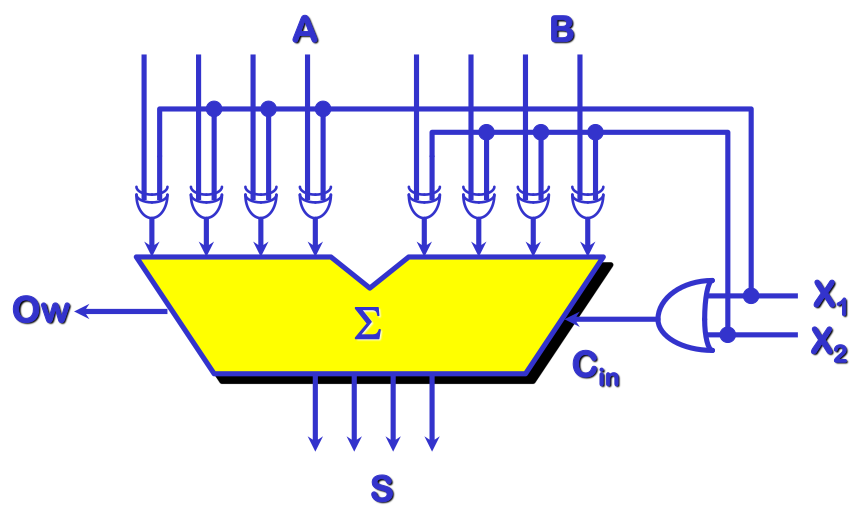

## 2.7. Arithmetic Logic Unit (ALU)

An **Arithmetic Logic Unit** (**ALU**) extends the adder architecture to
perform both arithmetic and bitwise logic operations using **Pass-Transistor
Logic** (**PTL**) / **Programmable TSA** blocks (_Transistor Switch Array_).

A 4-to-1 **PTL** multiplexer controlled by inputs $A$ and $B$ takes four
programming bits $G_{3-0}$ to synthesize any of the $16$ possible boolean
functions of two variables.

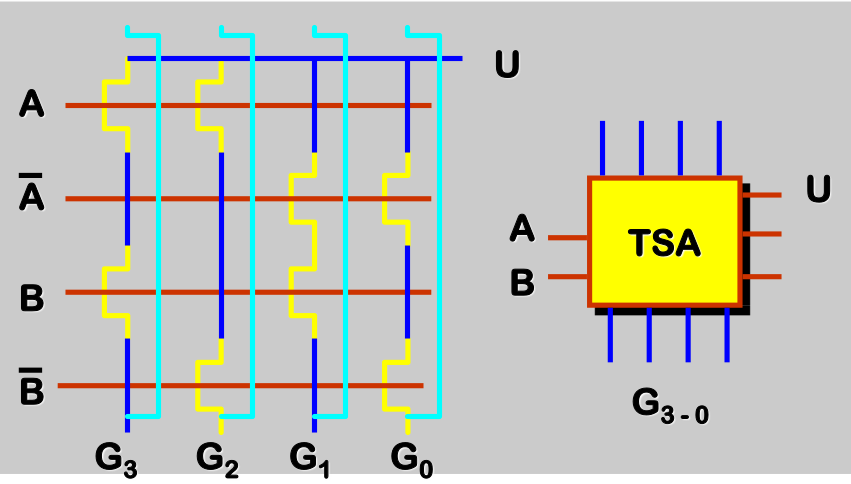

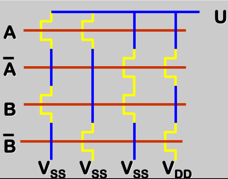

The complete _Programming Table_ for the $G_{3-0}$ configuration bits is as
follows:

$$
\def\arraystretch{1.5}
\begin{array}{c|c:c:c:c|c}
\text{HEX} & G_3 & G_2 & G_1 & G_0 & U \\
\hline
0 & 0 & 0 & 0 & 0 & 0 \\
1 & 0 & 0 & 0 & 1 & \overline{A + B} \\
2 & 0 & 0 & 1 & 0 & \overline{A} \cdot B \\
3 & 0 & 0 & 1 & 1 & \overline{A} \\
4 & 0 & 1 & 0 & 0 & A \cdot \overline{B} \\
5 & 0 & 1 & 0 & 1 & \overline{B} \\
6 & 0 & 1 & 1 & 0 & A \oplus B \\
7 & 0 & 1 & 1 & 1 & \overline{A \cdot B} \\
8 & 1 & 0 & 0 & 0 & A \cdot B \\
9 & 1 & 0 & 0 & 1 & \overline{A \oplus B} \\
\text{A} & 1 & 0 & 1 & 0 & B \\
\text{B} & 1 & 0 & 1 & 1 & \overline{A} + B \\
\text{C} & 1 & 1 & 0 & 0 & A \\
\text{D} & 1 & 1 & 0 & 1 & A + \overline{B} \\
\text{E} & 1 & 1 & 1 & 0 & A + B \\
\text{F} & 1 & 1 & 1 & 1 & 1
\end{array}
$$

By combining three programmable **PTL** blocks (to compute $G_i$, $P_i$, and
$S_i$) with a carry stage controlled by an enable signal $\Phi$, we build a
1-bit **ALU** slice.

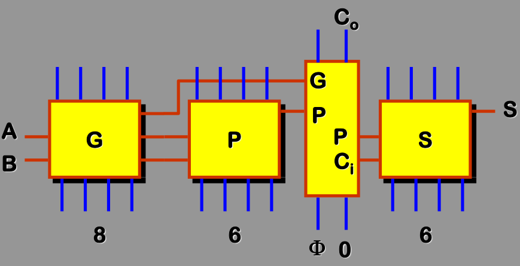

For instance, setting the programming codes to $\text{HEX } 8$ ($G_i = A_i B_i$),
$\text{HEX } 6$ ($P_i = A_i \oplus B_i$ and $S_i = P_i \oplus C_i$) configures
the **ALU** as a **Full Adder**.

Cascading $N$ blocks yields an $N$-bit **ALU**, where the programming bits
act as the _microcode_ selecting the active operation (**Adder**,
**Subtractor**, **AND**, **OR**, **XOR**, etc.).

## 2.8. Parallel Multiplier

Given two unsigned binary words $X$ ($m$ bits) and $Y$ ($n$ bits), their
product $P$ ($m + n$ bits) is expressed as:

$$
P = \sum_{i=0}^{m-1} x_i 2^i \cdot \sum_{j=0}^{n-1} y_j 2^j =
  \sum_{i=0}^{m-1} \sum_{j=0}^{n-1} (x_i y_j) 2^{i+j} =
\sum_{k=0}^{m+n-1} p_k 2^k
$$

Implementing a $16 \times 16$ multiplier via a **ROM Lookup Table** is
unfeasible, as it would require $32$ address bits and $2^{32}$ words of $32$
bits, resulting in a $16\ \text{GB}$ **ROM**.
Which can become problematic for both price and access time (since
it grows with the more bits we have).

Instead, we evaluate all partial products $x_i y_j$ in parallel using **AND**
gates and sum them across an **Array Multiplier** structure.

<figure class="100">
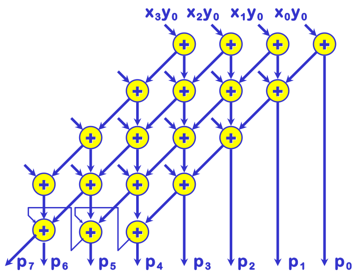

<figcaption>

This figure is **a lot generous**, since we don't actually need all
those full adders. 
In many case we can use simple _half-adders_ or even just omit the
adder entirely (we are summing with fixed $0$ value).

</figcaption>
</figure>

To build a modular $N \times N$ **Parallel Multiplier**, we define five basic
cells:

- **Basic Block 1 (Product)**: computes the partial product $p = x \cdot y$
  and forwards $x$ and $y$.
- **Basic Block 2 (Half Adder)**: sums two inputs $a, b$ producing sum $p$ and
  carry $c_o$.
- **Basic Block 3 (Full Adder)**: sums three inputs $a, b, c_i$ producing sum
  $p$ and carry $c_o$.
- **Basic Block 4 (Product + Half Adder)**: computes $x \cdot y$ and adds it
  to incoming partial sum $a$ via a **Half Adder**.
- **Basic Block 5 (Product + Full Adder)**: computes $x \cdot y$ and adds it
  to $a$ and $c_i$ via a **Full Adder**.

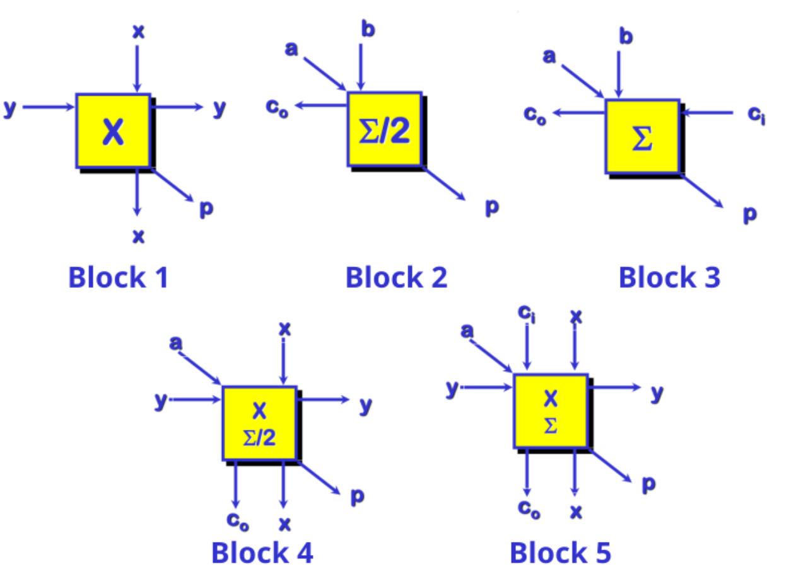

Connecting these blocks in a regular 2D grid forms the complete **Parallel
Array Multiplier**, where the final row acts as a **Ripple Carry Adder** to
resolve the MSBs.

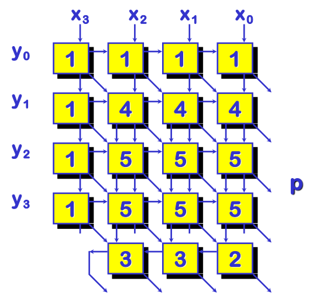

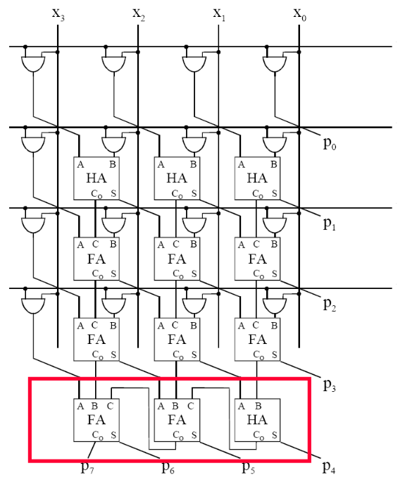

For an $N \times N$ **Parallel Multiplier**, the overall hardware complexity
and worst-case _propagation delay_ are:

- **AND Gates**: $N^2$ units to generate all partial products.
- **Half Adders (HA)**: $N$ units.
- **Full Adders (FA)**: $N(N - 2)$ units.
- **Total Propagation Delay**: $T_{tot} = 2(N - 1) T_b$, where $T_b$ is the
  _propagation delay_ of a single cell along the critical diagonal-and-horizontal
  path.
