# 1. Index

<!--toc:start-->

- [1. Index](#1-index)
- [2. Design for Low Power](#2-design-for-low-power)
  - [2.1. Why Power Matters and Power Density](#21-why-power-matters-and-power-density)
  - [2.2. The Performance vs Power Dilemma](#22-the-performance-vs-power-dilemma)
  - [2.3. Power Saving Opportunities across Design Levels](#23-power-saving-opportunities-across-design-levels)
- [3. CMOS Energy and Power Equations](#3-cmos-energy-and-power-equations)
  - [3.1. Dynamic Power Consumption](#31-dynamic-power-consumption)
  - [3.2. Short Circuit Power Consumption](#32-short-circuit-power-consumption)
  - [3.3. Leakage Static Power Consumption](#33-leakage-static-power-consumption)
  - [3.4. Power and Energy Design Space](#34-power-and-energy-design-space)
- [4. Design Time Low Power Techniques](#4-design-time-low-power-techniques)
  - [4.1. Dynamic Power as a Function of Device Size](#41-dynamic-power-as-a-function-of-device-size)
  - [4.2. Standard Cell Technology Library Characterization](#42-standard-cell-technology-library-characterization)
  - [4.3. Switching Activity and Static Transition Probabilities](#43-switching-activity-and-static-transition-probabilities)
  - [4.4. Inter signal Correlations and Logic Restructuring](#44-inter-signal-correlations-and-logic-restructuring)
  - [4.5. Glitching in Static CMOS Networks and Balanced Paths](#45-glitching-in-static-cmos-networks-and-balanced-paths)
  - [4.6. Dynamic Power as a Function of Supply Voltage and Multi VDD](#46-dynamic-power-as-a-function-of-supply-voltage-and-multi-vdd)
  - [4.7. Leakage as a Function of Design Time Threshold Voltage](#47-leakage-as-a-function-of-design-time-threshold-voltage)
  - [4.8. Evaluating Minimum Clock Period](#48-evaluating-minimum-clock-period)
- [5. Low Power Techniques in Microarchitectures and Memories](#5-low-power-techniques-in-microarchitectures-and-memories)
  - [5.1. Bus Multiplexing and Correlated Data Streams](#51-bus-multiplexing-and-correlated-data-streams)
  - [5.2. Glitch Reduction by Pipelining](#52-glitch-reduction-by-pipelining)
  - [5.3. Non Active Modules and Clock Gating](#53-non-active-modules-and-clock-gating)
  - [5.4. Run Time Dynamic Frequency and Voltage Scaling](#54-run-time-dynamic-frequency-and-voltage-scaling)
- [6. Dynamic Thermal Management](#6-dynamic-thermal-management)
  - [6.1. DTM Trigger Mechanisms](#61-dtm-trigger-mechanisms)
  - [6.2. DTM Initiation and Response Mechanisms](#62-dtm-initiation-and-response-mechanisms)
  - [6.3. DTM Activation Cycle and Cost Savings](#63-dtm-activation-cycle-and-cost-savings)
  <!--toc:end-->

# 2. Design for Low Power

## 2.1. Why Power Matters and Power Density

Let's start by analyzing why _power consumption_ has become a primary constraint
in modern digital integrated circuits. Historically, designers focused almost
exclusively on _area_ and _propagation delay_, treating power as a secondary
afterthought.

Today, managing power dissipation is mandatory for several fundamental reasons:

- **Packaging costs**: higher power dissipation requires expensive ceramic or
  advanced thermally-enhanced packages instead of cheap plastic ones.
- **Power supply rail design**: delivering large currents across the die causes
  severe voltage drops (_IR-drop_) and _electromigration_ issues on the metal
  power grid.
- **Chip and system cooling costs**: fans, heat sinks, and heat pipes increase
  both the physical volume and the overall bill of materials of the system.
- **Noise immunity and system reliability**: high operating temperatures
  accelerate silicon aging and degrade signal integrity.
- **Battery life**: in portable and handheld systems, energy efficiency directly
  dictates how long the device can operate on a single charge.
- **Environmental concerns**: office equipment (professional, government, and
  banks) accounted for $14\%$ of total US commercial energy usage in 2012, and
  compliance standards like **Energy Star** strictly regulate hidden _standby
  energy_ costs.

If we look at the historical trend of lead microprocessors (from the **Intel
4004** in 1971 up to the **Pentium** and **P6** architectures), total dissipated
power has climbed exponentially from fractions of a Watt to tens and hundreds of
Watts, making power delivery and dissipation prohibitive.

Power Dissipation Trend

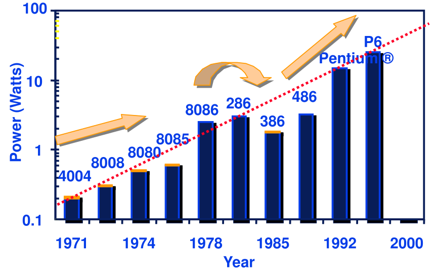

Chip Power Density Trend

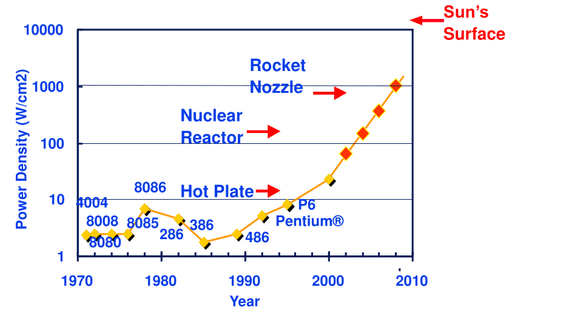

Even more concerning than total power is **Chip Power Density**, measured in
$W/cm^2$. As transistor dimensions scale down, power density has surpassed that
of a kitchen _hot plate_ ($\approx 10\;W/cm^2$), approaching the thermal flux of
a _nuclear reactor_ ($\approx 100\;W/cm^2$) and moving toward a _rocket nozzle_
($1000\;W/cm^2$).

Furthermore, **power density is not uniformly distributed** across the die.
Because silicon is not a good heat conductor, localized high-activity blocks
create severe **hot-spots**.

<figure class="80">
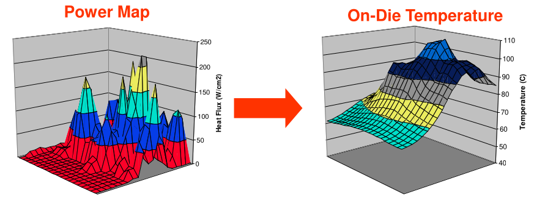
<figcaption>

Comparison between the _Heat Flux_ map (in $W/cm^2$) and the resulting _On-Die
Temperature_ map (in $^\circ C$). 
The _maximum junction temperature_ is strictly dictated by these localized
hot-spots, which heavily impacts packaging and cooling design.

</figcaption>
</figure>

When cooling fails or thermal density exceeds physical limits, the silicon die
can suffer catastrophic physical destruction, literally burning through the
package (as seen when comparing intact and thermally destroyed **Intel Pentium
III** and **AMD** processors).

Intact Processors

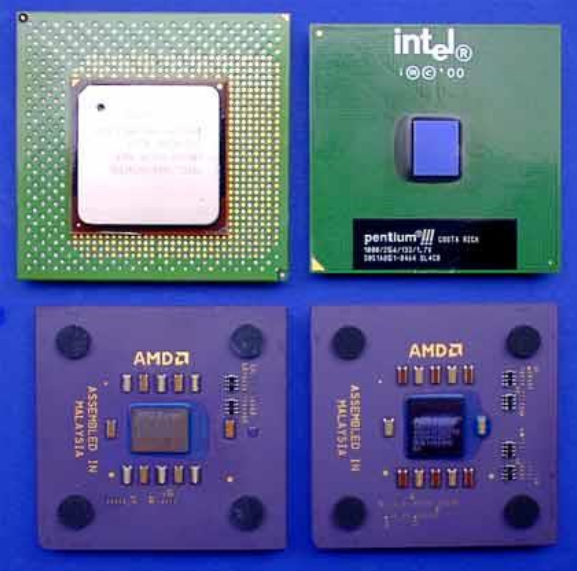

Thermally Destroyed Processors

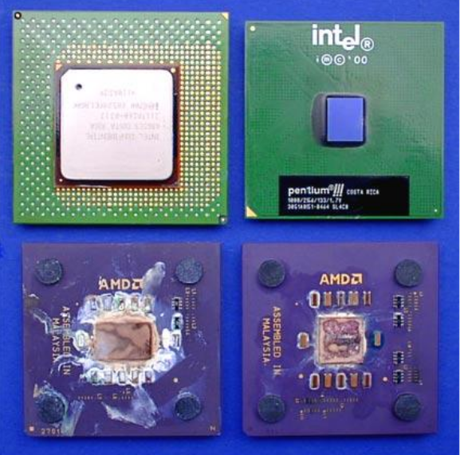

This exact thermal wall forced a major paradigm shift in the semiconductor
industry. A famous example is **Intel's Tejas project** in May 2004: because the
new single-core processor was running slower and much hotter than its
predecessor, Intel canceled the project and moved down a **parallel track**.

Instead of straining to increase the clock speed of a single monolithic
processor, designers started stamping **multiple processors on a single chip**
(multi-core architectures):

- **Dual-Core/Multi-Threaded Pentium 4**: built on a $90\;nm$ process with two
  $1\;MB$ caches, speeds up to $3.2\;GHz$, supporting up to $4$ threads, a
  shared $800\;MHz$ quad-pumped FSB, and enhanced _auto-halt_ and 2-state
  **SpeedStep** power management.
- **Heterogeneous Multi-Core Processors**: architectures like the Cell processor
  running at $3.2\;GHz$ with $241\;\text{M}$ transistors in $235\;mm^2$,
  combining $1$ **Power Processor Element** (**PPE**) and $8$ **Synergistic
  Processing Elements** (**SPEs**) for $9$ cores and $10$ threads total,
  achieving $> 200\;\text{GFlops}$ (SP).

## 2.2. The Performance vs Power Dilemma

As we scale down CMOS technology (moving through $130\;nm$, $90\;nm$, $65\;nm$,
and beyond) to achieve lower cost and higher integration, we face the
**Performance vs. Power Dilemma**:

- **Wireless and Handheld Systems**: aim to **maintain battery life** while
  handling complex tasks (3D graphics, multimedia). They require the lowest
  possible _leakage_ and _dynamic power_.
- **High-Performance Systems**: aim to **increase performance**, which leads to
  increased _leakage_, _IR-drop_, _electromigration_, and severe _thermal
  management_ challenges (packaging, cooling, and cost).

Performance vs Power Dilemma

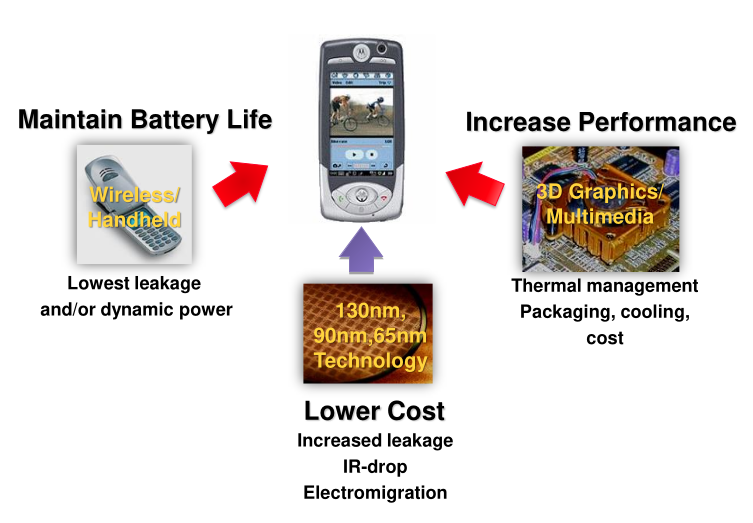

Leakage vs Dynamic Power Trend

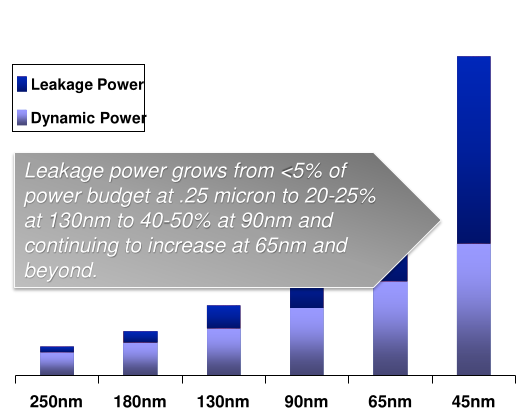

Power management becomes increasingly challenging at advanced process geometries
because **Leakage Power** begins to dominate:

- At $250\;nm$ ($0.25\;\mu m$), _leakage power_ is $< 5\%$ of the total power
  budget.
- At $130\;nm$, it grows to $20\text{--}25\%$.
- At $90\;nm$, it reaches $40\text{--}50\%$, continuing to increase at $65\;nm$
  and $45\;nm$.

At the same time, battery technology evolves very slowly. Looking at the
_nominal capacity_ (in $W\text{-}hr/lb$) of **Nickel-Cadmium**, **Ni-Metal
Hydride**, and **Rechargeable Lithium** batteries, the expected battery lifetime
increase over $5$ years is only $30\%$ to $40\%$. Without low-power design,
portable devices would require massive batteries.

Battery Capacity Trend

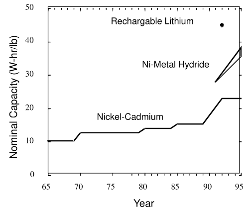

Standby Power Growth

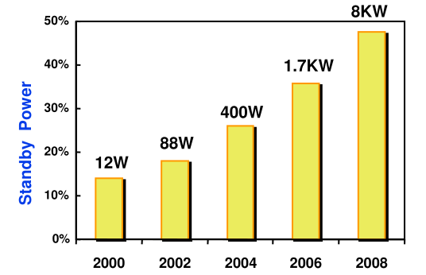

Moreover, **Standby Power** has exploded. As the power supply $V_{dd}$ scales
down over the years, the threshold voltage $V_T$ must also decrease to maintain
_noise margins_ and meet _frequency demands_:

- **2002**: $V_{dd} = 1.5\;V \quad \to \quad V_T = 0.4\;V$
- **2005**: $V_{dd} = 1.2\;V \quad \to \quad V_T = 0.4\;V$
- **2008**: $V_{dd} = 0.9\;V \quad \to \quad V_T = 0.35\;V$
- **2011**: $V_{dd} = 0.7\;V \quad \to \quad V_T = 0.3\;V$
- **2014**: $V_{dd} = 0.6\;V \quad \to \quad V_T = 0.25\;V$

Because _drain leakage_ increases exponentially as $V_T$ decreases, this leads
to excessive battery-draining standby power consumption in mobile phones and
embedded systems.

## 2.3. Power Saving Opportunities across Design Levels

We can summarize the **Low Power Design Challenge** as:

> The challenge to **design an embedded system (both HW and SW) that
> _provides the target functionality_ with _minimum power consumption_**.

To do so, we should adopt a design style that includes power consumption
as a **primary _figure of merit_**, exploiting all opportunities and techniques
available at each abstraction level, from the system concept down to the physical
implementation phase,

The potential for **power savings** is much larger at higher levels of
abstraction:

- **System Level** (evaluated via _System Power Estimator_): $> 70\%$ potential
  power savings.
- **Behavioral Level** (evaluated via _Behavioral Analysis_): $40\text{--}70\%$
  savings.
- **SW/HW Architecture Level** (evaluated via _SW Power Analysis_ and _HW Power
  Analysis_): $25\text{--}40\%$ savings.
- **Logic / Gate Level** (evaluated via _Gate Level Analysis_):
  $15\text{--}25\%$ savings.
- **Physical Level**: $10\text{--}15\%$ savings.

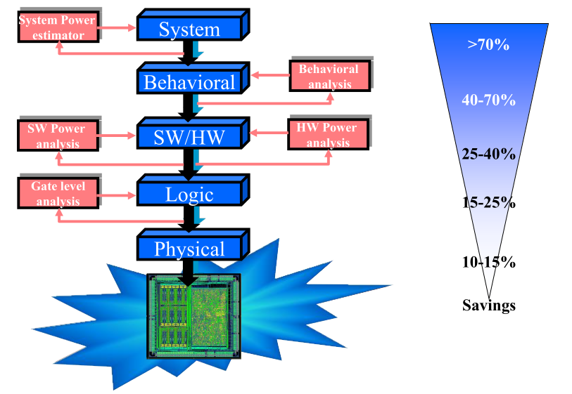

# 3. CMOS Energy and Power Equations

Let's examine the fundamental physics of energy and power dissipation in a
static CMOS gate. The total energy per clock period and total power consumption
are given by three distinct contributions:

$$
\begin{align*}
  E &= C_L V_{DD}^2 P_{0 \to 1} + t_{sc} V_{DD} I_{peak} P_{0 \to 1} + V_{DD}
I_{leakage} \\
  P &= C_L V_{DD}^2 f_{0 \to 1} + t_{sc} V_{DD} I_{peak} f_{0 \to 1} + V_{DD}
I_{leakage}
\end{align*}
$$

Where $f_{0 \to 1} = P_{0 \to 1} \cdot f_{clock}$ represents the average
frequency of $0 \to 1$ output transitions.

The three terms correspond to:

- **Dynamic power** ($C_L V_{DD}^2 f_{0 \to 1}$): due to charging and
  discharging load capacitances (its relative percentage is decreasing in deep
  submicron).
- **Short-circuit power** ($t_{sc} V_{DD} I_{peak} f_{0 \to 1}$): due to direct
  current paths during switching transitions.
- **Leakage power** ($V_{DD} I_{leakage}$): static power dissipated even when no
  switching occurs (its relative percentage is increasing rapidly in deep
  submicron).

## 3.1. Dynamic Power Consumption

**Dynamic Power Consumption** occurs whenever the output node switches from $0$
to $1$, drawing energy from the power supply $V_{DD}$ to charge the load
capacitor $C_L$.

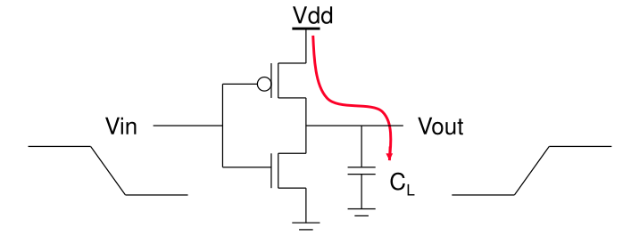

The energy dissipated per transition and the resulting dynamic power are:

$$
\begin{align*}
  \text{Energy/transition} &= C_L \cdot V_{DD}^2 \cdot P_{0 \to 1} \\
  P_{dyn} &= \text{Energy/transition} \cdot f = C_L \cdot V_{DD}^2 \cdot
(P_{0 \to 1} \cdot f) = C_{EFF} \cdot V_{DD}^2 \cdot f
\end{align*}
$$

Where $C_{EFF} = P_{0 \to 1} C_L$ is the **effective capacitance** switched per
cycle.

Notice two crucial properties of dynamic energy per transition:

- It is **not a direct function of transistor sizes** (for a fixed $C_L$, the
  energy burned in the pull-up/pull-down resistance is always $\frac{1}{2} C_L
  V_{DD}^2$ per edge, or $C_L V_{DD}^2$ per full $0 \to 1 \to 0$ cycle).
- It is **data dependent**, meaning it is a direct function of the **switching
  activity** $P_{0 \to 1}$.

To lower $P_{dyn} = C_L V_{DD}^2 P_{0 \to 1} f$, we must act on four parameters:

- **Capacitance** ($C_L$): a function of _fan-out_, _wire length_, and
  _transistor sizes_.
- **Supply Voltage** ($V_{DD}$): has been dropping with successive technology
  generations, offering a quadratic reduction in dynamic power. Decreasing
  it too much can have two main drawback: **it reduces noise margins** and
  it **increases the propagation delay**.
- **Activity factor** ($P_{0 \to 1}$): how often, on average, do wires switch?
- **Clock frequency** ($f$): historically increasing to boost performance,
  driving dynamic power up. In many applications we perform
  **Just-In-Time-Computing** to reduce the clock frequency when full
  performance is not necessary.

## 3.2. Short Circuit Power Consumption

**Short-Circuit Power Consumption** arises because the input signal $V_{in}$ has
a **finite slope** (nonzero rise and fall time).

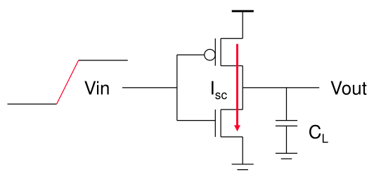

When $V_{in}$ transitions between $V_{Tn}$ and $V_{DD} - |V_{Tp}|$, **both the
NMOS and PMOS transistors are conducting simultaneously**, creating a direct
current path $I_{sc}$ between $V_{DD}$ and $GND$ for a short duration $t_{sc}$:

$$
\begin{align*}
E_{sc} &= t_{sc} V_{DD} I_{peak} P_{0 \to 1} \\
P_{sc} &= t_{sc} V_{DD} I_{peak} f_{0 \to 1}
\end{align*}
$$

The short-circuit current determinants are:

- **Duration and slope of the input signal** ($t_{sc}$): slower input edges keep
  both transistors ON for a longer time.
- **Peak current** ($I_{peak}$): determined by the _saturation current_ of the P
  and N transistors (which depends on their sizes, process technology, and
  temperature) and is a **strong function of the ratio between input and output
  slopes** — which in turn is a function of the load capacitance $C_L$.

## 3.3. Leakage Static Power Consumption

**Leakage (Static) Power Consumption** is given by $P_{leak} = V_{DD}
I_{leakage}$ and consists of three main physical mechanisms:

- **Sub-threshold current**: current flowing between drain and source when
  $V_{GS} < V_T$. **This is the dominant factor**.
- **Gate leakage**: tunneling current through the ultra-thin gate oxide.
- **Drain junction leakage**: reverse-bias current through the drain-to-substrate
  $pn$ junction diode.

Leakage Currents in CMOS

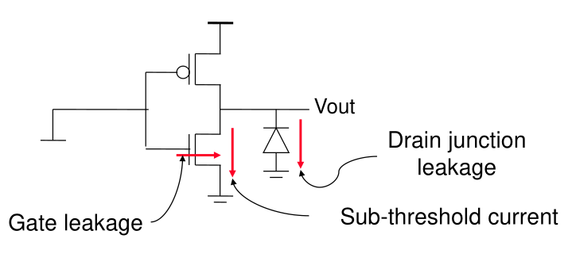

Leakage vs Threshold Voltage

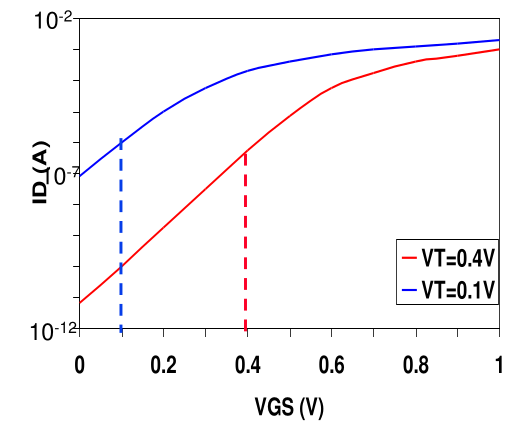

All leakage components **increase exponentially with temperature** and with the
reduction of the **threshold voltage** $V_T$:

- Continued scaling of $V_{DD}$ requires scaling down $V_T$, making
  _sub-threshold conduction_ a dominant component of power dissipation.
- With a typical sub-threshold slope (_roll-off_) of $\approx 85\text{--}90\;mV/\text{decade}$,
  each $255\;mV$ increase in $V_T$ gives **3 orders of magnitude reduction in
  leakage** (compare the red curve for $V_T = 0.4\;V$ at $10^{-11}\;A$ vs the
  blue curve for $V_T = 0.1\;V$ at $10^{-7}\;A$ when $V_{GS} = 0\;V$), although
  a higher $V_T$ adversely affects switching performance, since **delay** increases
  inversely with $V_{DD} - V_T$.

We can see this exact trade-off in real industrial processes by comparing the
**TSMC Processes** characterization data across General ($G$), Low Power ($LP$),
Ultra-Low Power ($ULP$), and High-Speed ($HS$) libraries:

| Parameter                            |     CL018 G      |     CL018 LP     |    CL018 ULP     |     CL018 HS     |     CL015 HS     |     CL013 HS     |
| :----------------------------------- | :--------------: | :--------------: | :--------------: | :--------------: | :--------------: | :--------------: |
| **$V_{dd}$**                         |     $1.8\;V$     |     $1.8\;V$     |     $1.8\;V$     |      $2\;V$      |     $1.5\;V$     |     $1.2\;V$     |
| **$T_{ox}$ (effective)**             | $42\;\text{\AA}$ | $42\;\text{\AA}$ | $42\;\text{\AA}$ | $42\;\text{\AA}$ | $29\;\text{\AA}$ | $24\;\text{\AA}$ |
| **$L_{gate}$**                       |  $0.16\;\mu m$   |  $0.16\;\mu m$   |  $0.18\;\mu m$   |  $0.13\;\mu m$   |  $0.11\;\mu m$   |  $0.08\;\mu m$   |
| **$I_{DSat}\;(n/p)\;(\mu A/\mu m)$** |    $600/260$     |    $500/180$     |    $320/130$     |    $780/360$     |    $860/370$     |    $920/400$     |
| **$I_{Off}$ (leakage) $(pA/\mu m)$** |       $20$       |      $1.60$      |      $0.15$      |      $300$       |      $1800$      |     $13000$      |
| **$V_{Tn}$**                         |    $0.42\;V$     |    $0.63\;V$     |    $0.73\;V$     |    $0.40\;V$     |    $0.29\;V$     |    $0.25\;V$     |
| **FET Perf. $(GHz)$**                |       $30$       |       $22$       |       $14$       |       $43$       |       $52$       |       $80$       |

Furthermore, $I_{leakage}$ (in $nA/\mu m$) increases exponentially as
temperature rises from $30^\circ C$ to $110^\circ C$ across the $0.25\;\mu m$,
$0.18\;\mu m$, $0.13\;\mu m$, and $0.1\;\mu m$ technology nodes.

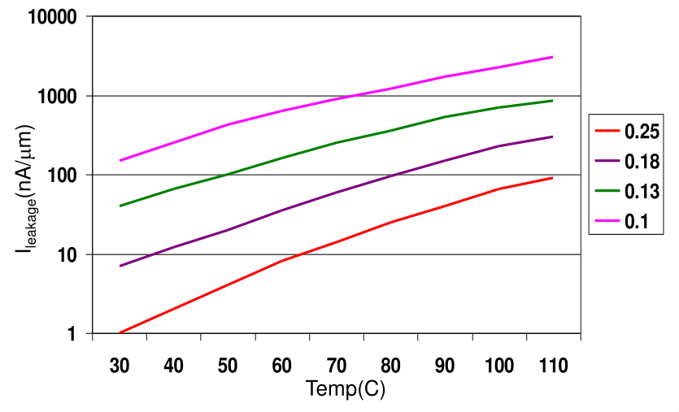

## 3.4. Power and Energy Design Space

To organize all low-power techniques systematically, we can classify methods
across two dimensions: **Energy Component** (_Active_ vs. _Leakage_) and
**Operational Phase / Throughput Constraint** (_Design Time_ at Constant
Throughput/Latency, _Non-active Modules_, and _Run Time_ at Variable
Throughput/Latency):

- **Design Time (Constant Throughput/Latency)**:
  - **Active Energy**: _Logic Design_, _Reduced $V_{dd}$_, _Sizing_, _Multi_-$V\_{dd}$.
  - **Leakage Energy**: _Multi-$V_{dd}$ + Multi-$V_T$\_.
- **Non-active Modules**:
  - **Active Energy**: _Clock Gating_.
  - **Leakage Energy**: _Sleep Transistors_, _Multi-$V_{dd}$_, _Variable $V_T$\_.
- **Run Time (Variable Throughput/Latency)**:
  - **Active Energy**: _DFS, DVS (Dynamic Frequency, Voltage Scaling)_.
  - **Leakage Energy**: _DFS, DVS + Variable $V_T$_.

# 4. Design Time Low Power Techniques

## 4.1. Dynamic Power as a Function of Device Size

Let's start with **Device Sizing** at design time. While the energy dissipated
to charge an external load is fixed, sizing the transistors of a gate changes
its internal parasitic capacitances and input gate capacitance.

Key insights from the normalized energy plot against the stage sizing factor $f$
for different overall effective fan-outs $F = C_L / C_{g,1}$:

- Device sizing significantly affects dynamic energy consumption, and the gain
  is largest for networks with **large overall effective fan-outs** ($F = 10$,
  $F = 20$).
- The **optimal gate sizing factor** $f_{opt}(\text{energy})$ for dynamic energy
  is **smaller** than the one for pure performance $f_{opt}(\text{performance})$,
  especially for large $F$:
  - For $F = 20$: $f_{opt}(\text{energy}) = 3.53$, whereas
    $f_{opt}(\text{performance}) = 4.47$.
- **Design rule**: if energy is a concern, **avoid oversizing** transistors
  beyond the optimal point.

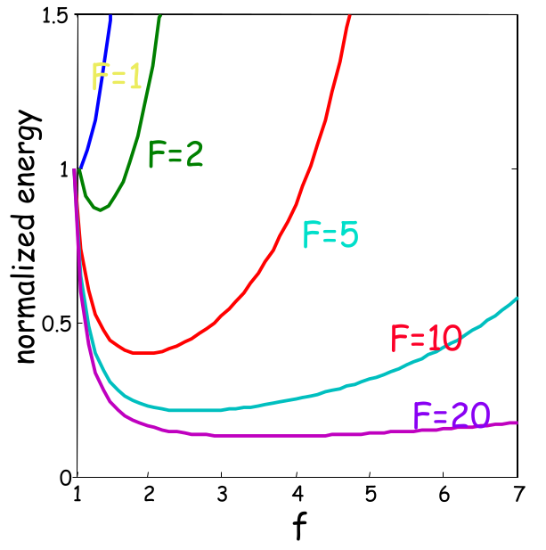

## 4.2. Standard Cell Technology Library Characterization

To evaluate delay and power accurately at the gate level, EDA tools rely on a
**Standard-Cell Technology Library** databook, such as the
**Austriamicrosystems (ams) $0.35\;\mu m$ CMOS Digital Standard Cell Databook**
(`c35_CORELIBD_BC`, characterized at best-case corner $V_{dd} = 3.63\;V$ and
$T_j = -50.0^\circ C$).

In these databooks, timing and power are characterized as 2D lookup tables
indexed by **Input Transition** time ($0.01\;ns$ vs. $4.00\;ns$, measured $20\%$
to $80\%$ rising and $80\%$ to $20\%$ falling) and **Load Capacitance** $C_L$
(measured in $fF$), while _propagation delay_ is measured from $50\%$ input
transition to $50\%$ output transition:

- **INVX1** (Inverter, _Strength_ $1$):
  - **Cell Area**: $29.120\;\mu m^2$, **Equation**: $Q = \text{!A}$.
  - **Input Capacitance**: $C_A = 2.8210\;fF$, **Leakage**: $0.26\;pW$.
  - **Dynamic Power Consumption**: increases sharply with both $C_L$ and input
    transition time (due to short-circuit current at slow input ramps), going
    from $1.93 / 2.35\;nW/MHz$ (fall/rise at $0.01\;ns$ input ramp, $5\;fF$
    load) to $38.82 / 40.07\;nW/MHz$ (at $0.01\;ns$ ramp, $100\;fF$ load), and up
    to $516.63 / 510.09\;nW/MHz$ (at $4.00\;ns$ ramp, $5\;fF$ load) and
    $813.89 / 712.95\;nW/MHz$ (at $4.00\;ns$ ramp, $100\;fF$ load).
- **NAND2X1** (2-input NAND, _Strength_ $1$):
  - **Cell Area**: $43.680\;\mu m^2$, **Equation**: $Q = \text{!(A\&B)}$.
  - **Input Capacitance**: $C_A = 2.7240\;fF$, $C_B = 3.0190\;fF$ (notice the
    different pin capacitances due to series NMOS positions), **Leakage**:
    $0.28\;pW$.
- **NAND2X2** (2-input NAND, _Strength_ $2$):
  - **Cell Area**: $43.680\;\mu m^2$ (same cell footprint as `NAND2X1`, utilizing
    internal transistor folding/sizing).
  - **Input Capacitance**: $C_A = 3.8420\;fF$, $C_B = 4.4020\;fF$, **Leakage**:
    $0.31\;pW$.
  - Characterization loads scale by $2\times$ ($10\;fF$ and $200\;fF$), with dynamic
    power reaching $1162.42 / 945.27\;nW/MHz$ ($B \to Q$ at $4.00\;ns$ ramp,
    $10\;fF$) and $1504.40 / 1252.61\;nW/MHz$ (at $4.00\;ns$ ramp, $200\;fF$).
- **NAND2X6** (2-input NAND, _Strength_ $6$):
  - **Cell Area**: $72.800\;\mu m^2$.
  - **Input Capacitance**: $C_A = 10.1390\;fF$, $C_B = 11.0760\;fF$, **Leakage**:
    $0.35\;pW$.
  - Characterization loads scale to $30\;fF$ and $600\;fF$, with dynamic power
    reaching $4408.72 / 3647.73\;nW/MHz$ ($B \to Q$ at $4.00\;ns$ ramp, $600\;fF$).
- **NOR2X1** (2-input NOR, _Strength_ $1$):
  - **Cell Area**: $43.680\;\mu m^2$, **Equation**: $Q = \text{!(A|B)}$.
  - **Input Capacitance**: $C_A = 2.6610\;fF$, $C_B = 2.9400\;fF$, **Leakage**:
    $0.26\;pW$.
  - Because of the series PMOS network, rising propagation delays ($1.17\;ns$ at
    $0.01\;ns$ ramp, $100\;fF$ load) and rising output transitions ($1.81\;ns$)
    are significantly slower than on the `NAND2X1` ($0.68\;ns$ delay and
    $1.05\;ns$ output transition under the same conditions).

As a general _rule of thumbs_ we can say that **Leakage Power is somewhat proportional
to Cell Area**.

## 4.3. Switching Activity and Static Transition Probabilities

**Dynamic Power Consumption is Data Dependent**. The switching activity
$P_{0 \to 1}$ has two components:

- **A static component**: a function of the **logic topology** and input signal
  probabilities.
- **A dynamic component**: a function of the **timing behavior** of the circuit,
  known as **glitching**.

Assuming temporally independent inputs, the **static transition probability** of
a gate output is the probability that the output is currently $0$ multiplied by
the probability that it becomes $1$ in the next cycle:

$$
P_{0 \to 1} = P_{out = 0} \times P_{out = 1} = P_0 \times (1 - P_0)
$$

Let's verify this on a **2-input NOR Gate**, whose _Truth Table_ is:

$$
\def\arraystretch{1.5}
\begin{array}{c:c||c}
A & B & Out \\
\hline
0 & 0 & 1 \\
0 & 1 & 0 \\
1 & 0 & 0 \\
1 & 1 & 0
\end{array}
$$

With uniform random input signal probabilities $P_{A=1} = 1/2$ and $P_{B=1} =
1/2$, the output is $1$ in only $1$ out of $4$ cases ($P_{out=1} = 1/4$) and $0$
in $3$ out of $4$ cases ($P_0 = 3/4$). Thus:

$$
P_{0 \to 1}(\text{NOR2}) = \frac{3}{4} \times \frac{1}{4} = \frac{3}{16}
$$

In general, for arbitrary input probabilities $P_A = P(A=1)$ and $P_B = P(B=1)$,
the **Transition Probabilities for Basic Gates** are:

- **NOR**: $P_{0 \to 1} = (1 - (1 - P_A)(1 - P_B)) \times (1 - P_A)(1 - P_B)$
- **OR**: $P_{0 \to 1} = (1 - P_A)(1 - P_B) \times (1 - (1 - P_A)(1 - P_B))$
- **NAND**: $P_{0 \to 1} = P_A P_B \times (1 - P_A P_B)$
- **AND**: $P_{0 \to 1} = (1 - P_A P_B) \times P_A P_B$
- **XOR**: $P_{0 \to 1} = (1 - (P_A + P_B - 2 P_A P_B)) \times (P_A + P_B - 2 P_A
P_B)$

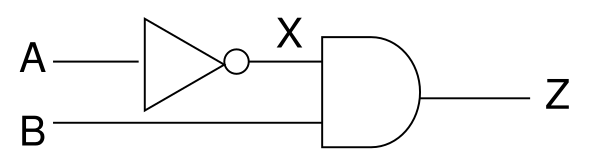

Let's see the cascade example above, where input $A$ ($P_A = 0.5$) passes
through an inverter to produce node $X$, which then feeds an AND gate together
with $B$ ($P_B = 0.5$) to produce output $Z$:

- **For node $X$**: $P_{0 \to 1} = P_0 \times P_1 = (1 - P_A) P_A = 0.5 \times
  0.5 = 0.25$ (with $P_X = 0.5$).
- **For node $Z$**: $P_{0 \to 1} = P_0 \times P_1 = (1 - P_X P_B) P_X P_B = (1 -
  (0.5 \times 0.5)) \times (0.5 \times 0.5) = \frac{3}{16}$.

## 4.4. Inter signal Correlations and Logic Restructuring

Determining switching activity in multi-level combinational networks is
complicated by the fact that signals exhibit **correlation in space and time**,
particularly in the presence of **reconvergent fan-out**.

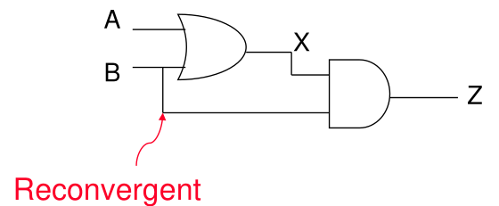

Consider the circuit above, where input $A$ ($P_A = 0.5$) is inverted and OR-ed
with $B$ ($P_B = 0.5$) to form $X = \bar{A} + B$, and then $X$ is AND-ed with
$A$ to form $Z = A \cdot X$:

- If we **ignore spatial correlation** and treat $X$ and $A$ as independent:
  - At node $X$: $P_X = 1 - (1 - 0.5)(1 - 0.5) = 3/4$, so $P_{0 \to 1}(X) =
    (1 - 0.5)(1 - 0.5) \times (1 - (1 - 0.5)(1 - 0.5)) = \frac{3}{16}$.
  - At node $Z$: naive calculation using $3/16 \times 0.5$ gives $(1 - 3/16
    \times 0.5) \times (3/16 \times 0.5) = 0.085$.
- However, because of **reconvergent fan-out**, $X$ and $A$ are correlated! We
  **have to use conditional probabilities**:

$$
P(Z = 1) = P(A = 1) \cdot P(X = 1 \mid A = 1) = P(A = 1) \cdot P(B = 1) = 0.5
\times 0.5 = 0.25
$$

Indeed, Boolean simplification shows $Z = A(\bar{A} + B) = A \cdot B$, so the
true static transition probability of $Z$ is $(1 - 0.25) \times 0.25 = 3/16 =
0.1875$.

We can exploit these transition probabilities at design time via **Logic
Restructuring**, which consists of changing the topology of a logic network to
reduce internal transitions.

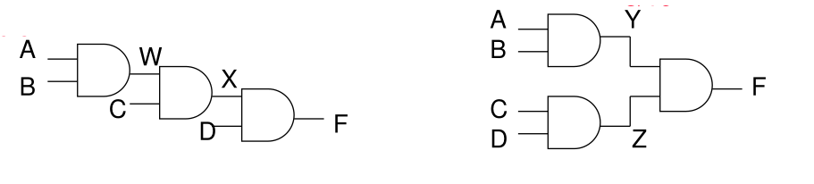

Let's compare two implementations of a 4-input AND function $F = A \cdot B \cdot
C \cdot D$ with uniform random inputs ($P_A = P_B = P_C = P_D = 0.5$), recalling
that for an AND gate $P_{0 \to 1} = P_0 \times P_1 = (1 - P_1) \times P_1$:

- **Tree Implementation** (right):
  - First-level nodes $W = A \cdot B$ and $Z = C \cdot D$ both have $P_1 = 0.25$,
    so each has $P_{0 \to 1} = (1 - 0.25) \times 0.25 = \frac{3}{16} = \frac{48}{256}$.
  - Output node $F = W \cdot Z$ has $P_1 = (1/2)^4 = 1/16$, so $P_{0 \to 1}(F) =
    \frac{15}{16} \times \frac{1}{16} = \frac{15}{256}$.
  - **Total internal + output switching**: $\frac{3}{16} + \frac{3}{16} +
    \frac{15}{256} = \frac{111}{256} \approx 0.4336$.
- **Chain Implementation** (left):
  - First internal node $X = A \cdot B$ has $P_1 = 1/4 \quad \to \quad
    P_{0 \to 1}(X) = \frac{3}{16} = \frac{48}{256}$.
  - Second internal node $Y = X \cdot C$ has $P_1 = 1/8 \quad \to \quad
    P_{0 \to 1}(Y) = \frac{7}{8} \times \frac{1}{8} = \frac{7}{64} = \frac{28}{256}$.
  - Output node $F = Y \cdot D$ has $P_1 = 1/16 \quad \to \quad
    P_{0 \to 1}(F) = \frac{15}{256}$.
  - **Total internal + output switching**: $\frac{3}{16} + \frac{7}{64} +
    \frac{15}{256} = \frac{91}{256} \approx 0.3555$.

> [!note]
> For random inputs, the **chain implementation has a lower overall switching
> activity than the tree implementation**, though this static analysis ignores
> glitching effects.  
> If we were comparing them on worst-case delay, then the **tree implementation**
> would have been a more suitable choice.

Another powerful gate-level optimization is **Input Ordering**. Suppose we have
a 2-stage chain of AND gates computing $F = A \cdot B \cdot C$ where the inputs
have different signal probabilities: $P_A = 0.5$, $P_B = 0.2$, and $P_C = 0.1$.

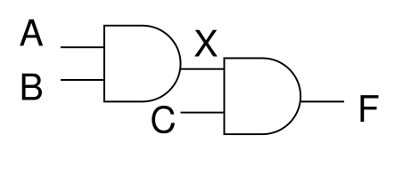

Let's compare the switching activity at the intermediate node $X$ for two
different input permutations:

- **Order 1** ($X = A \cdot B$, then $F = X \cdot C$):
  - $P_{0 \to 1}(X) = (1 - 0.5 \times 0.2) \times (0.5 \times 0.2) = 0.9 \times
    0.1 = 0.09$.
- **Order 2** ($X = B \cdot C$, then $F = X \cdot A$):
  - $P_{0 \to 1}(X) = (1 - 0.2 \times 0.1) \times (0.2 \times 0.1) = 0.98 \times
    0.02 = 0.0196$.

It is always **beneficial to postpone the introduction of signals with a high
transition rate** (i.e., signals with signal probability close to $0.5$), placing
them as close to the output as possible so they do not toggle intermediate nodes.

## 4.5. Glitching in Static CMOS Networks and Balanced Paths

So far we have only considered static transitions, but real logic gates have a
**nonzero propagation delay**, resulting in spurious transitions or **glitches**
(_dynamic hazards_).

We define a **Glitch** as a node exhibiting multiple transitions
in a single clock cycle before settling to the correct steady-state logic
value.

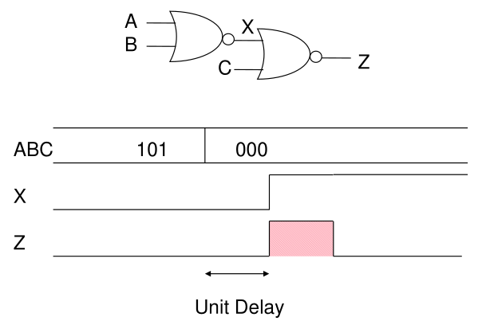

In the 2-stage NOR network above $(X = \overline{A + B}$ and $Z =
\overline{X + C})$, suppose the input vector $ABC$ transitions simultaneously
from $101 \to 000$ assuming a _Unit Delay_ per gate:

- Initially ($ABC = 101$): $X = 0$ and $Z = \overline{0 + 1} = 0$.
- When $ABC$ switches to $000$ at $t = 0$: input $C$ drops to $0$ immediately at
  the second NOR gate, while node $X$ still holds $0$ for one unit delay.
- After $1$ unit delay: $X$ rises to $1$, while $Z$ (seeing $X = 0, C = 0$
  during the first unit interval) momentarily **glitches up to $1$** before
  being pulled back down to $0$ when the new value $X = 1$ propagates through
  the second gate.

A classic circuit that suffers heavily from cascading glitches is the **Ripple
Carry Adder** (**RCA**). When $C_{in}$ rises and ripples across a 16-bit adder
from $S_0$ to $S_{15}$, the sum outputs $S_1, S_2, S_3, S_4, S_5, S_{10}, S_{15}$
experience partial and full-swing spurious voltage pulses over a $12\;ps$ window
before settling back to $0\;V$.

<figure class="">
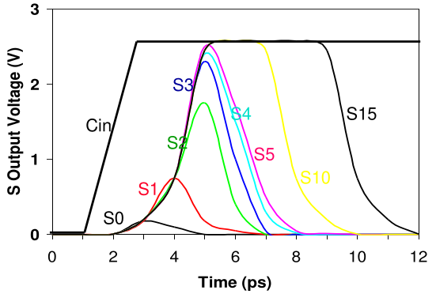
<figcaption>

Even though it looks like the glitching has no long-term effect,
we must keep in mind that at each glitching event,
our transistor will **consume dynamic energy**.

</figcaption>
</figure>

**Glitching is due to a mismatch in the path lengths** in the logic network:

- In the unbalanced chain structure ($F_1 \to F_2 \to F_3$), inputs arrive at
  $F_2$ at times $0$ and $1$, and at $F_3$ at times $0$ and $2$, causing
  repeated glitches.
- If **all input signals of a gate change simultaneously, no glitching occurs**.
  By restructuring the blocks into a balanced tree where $F_1$ and $F_2$ operate
  in parallel, both inputs to $F_3$ arrive at time $1$.
- **Design rule**: **equalize the lengths of timing paths** through logic to
  eliminate dynamic hazards.

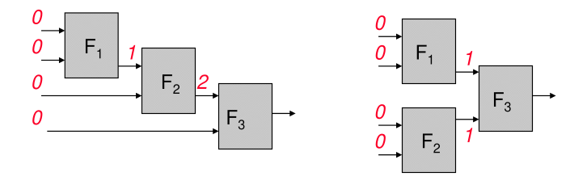

## 4.6. Dynamic Power as a Function of Supply Voltage and Multi VDD

Moving to **Reduced $V_{DD}$ and Multi-$V_{DD}$** in our design space,
decreasing the supply voltage $V_{DD}$ decreases dynamic energy consumption
**quadratically** ($E_{dyn} \propto V_{DD}^2$), but it **increases gate delay**
(decreasing performance) according to the propagation delay equations:

$$
\begin{align*}
t_{p_{HL}} &\propto \frac{K \cdot C}{\beta_n \cdot (V_{DD} - V_{Tn})} \\
t_{p_{LH}} &\propto \frac{K \cdot C}{\beta_p \cdot (V_{DD} + V_{Tp})}
\end{align*}
$$

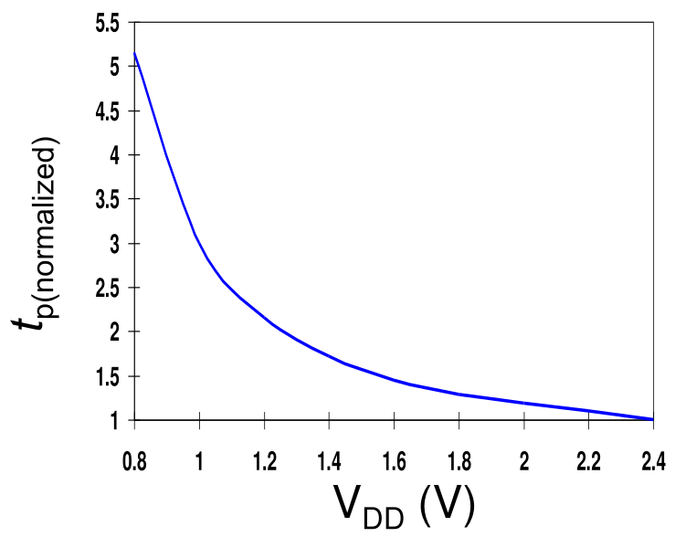

To get the quadratic energy savings without sacrificing the clock frequency of
the circuit, we use a **Multiple $V_{DD}$** strategy:

- Determine the _critical path(s)_ at design time and use a **high supply
  voltage** ($V_{DDH}$) for the transistors on those paths for speed.
- Use a **lower supply voltage** ($V_{DDL}$) on all non-critical gates,
  especially those that drive large capacitances (as this yields the largest
  energy benefits).

Two supply voltages ($V_{DDH}$ and $V_{DDL}$) are becoming standard (many chips
already have two supplies: one for the core and one for I/O). However, combining
multiple supplies introduces a circuit-level issue:

- Whenever a module at the lower supply $V_{DDL}$ drives a gate at the higher
  supply $V_{DDH}$ (**step-up**), if $V_{in} = V_{DDL}$ is applied directly to a
  $V_{DDH}$ gate, the PMOS transistor has $V_{SG} = V_{DDH} - V_{DDL}$. If
  $V_{DDH} - V_{DDL} > |V_{Tp}|$, **the PMOS never turns off**, causing huge
  static short-circuit current!
- Therefore, **level converters** are required for every **step-up** ($V_{DDL}
  \to V_{DDH}$) interface:
  - **Cross-coupled PMOS transistors** connected to $V_{DDH}$ perform the level
    conversion.
  - **NMOS transistors** are driven by $V_{in}$ and $\overline{V_{in}}$ (generated
    by an inverter operating on the reduced supply $V_{DDL}$).
- **Level converters are not needed for a step-down** ($V_{DDH} \to V_{DDL}$)
  change in voltage.
- The delay and area overhead of level converters can be mitigated by doing
  conversions only at register boundaries and **embedding the level conversion
  inside the flip-flop**.

Level Converter Circuit

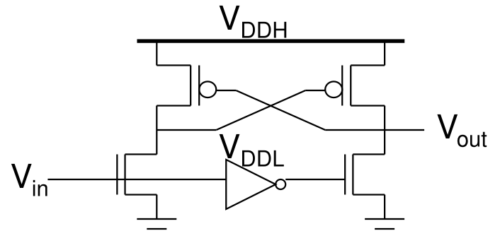

Clustered Voltage Scaling

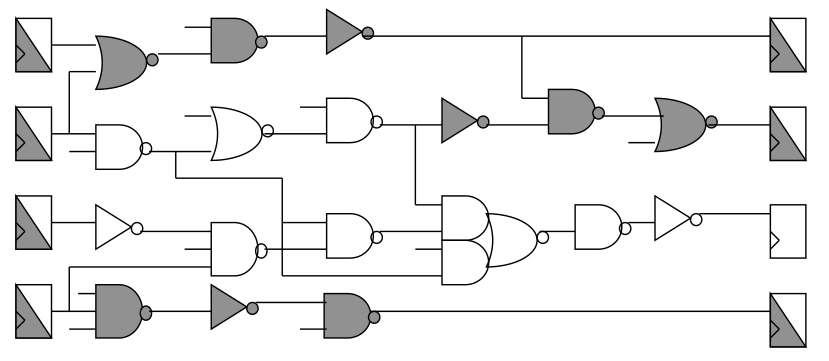

Inside a combinational logic block, minimum energy consumption is achieved when
**all logic paths become critical** (i.e., have the exact same delay, satisfying
the timing constraint $T \ge t_{c-q} + t_{plogic} + t_{su}$). To avoid placing
level converters in the middle of combinational logic, we use **Clustered
Voltage-Scaling** (**CVS**):

- Each combinational path starts with $V_{DDH}$ gates (white gates) and switches
  to $V_{DDL}$ gates (shaded gray logic gates) once sufficient delay slack is
  available, never transitioning back from $V_{DDL}$ to $V_{DDH}$ inside the
  logic cloud.
- Level conversion back to $V_{DDH}$ is performed inside the **level-converting
  flip-flops** (half-white, half-gray registers) at the end of the paths.

## 4.7. Leakage as a Function of Design Time Threshold Voltage

Next in our design space is controlling static leakage at design time via
**Multi-$V_T$** (Dual-Threshold CMOS):

- Reducing $V_T$ increases the _sub-threshold leakage current_ **exponentially**
  (a $90\;mV$ reduction in $V_T$ increases leakage by an order of magnitude).
- However, reducing $V_T$ decreases gate delay (increasing performance).

Leakage vs Design Time VT

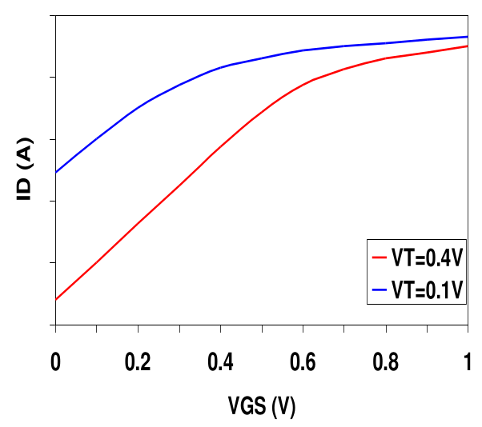

Dual Thresholds in Logic Block

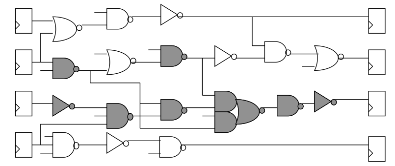

Therefore, we apply a **Dual-Thresholds** strategy:

- Determine the _critical path(s)_ at design time and use **low-$V_T$ devices**
  (white gates) on those timing-critical paths for speed.
- Use **high-$V_T$ devices** (shaded gray gates) on all non-critical logic paths
  for leakage control, slowing them down until all paths meet $T \ge t_{c-q} +
  t_{plogic} + t_{su}$.
- A careful assignment of $V_T$ can **reduce total leakage by as much as
  $80\%$**.
- Unlike Multi-$V_{DD}$, **no level converters are needed** because all gates
  share the same voltage swing, so $V_T$ assignment can be done freely on a
  **per-gate or per-transistor basis** with no clustering required!

## 4.8. Evaluating Minimum Clock Period

Let's work through a complete numerical example to evaluate the **minimum Clock
Period** $T$ (and maximum clock frequency) of a sequential circuit using the
fundamental timing constraint:

$$
T \ge t_{c-q} + t_{plogic} + t_{su}
$$

In this circuit, we have input flip-flops `DF84` (driven by `I1`, with
clock-to-Q delay $t_{c-q} = 0.90\;ns$) and `DF8` (driven by `I2`, with $t_{c-q}
= 0.75\;ns$ on $Q$ and $0.74\;ns$ on $QN$), feeding combinational cells `EN1`
(XNOR), `NO2` (NOR2), and `ON21` (OR-NAND complex gate), and captured by output
flip-flops `DF8` (output `U`, setup time $t_{su} = 0.17\;ns$) and `DFA` (output
`S`, with $t_{su} = 0.16\;ns$ and feedback $t_{c-q} = 1.20\;ns$).

Adding the interconnect wire delays (in red: $0.02\;ns$, $0.015\;ns$, $0.01\;ns$)
into the gate/setup numbers, we evaluate all $6$ register-to-register paths
(**A, B, C, D, E, F**):

- **Path A** (`DF84.Q` $\to$ `EN1.A` $\to$ `NO2.A` $\to$ `DF8.D` at `U`):
  - $T_A = 0.90 + 0.35 + 0.13 + 0.17 = 1.55\;ns$
- **Path B** (`DF84.Q` $\to$ `ON21.A` $\to$ `DFA.D` at `S`):
  - $T_B = 0.90 + 0.16 + 0.16 = 1.22\;ns$
- **Path C** (`DF8.Q` $\to$ `ON21.B` $\to$ `DFA.D` at `S`):
  - $T_C = 0.75 + 0.17 + 0.16 = 1.08\;ns$
- **Path D** (`DF8.QN` $\to$ `ON21.C` $\to$ `DFA.D` at `S`):
  - $T_D = 0.74 + 0.14 + 0.16 = 1.04\;ns$
- **Path E** (`DFA.Q` feedback $\to$ `NO2.B` $\to$ `DF8.D` at `U`):
  - $T_E = 1.20 + 0.11 + 0.17 = 1.48\;ns$
- **Path F** (`DFA.Q` feedback $\to$ `EN1.B` $\to$ `NO2.A` $\to$ `DF8.D` at `U`):
  - $T_F = 1.20 + 0.33 + 0.13 + 0.17 = 1.83\;ns$

The **critical path is Path F** with a total delay of $T_{min} = 1.83\;ns$,
which sets the maximum operating clock frequency to:

$$
f_{max} = \frac{1}{T_{min}} = \frac{1}{1.83\;ns} \approx 546.45\;MHz
$$

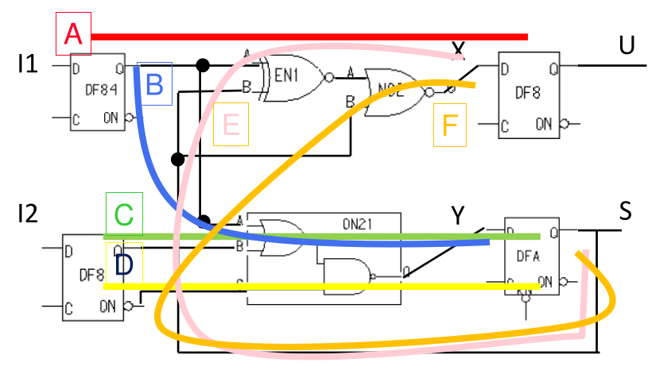

Notice that paths **A, B, C, D, and E** all have positive timing slack compared
to Path **F** ($1.83\;ns$), meaning their gates (`ON21`, input flip-flop `DF8`)
are prime candidates for **Multi-$V_{DD}$** ($V_{DDL}$) or **Multi-$V_T$**
(high-$V_T$) power optimization!

# 5. Low Power Techniques in Microarchitectures and Memories

## 5.1. Bus Multiplexing and Correlated Data Streams

Let's now explore architectural and microarchitectural low-power techniques.
Long on-chip **buses** are a major source of power dissipation due to high
switching activities and large capacitive loading:

- $15\%$ of total power in the **Alpha 21064** microprocessor.
- $30\%$ of total power in the **Intel 80386** microprocessor.

To reduce physical wiring area and interconnect capacitance, designers often
**share long data buses with time multiplexing**: instead of two dedicated buses
($S_1 \to D_1$ and $S_2 \to D_2$), a single multiplexed bus transfers $S_1$ on
even clock cycles and $S_2$ on odd clock cycles.

Dedicated vs Time Multiplexed Bus

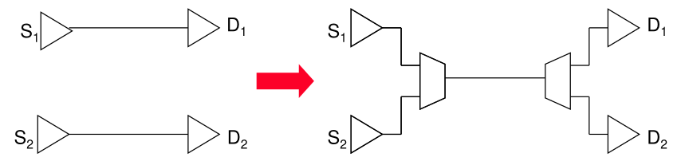

Correlated Data Streams Switching

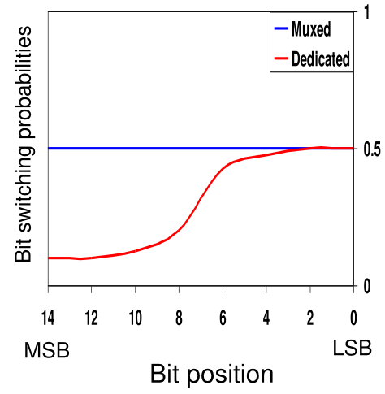

However, what happens if successive data samples within a stream are temporally
**correlated** (e.g., high-order **sign bits** in DSP audio/video streams)?

- On a **dedicated bus** (red curve), while the Least Significant Bits (LSBs,
  bits $0\text{--}4$) switch randomly with probability $0.5$, the Most
  Significant Bits (MSBs, bits $8\text{--}14$, representing sign extensions or
  slowly varying amplitudes) have a very low switching probability ($\approx
  0.1$) because consecutive samples have the same sign.
- On a **shared (multiplexed) bus** (blue curve), the **advantages of data
  correlation are completely lost**: because the bus alternates between samples
  from two independent, uncorrelated data streams ($S_1$ and $S_2$), every bit
  position from LSB to MSB switches with probability $0.5$!
- **Architectural rules**:
  - **Bus sharing should NOT be used** for **positively correlated** data
    streams.
  - **Bus sharing may prove advantageous** in a **negatively correlated** data
    stream (where successive samples frequently switch sign bits), as multiplexing
    turns near-$1.0$ switching back toward random $0.5$ switching.

## 5.2. Glitch Reduction by Pipelining

At the microarchitectural level, another effective way to suppress dynamic power
is **Glitch Reduction by Pipelining**.

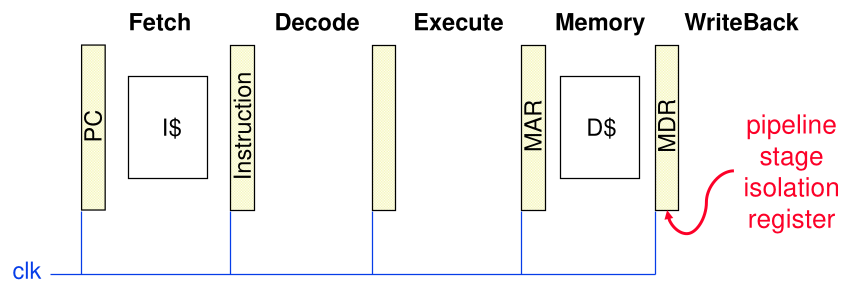

As we saw earlier, glitches depend heavily on the **logic depth** of the
circuit: gates deeper in the logic network are much more prone to glitching
because arrival times of gate inputs become more spread out due to cumulative
delay imbalances, and they are triggered repeatedly by primary input switching.

By inserting **pipeline stage isolation registers** (such as between _Fetch_,
_Decode_, _Execute_, _Memory_, and _WriteBack_ stages), we **reduce the logic
depth** of each combinational cloud, blocking glitches from propagating across
stages. This glitch energy reduction must be traded off against the **additional
energy used by the clock distribution network and the pipeline registers**
themselves.

## 5.3. Non Active Modules and Clock Gating

Moving to the middle column of our design space (**Non-active Modules**), the
most popular and widespread method for power reduction of clock signals and idle
functional units is **Clock Gating**.

Clock Gating Principle

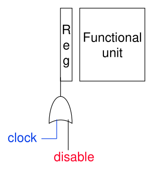

Clock Gating in Pipelined Datapath

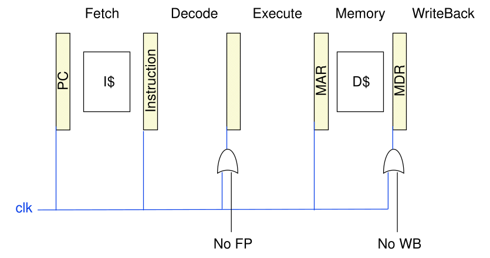

In **Clock Gating**, we **gate off the clock** to idle registers and functional
units (e.g., disabling a floating-point unit during integer instructions, or
disabling the _WriteBack_ `MDR` register on `No FP` / `No WB` instructions like
branches and stores) using a gating logic gate (`clock` OR-ed with `disable`):

- When `disable` $= 1$, the OR gate output is held constantly high, freezing the
  register inputs so neither the register nor the downstream combinational
  functional unit dissipates dynamic switching power.
- **Design considerations and trade-offs**:
  - Requires additional control logic to generate the `disable` signal, which
    increases control complexity and consumes a small amount of power.
  - The `disable` signal is **timing critical** to avoid **clock glitches** at
    the OR gate output.
  - Introduces an additional gate delay (clock skew) on the clock signal, though
    the **gating OR gate can replace an existing buffer** in the clock
    distribution tree to equalize insertion delay.

## 5.4. Run Time Dynamic Frequency and Voltage Scaling

Moving to the right column of our design space (**Run Time — Variable
Throughput/Latency**), we can exploit variations in workload demand at run time
using **Dynamic Frequency Scaling** (**DFS**) and **Dynamic Voltage Scaling**
(**DVS**).

Since decreasing $V_{DD}$ yields a quadratic reduction in dynamic energy at the
cost of increased gate delay, whenever maximum throughput is not required we can
lower both the clock frequency and the supply voltage together. Let's compare
two pioneering commercial implementations:

- **Intel's SpeedStep**:
  - Hardware mechanism that steps down the clock frequency (**DFS**) when the
    user unplugs the laptop from AC power.
  - Switches the Phase-Locked Loop (**PLL**) from $650\;MHz \to 500\;MHz$.
  - The CPU stalls during the SpeedStep adjustment.
- **Transmeta LongRun**:
  - Hardware/software mechanism that applies **both DFS and DVS** (dynamic supply
    voltage scaling) dynamically based on real-time workload.
  - Supports **32 levels of $V_{DD}$** from $1.1\;V$ to $1.6\;V$ and scales the
    **PLL** from $200\;MHz \to 700\;MHz$ in increments of $33\;MHz$.
  - Triggered automatically when a **CPU load change is detected by software**,
    following a strict sequencing protocol to prevent timing violations:
    - **Heavier load** $\quad \to \quad$ **first ramp up $V_{DD}$**, and only
      when the higher voltage is stable, **speed up the clock**.
    - **Lighter load** $\quad \to \quad$ **first slow down the clock**, and once
      the PLL locks onto the new slower rate, **ramp down $V_{DD}$**.
  - The CPU stalls only during PLL relock ($< 20\;\mu s$).

At the operating system level, these hardware mechanisms are exposed through OS
power management profiles (such as the Windows _Opzioni risparmio energia_
dialog, configuring separate timeouts and processor power states for _A
batteria_ vs. _Alimentazione da rete elettrica_).

# 6. Dynamic Thermal Management

## 6.1. DTM Trigger Mechanisms

Even with low-power design, modern high-performance processors cannot be
packaged for their absolute theoretical worst-case power without prohibitive
cooling costs. Instead, systems rely on **Dynamic Thermal Management** (**DTM**),
which operates like a fire-response system built around three fundamental
components:

1. **Trigger Mechanism** (the house on fire): _When_ do we enable DTM
   techniques?
2. **Initiation Mechanism** (the fire truck): _How_ do we enable the technique?
3. **Response Mechanism** (the fire extinguisher): _What_ technique do we
   enable?

Let's examine **DTM Trigger Mechanisms** across two aspects:

- **Mechanism — How to deduce temperature?**:
  - **Direct approach**: using **on-chip temperature sensors**, which are based
    on measuring the differential voltage change across **2 diodes of different
    sizes**.
  - Because hot-spots move across the die depending on the active functional
    units, a chip **may require $> 1$ sensor**.
  - Sensor **hysteresis and delay** are practical engineering problems that must
    be accounted for.
- **Policy — When to begin responding?**:
  - **Trigger level set too high**: requires a larger thermal margin, meaning
    **higher packaging and cooling costs**.
  - **Trigger level set too low**: causes **frequent triggering and a severe loss
    in performance**.
  - **Design goal**: choose the trigger level to **exploit the difference
    between average and worst-case power**.

## 6.2. DTM Initiation and Response Mechanisms

Once the thermal trigger threshold is crossed, **DTM Initiation and Response
Mechanisms** take over:

- **Operating system or microarchitectural control?**:
  - Providing direct **hardware support** for initiation and response can
    **reduce the performance penalty by $20\text{--}30\%$** compared to slow OS
    software intervention.
- **Initiation of policy incurs some delay**:
  - When using **DVS and/or DFS** as the response mechanism, **much of the
    performance penalty can be attributed to the enabling/disabling overhead**
    (voltage ramping and PLL relocking stalls) rather than the slower execution
    rate itself.
  - Increasing the _policy delay_ (staying in the throttled mode longer once
    entered) reduces the frequency of initiation overheads; smarter initiation
    techniques also help.
- **Thermal window ($100\text{K}\;\text{cycles}+$)**:
  - Because thermal time constants of silicon are much slower than electrical
    clock cycles, **larger thermal windows smooth out short thermal spikes**
    without falsely triggering throttling.

## 6.3. DTM Activation Cycle and Cost Savings

We can trace the complete timeline of a **DTM Activation and Deactivation
Cycle**:

DTM Activation Timeline

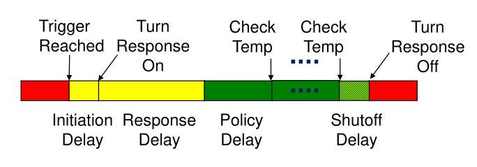

DTM System Cost Savings

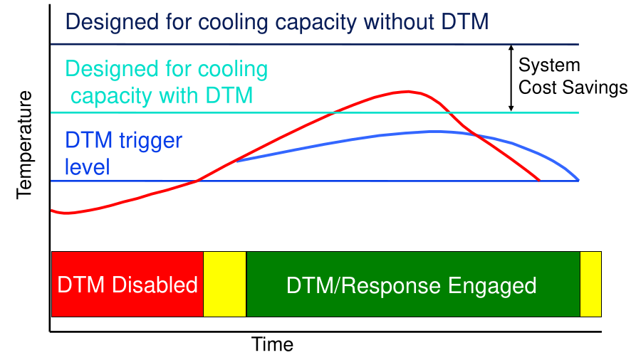

From the moment the **Trigger Reached** event occurs until normal operation
resumes, the system goes through four distinct phases:

1. **Initiation Delay** (light yellow): time spent in the OS interrupt/handler
   to recognize the thermal emergency.
2. **Response Delay** (bright yellow): invocation time required to engage the
   throttling mechanism (e.g., adjusting the clock and voltage) after **Turn
   Response On**.
3. **Policy Delay** (solid green): number of clock cycles the response mechanism
   remains actively engaged before polling the sensor (**Check Temp**). If the
   temperature is still above threshold, additional policy delay intervals are
   executed.
4. **Shutoff Delay** (striped green): disabling time required after **Turn
   Response Off** (e.g., re-adjusting the clock back to full speed) before
   returning to normal unthrottled execution (red).

Finally, we can see the overarching economic and engineering benefit of **DTM
Savings**:

- Without DTM (red temperature curve), the package and heat sink must be
  **designed for the maximum worst-case cooling capacity**, even if that peak
  temperature is rarely reached.
- With DTM enabled (blue temperature curve), as soon as the temperature crosses
  the **DTM trigger level**, the initiation and response mechanisms engage to
  cap the temperature below a much lower ceiling (**Designed for cooling
  capacity with DTM**).
- The vertical gap between the two cooling capacity ceilings translates directly
  into **System Cost Savings** (smaller heat sinks, quieter fans, and cheaper
  packaging) while impacting performance only during rare worst-case thermal
  peaks.
