# 1. Index

<!--toc:start-->

- [1. Index](#1-index)
- [2. Flip Flop Implementation](#2-flip-flop-implementation)
  - [2.1. NOR2 Based](#21-nor2-based)
  - [2.2. NAND2 Based](#22-nand2-based)
  - [2.3. SR with Enable](#23-sr-with-enable)
  - [2.4. D Latch and D Flip Flop](#24-d-latch-and-d-flip-flop)
  - [2.5. Edge Triggered SR Flip Flop](#25-edge-triggered-sr-flip-flop)
  - [2.6. Edge Triggered D Flip Flop](#26-edge-triggered-d-flip-flop)
  - [2.7. Two Ways Multiplexer](#27-two-ways-multiplexer)
    - [2.7.1. Positive D Latch](#271-positive-d-latch)
    - [2.7.2. Negative D Latch](#272-negative-d-latch)
    - [2.7.3. Positive Edge Triggered D Latch](#273-positive-edge-triggered-d-latch)
    - [2.7.4. Negative Edge Triggered D Latch](#274-negative-edge-triggered-d-latch)
  - [2.8. Two Phase Clock Signal Generator](#28-two-phase-clock-signal-generator)
  - [2.9. Static Flip Flop](#29-static-flip-flop)
    - [2.9.1. Transparent D Latch](#291-transparent-d-latch)
    - [2.9.2. Static Edge Triggered D Flip Flop](#292-static-edge-triggered-d-flip-flop)
  - [2.10. Dynamic Flip Flop](#210-dynamic-flip-flop)
    - [2.10.1. Shift Register Basic Cell](#2101-shift-register-basic-cell)
    <!--toc:end-->

# 2. Flip Flop Implementation

A Flip-Flop is a digital memory circuit that can store one bit of information.

It has two stable states and can be used to store binary data. Flip-Flops are
the building blocks of sequential logic circuits and are widely used in
digital electronics.

Their _Truth Table_ is as follows:

$$
\def\arraystretch{1.5}
\begin{array}{cc|cc}
R & S & Q & \overline{Q} \\ \hline
0 & 0 & Q & \overline{Q} \\
1 & 0 & 0 & 1 \\
0 & 1 & 1 & 0 \\
1 & 1 & - & -\\
\end{array}
$$

There are several approaches to implement a RS-Flip-FLOP, including using NAND
gates, NOR gates, and transistors.
Below are the implementations using NAND and NOR gates.

## 2.1. NOR2 Based

The logic scheme is the one on the right, and its _Truth Table_ is as follows:

$$
\def\arraystretch{1.5}
\begin{array}{cc|c}
A & B & NOR \\ \hline
0 & 0 & 1 \\
1 & 0 & 0 \\
0 & 1 & 0 \\
1 & 1 & 0
\end{array}
$$

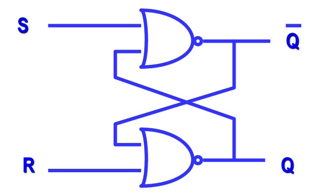

## 2.2. NAND2 Based

The logic scheme is the one on the right, and its _Truth Table_ is as follows:

$$
\def\arraystretch{1.5}
\begin{array}{cccc|cc}
S & R & \overline{S} & \overline{R} & Q & \overline{Q} \\ \hline
1 & 1 & 0 & 0 & - & - \\
1 & 0 & 0 & 1 & 1 & 0 \\
0 & 1 & 1 & 0 & 0 & 1 \\
0 & 0 & 1 & 1 & Q & \overline{Q} \
\end{array}
$$

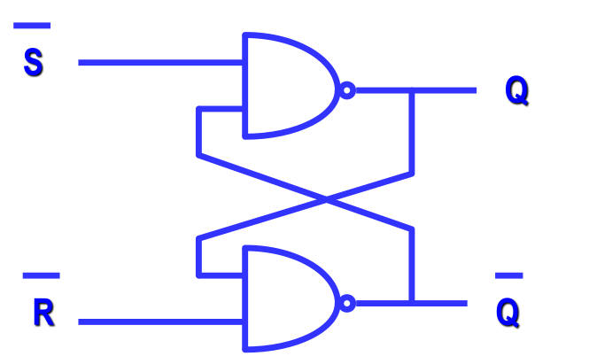

## 2.3. SR with Enable

While the former architecture used two inputs, the latter uses three inputs,
which are $S$, $R$, and the $Ck$ as an _Enable Signal_.

The architecture becomes like on the right, and the _Truth Table_ is as follows:

$$
\def\arraystretch{1.5}
\begin{array}{ccc|cc}
S & R & Ck & Q & \overline{Q} \\ \hline
X & X & 0 & Q & \overline{Q} \\
0 & 0 & 1 & Q & \overline{Q} \\
0 & 1 & 1 & 0 & 1 \\
1 & 0 & 1 & 1 & 0 \\
1 & 1 & 1 & - & - \
\end{array}
$$

The un-optimized scheme uses a total of 20 transistor, while it is possible
to optimize it to just 12 transistors.

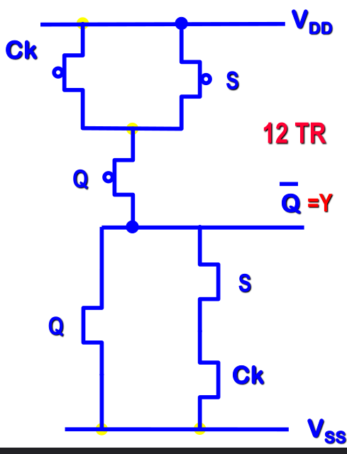

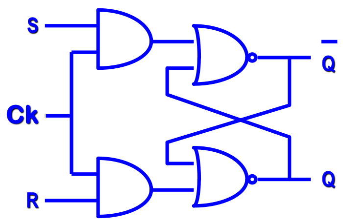

## 2.4. D Latch and D Flip Flop

A **D-Latch** is a type of flip-flop that has a single data input $D$ and a clock
input $Ck$.

It captures the value of the $D$ input when the clock signal is high and holds that
value until the clock signal goes low.

$$
\def\arraystretch{1.5}
\begin{array}{c|c|c}
  D & Ck & Q  \\ \hline
  X & 1 & Q \\
  0 & 0 & 0 \\
  1 & 0 & 1 \\
\end{array}
$$

In the D-Flip-Flop implementation, the truth table is reversed:

- $Ck = 1 \quad \to \quad Q = D$
- $Ck = 0 \quad \to \quad Q = Q$

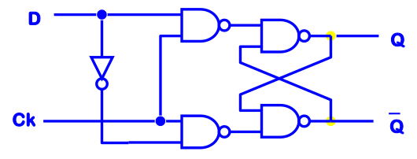

The D-Flip-Flop is a **transparent latch**, meaning that when the clock signal
is high, the output $Q$ follows the input $D$.

## 2.5. Edge Triggered SR Flip Flop

By applying the **Master-Slave Architecture** to two clocked SR Flip-Flops
(NAND2 based), we obtain an **Edge-Triggered SR Flip-Flop** that uses a total
of 32 transistors.

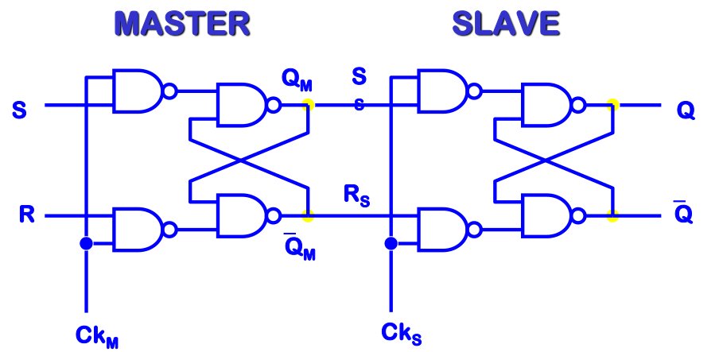

In this configuration, the _Master_ stage samples the inputs while its clock
$Ck_M$ is high, whereas the _Slave_ stage updates the final output $Q$ only when
its clock $Ck_S$ is high.

For it to work properly, $Ck_M$ and $Ck_S$ **must never be equal to 1 at the same
time**, otherwise the output $Q$ would be in transparency or worse, undefined.

However, this doesn't mean that we can generate $Ck_S$ by just
inverting $Ck_M$, as there will still be some overlapping due to
_propagation delay_.

To account for this overlap, we use a _threshold technique_ where the master
and slave clocks are delayed by a certain delay time $\tau$, that ensures that the
master clock is always high before the slave clock goes high.

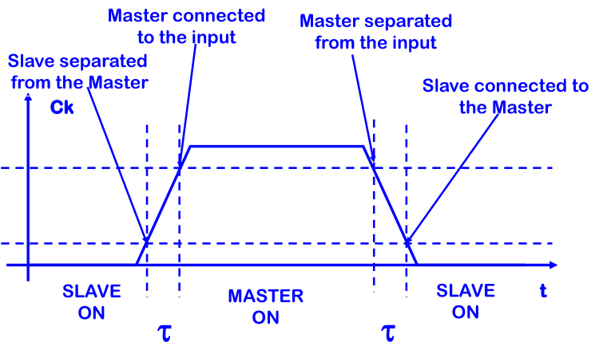

Its waveform is shown below, and its _Truth Table_ is as follows:

$$
\def\arraystretch{1.5}
\begin{array}{ccc|c}
Ck & S & R & Q \\ \hline
0 & X & X & Q \\
1 & X & X & Q \\
\uparrow & X & X & Q \\
\downarrow & 0 & 0 & Q \\
\downarrow & 0 & 1 & 0 \\
\downarrow & 1 & 0 & 1 \\
\downarrow & 1 & 1 & - \\
\end{array}
$$

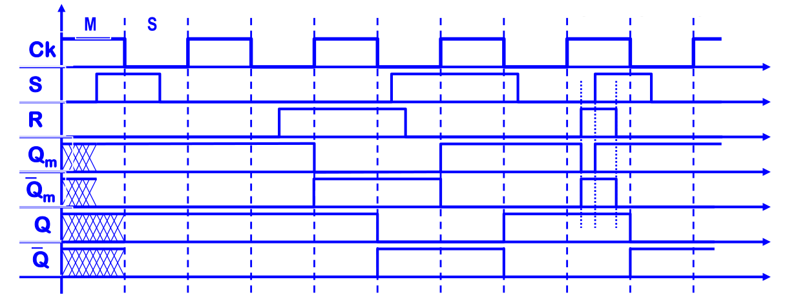

Depending on how the clock input is sensitive, we distinguish three different
logic symbols (level-sensitive, _Rising Edge_ $\uparrow$, and _Falling Edge_ $\downarrow$).

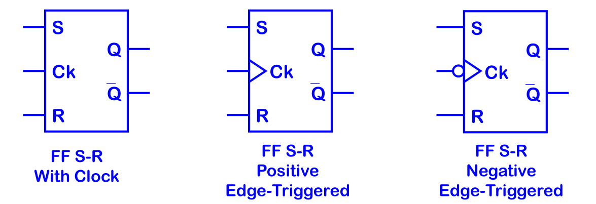

## 2.6. Edge Triggered D Flip Flop

To obtain an **Edge-Triggered D Flip-Flop**, we connect the $D$ input directly
to $S$ and, through an inverter, to $R$ of an Edge-Triggered SR Flip-Flop.

In this way, data is transferred to the output synchronously when the clock
_rising edge_ (or _falling edge_) occurs.

The logic scheme is the one on the right, and its _Truth Table_ (for the
**Positive Edge-Triggered** version) is as follows:

$$
\def\arraystretch{1.5}
\begin{array}{cc|c}
Ck & D & Q \\ \hline
0 & X & Q \\
1 & X & Q \\
\downarrow & X & Q \\
\uparrow & 0 & 0 \\
\uparrow & 1 & 1 \\
\end{array}
$$

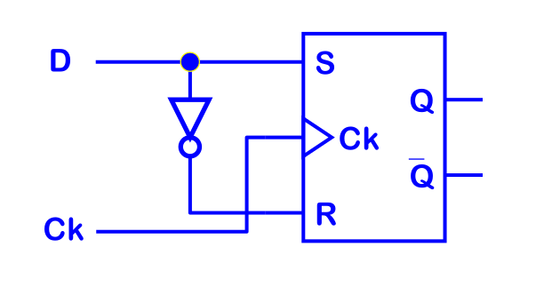

The NAND2-based implementation requires a total of 34 transistors (32 for the
Master-Slave SR Flip-Flop and 2 for the inverter).

However, if we use the optimized 12-transistor NOR2-based SR Flip-Flop for
both the _Master_ and _Slave_ stages, it is possible to optimize it to $12 +
12 + 2 = 26$ transistors.

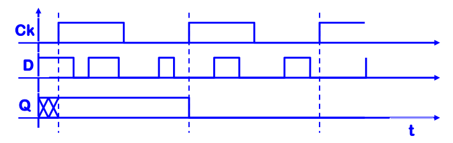

To guarantee a correct sampling without metastability, three fundamental
_Timing Rules_ must be respected around the active clock edge:

- **$T_{setup}$ (Setup Time)**: the minimum time interval before the active
  clock edge during which the input $D$ must remain stable.
- **$T_{hold}$ (Hold Time)**: the minimum time interval after the active clock
  edge during which the input $D$ must remain stable.
- **$T_{c-q}$ (Clock-to-Output Delay)**: the propagation delay required for
  the output $Q$ to update after the clock edge occurs.

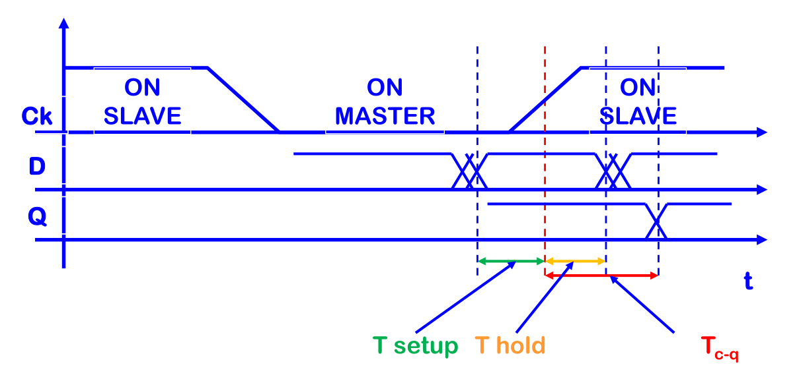

## 2.7. Two Ways Multiplexer

To further reduce the number of transistors, we can implement latches and
flip-flops using a **Two-Ways Multiplexer** based on CMOS **pass-gates**
(transmission gates).

The logic scheme is the one on the right, and its boolean equation is as follows:

$$
Q = A \cdot Ck + B \cdot \overline{Ck}
$$

This implementation uses a total of just 6 transistors (4 for the two
pass-gates and 2 for the clock inverter).

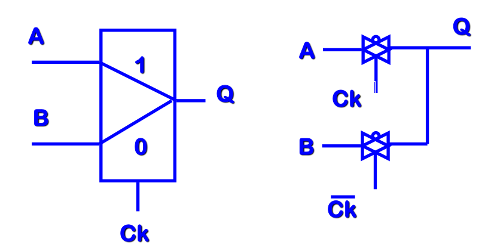

### 2.7.1. Positive D Latch

By connecting the output $Q$ back to the $0$ input of the multiplexer through
two cascaded inverters (which regenerate the logic level) and feeding $D$ into
the $1$ input, we obtain a **Positive D-Latch**.

- $Ck = 1 \quad \to \quad Q = D$ &emsp;the latch is _transparent_ and the
  output follows the input
- $Ck = 0 \quad \to \quad Q = Q$ &emsp;the feedback loop holds the stored
  value

This circuit uses a total of 10 transistors (6 for the multiplexer and 4 for
the two inverters).

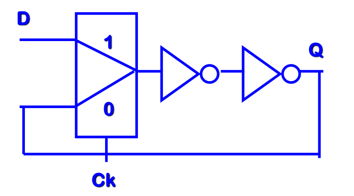

### 2.7.2. Negative D Latch

Conversely, by swapping the two multiplexer inputs—connecting $D$ to the $0$
input and the feedback loop to the $1$ input—we obtain a **Negative D-Latch**.

- $Ck = 0 \quad \to \quad Q = D$ &emsp;the output follows the input
- $Ck = 1 \quad \to \quad Q = Q$ &emsp;the previous state is maintained

Just like the positive counterpart, this scheme uses 10 transistors.

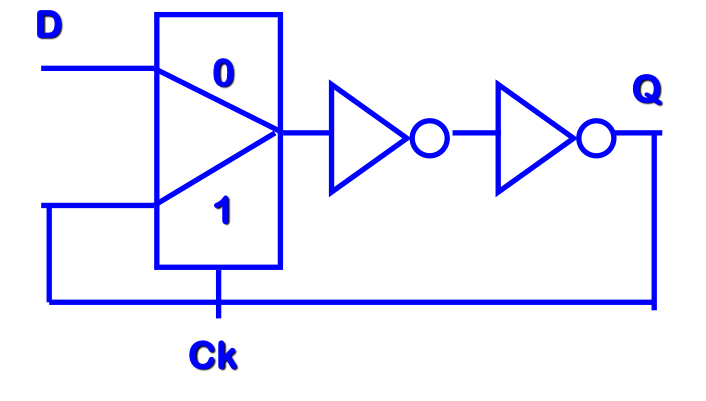

### 2.7.3. Positive Edge Triggered D Latch

By cascading a **Negative D-Latch** as the _Master_ stage and a **Positive
D-Latch** as the _Slave_ stage, we build a **Positive Edge-Triggered D Flip-Flop**.

When $Ck = 0$, the _Master_ is transparent and samples $D$, while the _Slave_
is in hold mode.
As soon as $Ck$ transitions from $0$ to $1$ (_rising edge_), the _Master_
disconnects from $D$ and the _Slave_ becomes transparent, transferring the
captured value to $Q$.

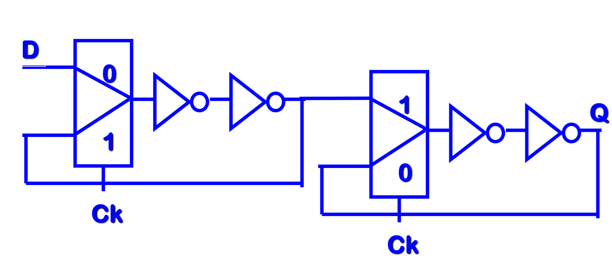

This architecture requires 20 transistors in total, offering a significant
complexity reduction compared to the gate-based solutions:

- **FF SR (NAND2)**: $34$ transistors
- **FF SR (NOR2)**: $26$ transistors
- **MUX Based**: $20$ transistors

### 2.7.4. Negative Edge Triggered D Latch

In a dual manner, by placing a **Positive D-Latch** as the _Master_ stage ($D$
on input $1$) followed by a **Negative D-Latch** as the _Slave_ stage (Master
output on input $0$), we obtain a **Negative Edge-Triggered D Flip-Flop**.

When $Ck = 1$, the _Master_ is transparent and reads $D$ while the _Slave_
holds the previous output.
On the clock _falling edge_ ($1 \to 0$), the _Master_ locks the sampled bit
and the _Slave_ becomes transparent, updating the output $Q$ with a total of
20 transistors.

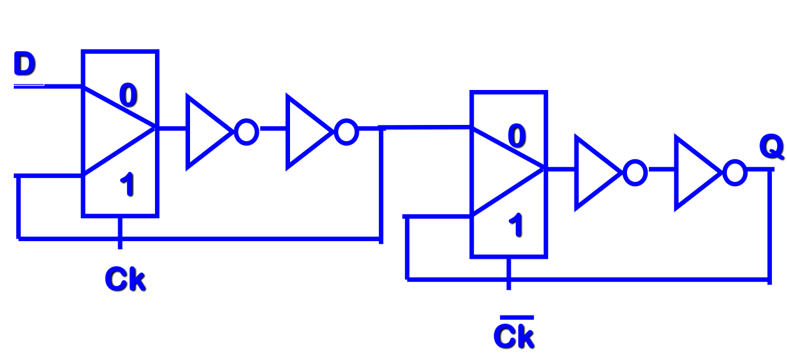

## 2.8. Two Phase Clock Signal Generator

The non-transparency condition has to be guaranteed.

The $Ck$ and the $\overline{Ck}$ signals must be complementary,
and the propagation delay of the inverters must be greater than the propagation
delay of the gates in the master and slave latches.

Let's see with a linear delay model for the inverter.

In the image on the right we can see the logic schema of a **Two-Phases
Clock Generator**.

The two signals $\Phi_1$ and $\Phi_2$ are not obtained just from a inverter,
but also from a NOR2 Flip-Flop, which is used to generate a further delay in the
signal.

In particular this configuration grants us that when $\Phi_1$ starts to be interpreted
as $0$, $\Phi_2$ has just started getting higher, so that when $\Phi_2 = 1$ $\Phi_1$
will already be $0$.

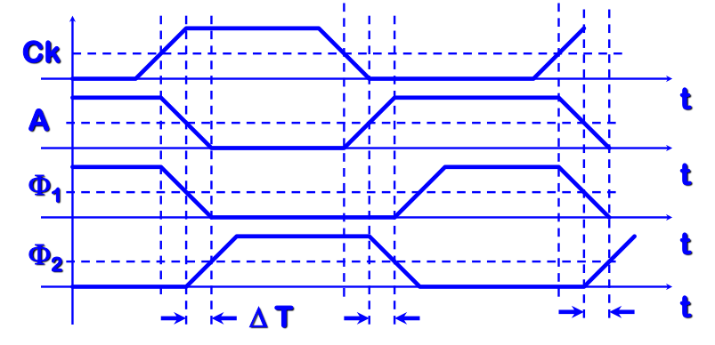

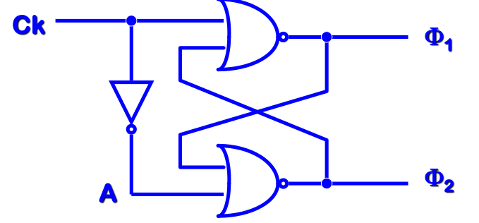

## 2.9. Static Flip Flop

The flip-flop solutions analyzed so far are quite complex because they do not
rely on the _high impedance_ of the MOS input.

With the **Two-Phase Clock Generator**, there is a short time interval where
both $\Phi_1$ and $\Phi_2$ are at the low logic level ($0$).
During this non-overlapping window, the intrinsic **MOS input capacitance** can
temporarily store the data as electric charge.

### 2.9.1. Transparent D Latch

By exploiting the input capacitance $C$ and single NMOS **pass-transistors**
driven by $\Phi_1$ and $\Phi_2$, we can build a **Transparent D-Latch** using
just 6 transistors (2 pass-transistors and 2 cascaded inverters).

- $\Phi_1 = 1, \Phi_2 = 0 \quad \to \quad Q = D$ &emsp;the input
  pass-transistor is ON, charging the capacitance $C$ so the output follows the
  input
- $\Phi_1 = 0, \Phi_2 = 1 \quad \to \quad Q = Q$ &emsp;the input is
  disconnected and the **feedback loop** is closed, regenerating and holding
  the stored value statically
- $\Phi_1 = 0, \Phi_2 = 0 \quad \to \quad Q = Q$ &emsp;both switches
  are OFF and the data is temporarily maintained by the input capacitance $C$

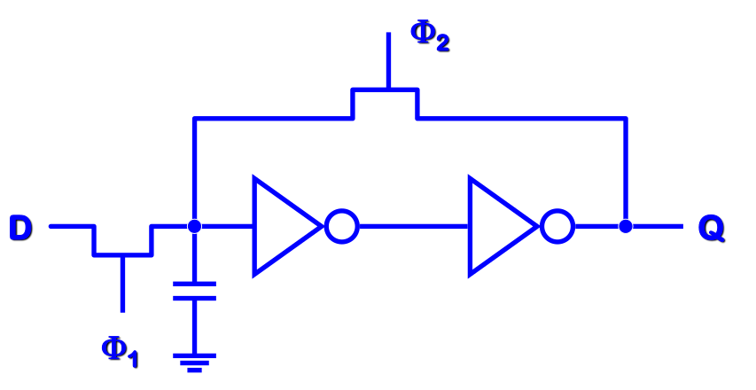

### 2.9.2. Static Edge Triggered D Flip Flop

By cascading two **Transparent D-Latches** in a _Master-Slave_ configuration
with inverted clock phases, we obtain a **Static Edge-Triggered D Flip-Flop**
that uses 12 transistors.

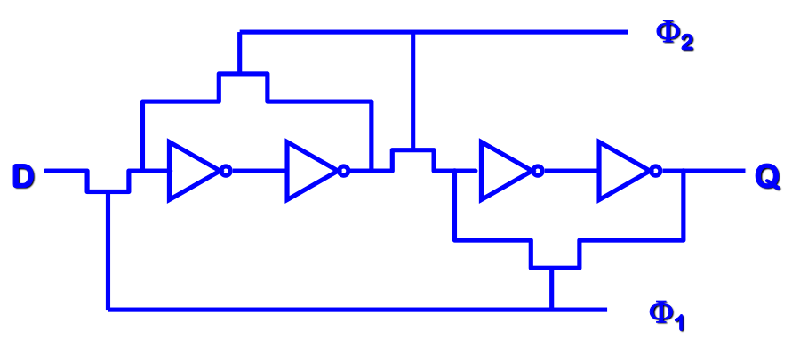

In the standard scheme, the input signal $D$ has to propagate through all 4
inverters before reaching the output $Q$[cite: 55].
To reduce the _propagation delay_, we can move the second inverter of each
stage inside the **feedback loop**.

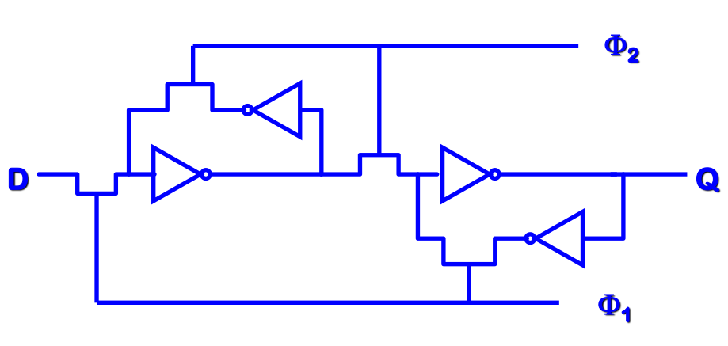

In this optimized configuration, the direct path from $D$ to $Q$ only crosses 2
inverters instead of 4, while the feedback inverters still guarantee static
data retention.

Furthermore, if we replace the single NMOS pass-transistors with full CMOS
**pass-gates** (transmission gates) to avoid threshold voltage degradation, the
circuit requires a total of 16 transistors.

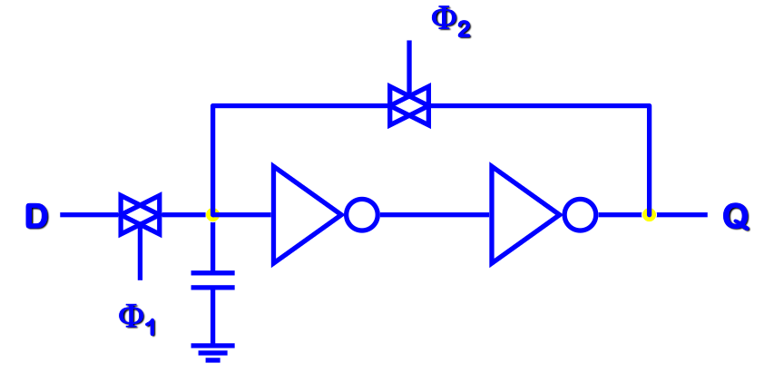

## 2.10. Dynamic Flip Flop

In **Dynamic Flip-Flops** we have a reduces network (both in length and number
of transistors) at the cost of needing a **always running clock**.

To have a _Dynamic Edge Triggered D-Flip-Flop_, without considering the additional
transistors, what we do is to remove the **feedback loops** of the _Static_
counterpart, and substitute the single transistor with a **pass-transistor**.

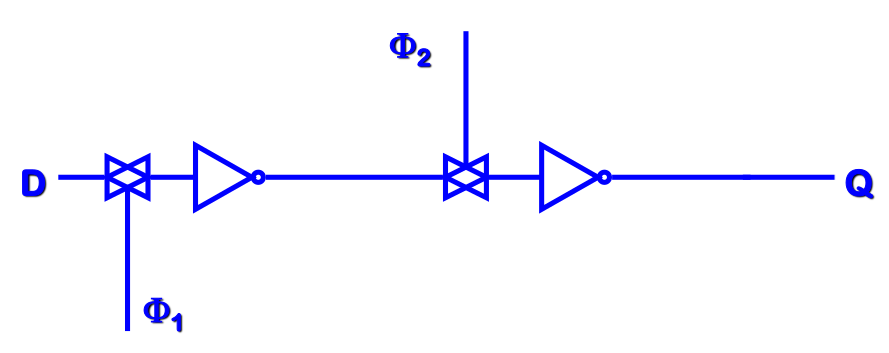

This technique introduces a problem: having also $\overline{\Phi_1}$ and
$\overline{\Phi_2}$.

We can't just add two inverter to the $\Phi_1$ and $\Phi_2$ signals, as this would
introduce a delay as we said before.

Thus, we need to change our **Two-Phase Clock Generator** to a **Pseudo Four-Phase
Clock Generator**.

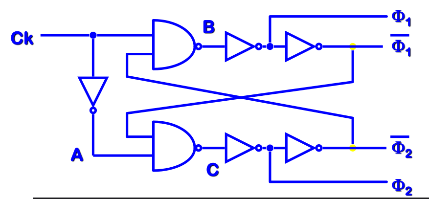

Its waveform is as follows:

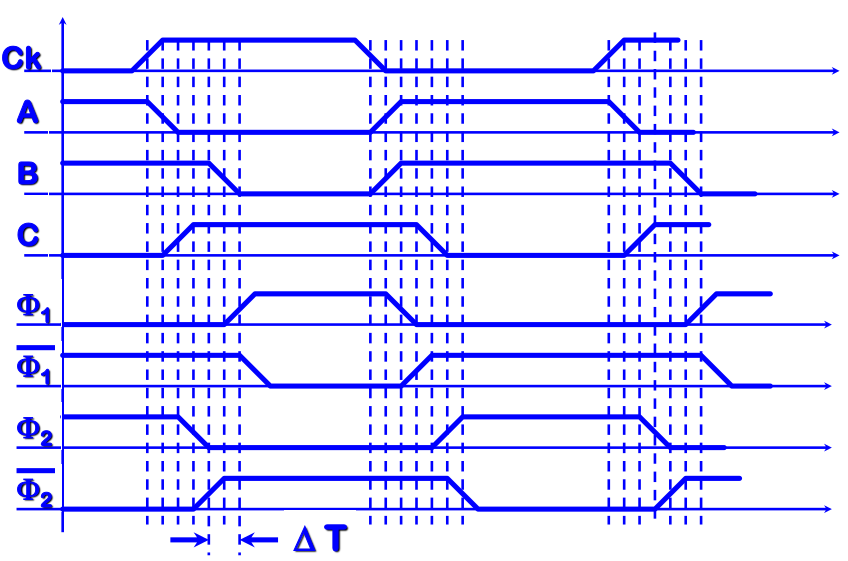

### 2.10.1. Shift Register Basic Cell

Shift registers are the basic cell in _digital delay lines_.

They are based on a _Dynamic Edge Triggered D Flip-Flop_ and are used to store and
shift data in a serial manner.

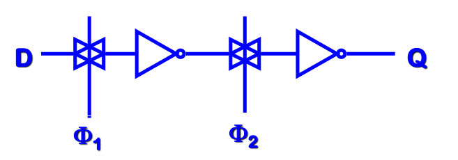
