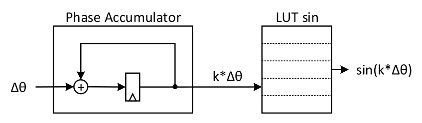

# 1. Index

<!--toc:start-->

- [1. Index](#1-index)
- [2. Direct Digital Frequency Synthesizer](#2-direct-digital-frequency-synthesizer)
  - [2.1. System Description](#21-system-description)
  - [2.2. Frequency Quantization](#22-frequency-quantization)
  - [2.3. Amplitude Quantization](#23-amplitude-quantization)
  <!--toc:end-->

# 2. Direct Digital Frequency Synthesizer

The **Direct Digital Frequency Synthesizer (DDFS)** is a digital system able
to generate a _quantized_ $\sin$ _waveform_, with frequency control.

Supposing we want to generate a single tone at frequency $f$, our ideal output
would be $\sin{(2\pi ft)} = \sin{(\theta)}$.

However, in a digital system we can only deal with **discrete time values**, meaning
our output will be more something like this $\sin{(2\pi fkT_{ck})} =
\sin{(k\Delta\theta)}$, where $T_{ck}$ is the sampling period and $k$ is the sample
index.

We can modify the _phase resolution_ of our system by tweaking the values of
$\Delta\theta = 2\pi \frac{f}{f_{ck}}$, by tweaking $f_{ck}$.

## 2.1. System Description

The $\Delta\theta$ is the _phase increment_ of our system, and it is accumulated
each _clock cycle_ to _sweep the phase_ $\theta$.

Instead, $\sin$ values are stored and accessed from a ROM (or a simple Look Up Table),
using the phase $k\Delta\theta$ as address.

## 2.2. Frequency Quantization

Ideally $\theta \in [0, 2\pi)$. Since we work with bits we need to remap the interval
into the $[0: 2^N -1]$ as _unsigned values_:

$$
LSB_\theta = \frac{2\pi}{2^N}
$$

We call the remapped _unsigned value_ the **frequency word** $f_W$:

$$
  f_w \in [0; 2^N -1] \qquad \Delta\theta = f_w \cdot LSB_\theta
$$

Since the frequency resolution is defined as $f = \frac{f_{ck}}{2\pi}
\Delta\theta$, we can map the minimum output frequency to
$\Delta\theta = LSB_\theta$:

$$
f_1 = \frac{f_{ck}}{2^N}
$$

The value of $N$ to choose depends the requirements on frequency resolution
and error.

Supposing we have $f_{clk} = 125\;MHz$, if we want to sweep the DDFS frequency range
with an accuracy less than $40\;kHz$:

$$
f_1 = \frac{f_{clk}}{2^N} < 40\;kHz \to N =
\left\lceil \log_2{\frac{f_{clk}}{40\;kHz}} \right\rceil = 12\;bit
$$

Meaning that our minimum frequency step is $f_1 = 30.5\;kHz$.

## 2.3. Amplitude Quantization

We need the LUT for the $\sin$ values to be quantized as well on $M$ bits.

Using a **C2 balanced representation** we need to map the values:

$$
[-1; 1] \to [-2^{M-1}; 2^{M-1}-1] \times LSB_A
$$

Where $LSB_A = \frac{1}{2^{M-1}}$ is the **amplitude resolution**.

Like $N$, $M$ depends on the **signal resolution requirements as well**.

To generate the quantized LUT values we can use the standard quantization formula
with the $LSB_A = \frac{1}{2^{M-1}}$:

$$
\begin{align*}
  y(k) = \sin{\left(k \cdot \frac{2\pi}{2^N}\right)} && k \in [0; 2^N - 1]\\
  y_q(k) = LSB_A \cdot \left[\frac{y(k)}{LSB_A}\right] && k \in [0; 2^N - 1]
\end{align*}
$$
