# 1. Index

<!--toc:start-->

- [1. Index](#1-index)
- [2. ZyBo Development Board](#2-zybo-development-board)
  - [2.1. GPIO](#21-gpio)
  - [2.2. System Clock](#22-system-clock)
  - [2.3. Power Source and Porgramming mode](#23-power-source-and-porgramming-mode)
- [3. Zynq 7000 APSoC](#3-zynq-7000-apsoc)
- [4. DDFS Implementation on ZyBo](#4-ddfs-implementation-on-zybo)
- [5. Xilinx VIVADO Design Suite](#5-xilinx-vivado-design-suite)
- [6. Vivado Design Flow](#6-vivado-design-flow)
<!--toc:end-->

# 2. ZyBo Development Board

The ZYBO (ZYnq BOard) is a _feature-rich_, _ready-to-use_, _entry-level_
_embedded software_ and _digital circuit_ development platform built around the
smallest member of the Xilinx Zynq-7000 family, the `Z-7010`.

The `Z-7010` is based on the **Xilinx All Programmable System-on-Chip (AP SoC)**
architecture, which tightly integrates a _dual-core ARM Cortex-A9 processor_ with
_Xilinx 7-series Field Programmable Gate Array (FPGA)_ logic.

<figure class="80">
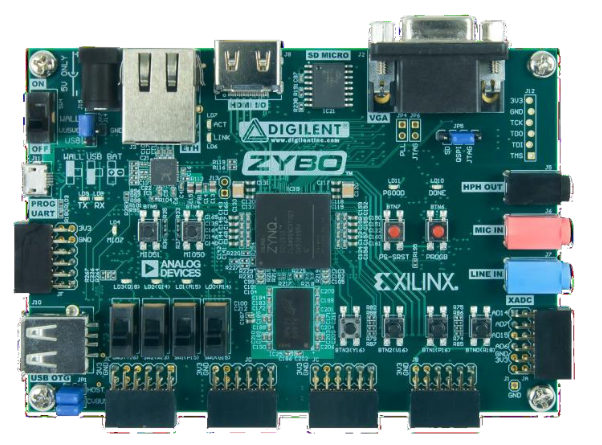
<figcaption>

`ZYNQ XC7Z010-1CLG400C`

</figcaption>
</figure>

The processor chip is located in the middle of the board. On the
[official documentation](https://www.xilinx.com/support/documentation/university/XUP%20Boards/XUPZYBO/documentation/ZYBO_RM_B_V6.pdf)
we can explore how the chip is actually connected to all the peripherals on the
board.

It has several interfaces for connecting to external devices, in particular
we will be using the `16-bit VGA` port.

The VGA uses a resistance ladder to generate the analog signals for the red, green
and blue channels from 5 bits, and a 6 bit DAC on GRN channel.

The board I/O pin $VIO = 3.3 V$, meaning that the voltage levels for the digital
signals
are 0 and 3.3 V.

We reach peak voltage when the signal is `GRN[5:0] = "111111"` $V_{DAC}(63)
\approx 3.2\;V$.

On the right we can see a bottom view of the pins.

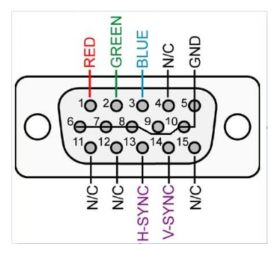

## 2.1. GPIO

To interact with the board there are several way to provide input data:

- 4 push buttons (active low)
- 4 slide switches (active high)
- 4 LEDs to show what bit we selected (active high)

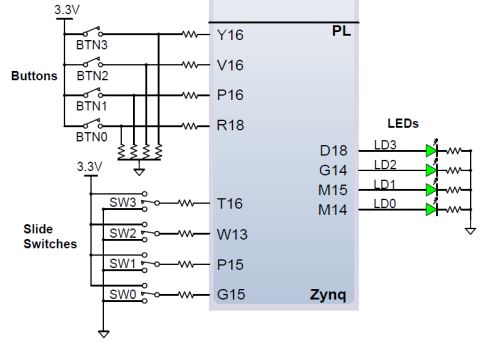

## 2.2. System Clock

The ZyBo board has a $125\;MHz$ clock to the PL in L16 pin.

It utilizes a $50\;MHz$ oscillator to generate the $125\;MHz$ clock using a
PLL (Phase Locked Loop) in the Zynq chip.

## 2.3. Power Source and Porgramming mode

The ZyBo board can be be powered by either:

- A USB port
- An internal battery
- A 5V power supply

To program the board there are three programming modes:

1. **Micro SD**
1. **SQPI Flash**: integrated flash memory on the board
1. **JTAG**: using the USB port and Vivado

Programming the board means loading a bitstream into the FPGA fabric.
The bitstream is generated by Vivado and is a binary file that contains
the configuration data for the FPGA.

# 3. Zynq 7000 APSoC

In the past, when we had multiple parts, the common architecture was to have
a microcontroller/microprocessor connected to a board on which we had several
components, such as memory, peripherals, etc. This architecture is called
**System on Board (SoB)**.

This architecture suffered from several problems, like:

- **Space**: the board was big and heavy, and the components were far away from
  each other.
- **Delays**: each wire had a capacitance, which caused delays in the signals.
- **Power Consumption**: each wire had a resistance, so each time current was flowing
  through it, it consumed power.

For these and other reasons, the industry started to integrate all the components
into a single chip, in an architecture called **System on Chip (SoC)**.

Intuition wuold tell us that making this chip bigger would allow us to have
more components, but the problem is that the bigger the chip, the more expensive
it becomes, without talking about a new problem that arises, called **yield**.

**Yield** is the percentage of chips that are functional after the manufacturing
process. The bigger the chip, the more likely it is that a defect will occur, and
the yield will be lower.

For this reason we transitioned to a new architecture: **System in Package (SiP)**,
which is a package that contains multiple chips, each one specialized in a specific
task and connected to the others through gold wires.

The reintroduction of wires brought back all the problems we had with the SoB
architecture, so the industry started to look for a new solution, the **Chiplet**.

<figure class="75">
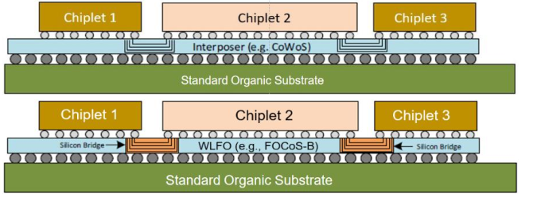
<figcaption>

The images show two different types of chiplets: with **interposer** and
with **WLFO** (Wireless Link For Off-chip communication).

</figcaption>
</figure>

The interposer is a silicon layer that connects the chiplets through metal wires,
while the WLFO uses wireless communication to connect the chiplets.

`Zynq 7000 APSoC` is a **All Programmable System on Chip (SoC)**, which is usable
in a vast range of applications, from consumer electronics to automotive and
industrial applications.

It is a single chip with a HW/SW design platform:

- PS: Processing System, which is a dual-core ARM Cortex-A9 processor. It is chosen
  by the manufacturer to be the best choice for the application, and it is not programmable.
- PL: Programmable Logic, which is a Artix 7-series FPGA 28nm. It is the wider
  part of the chip, and it is programmable by the user.

The reprogrammable logic equivalent to Artix-7 FPGA consists of:

- **4,400 logic slices**, each with **four 6-input LUTs** and **8 flip-flops**
- **240 KB of fast block RAM**
- **Two clock management tiles**, each with a **phase-locked loop (PLL)** and
  **mixed-mode clock manager (MMCM)**
- **80 DSP slices**
- **Internal clock speeds exceeding 450MHz**
- **On-chip analog-to-digital converter (XADC)**

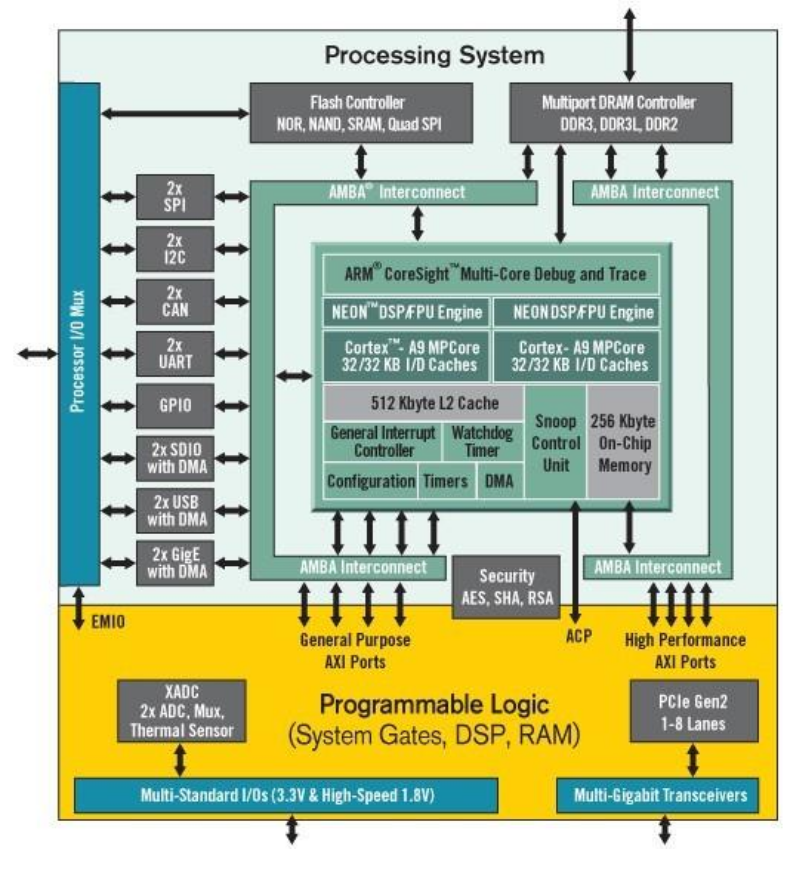
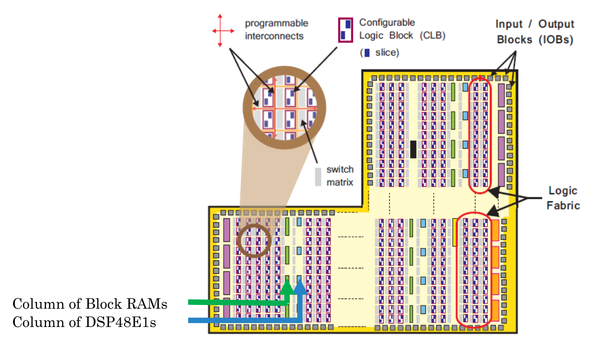

A single **Configurable Logic Block (CLB)** is composed of:

- 2 slices, each with 4 LUT and 8 flip-flops
- Switch Matrix
- Carry Logic
- Input/Output Blocks (IOBs)

We can see the schematics of the CLB architecture in the images below:

Simple Schematic

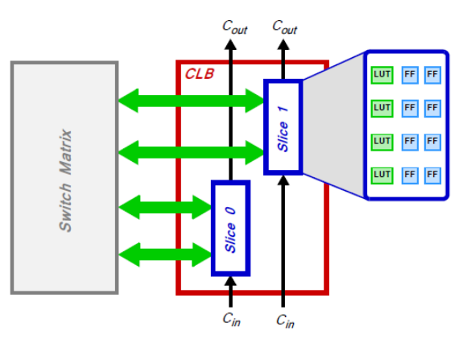

Slice Schematic

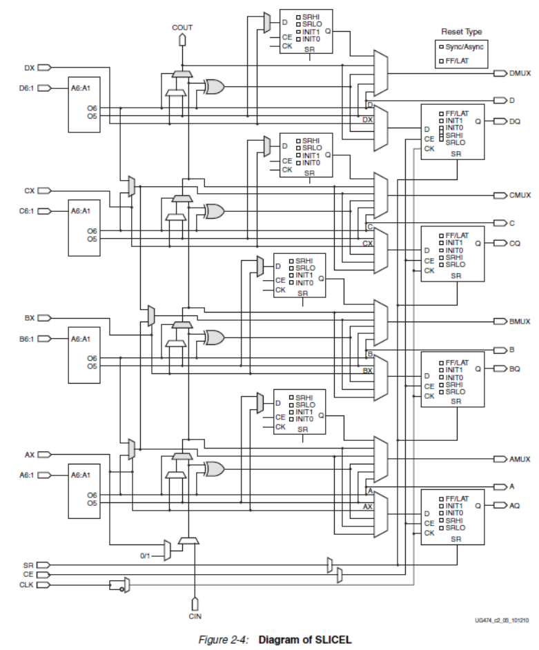

Another component of the chip is, sedie the Block RAM, the DPS48E1, which is a
**Digital Signal Processing (DSP)** slice that can perform different operations,
such as multiplication, addition and subtraction, to implement digital filters,
FFTs, and other signal processing algorithms.

<figure class="70">
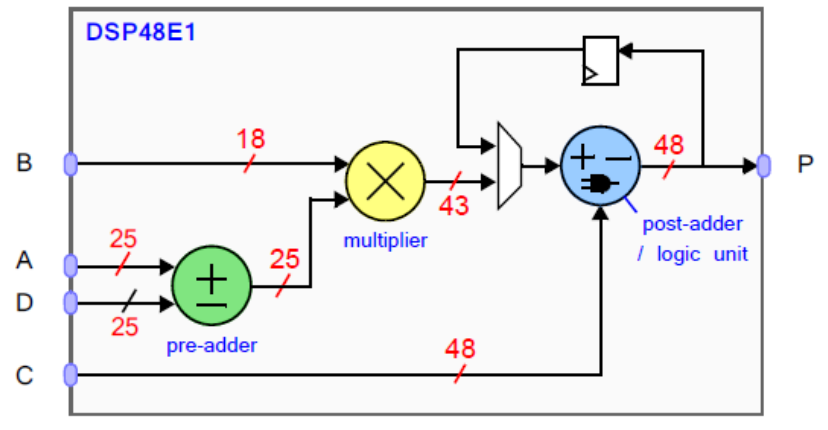
<figcaption>

In the image we can see a DSP48E1 slice, which is composed of a **pre-adder**, a
**multiplier** and a **post-adder**, allowing us to perform operations such
as $((A \pm D) \cdot B) \pm C$.  
The image, ignores the overflow bit.

</figcaption>
</figure>

# 4. DDFS Implementation on ZyBo

To actually implement a DDFS on the ZyBo board, we will use Vivado to
create a new project and add the necessary IP cores.

However, we first need to remap our system into the I/O resources of ZyBo:

- `fw[3:0]` on the switches as input, and on the led as feedback
- `reset` as an active right with one of the push buttons
- `yq[5:0]` to **unsigned** on the GRN channel of the VGA port.

To do this, we need to write a **wrapper** (a VHDL file) that allows the
DDFS we created before to be actually implemented on the ZyBo board.

<figure class="">
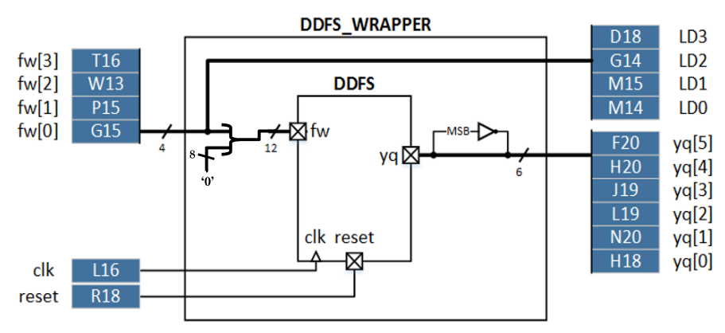
<figcaption>

This solution has an obvious limitation, as the types of inputs we are able to give,
since we can only change the 4 MSB of the frequency word.  
However, for our purposes, this is enough to demonstrate the functionality of the
DDFS.

</figcaption>
</figure>

Complementing the MSB of `yq` means to **shift** the output of the DDFS to
be all in the positive range, so we can use it as an unsigned value to drive
the DAC of the VGA port.

# 5. Xilinx VIVADO Design Suite

Vivado is a tool produced by AMD Xilinx to design, simulate and implement digital
circuits on AMD FPGAs and SoCs.

The design flow of Vivado is composed of several steps, which can be summarized
in the image below:

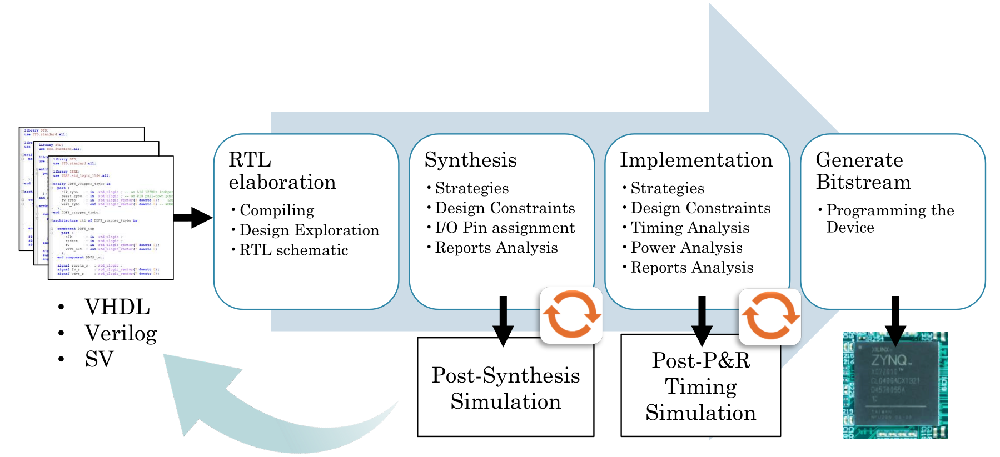

The main actor of the **synthesis** is the **synthesizer**, which extracts the
primitives from the `vhdl` file we wrote and maps them to the available resources
of the FPGA, such as LUTs, flip-flops, DSP slices, etc.

In this phase, it **does not choose the exact type of resource and location**.

We still get a list of generic resources we will use and a first specification
table that tells us in general, how we can expect the circuit to behave, using
general values for the delays and consumptions.

Is only in the **Implementation** phase, that we get a new **Boxed Netlist**,
which is a list of all the components and their connections, including of the specific
type, delays, and location on the board.

The report generated by this phase takes into account the actual resources available
on the board, and it is more accurate than the previous one.

Only at the end of the Implementation phase we will be able to **Generate Bitstream**.

# 6. Vivado Design Flow

For the full Vivado Design Flow, and usage of the Vivado Design Suite, please refer
to the slides provided by the professors on the official Teams Channel.
